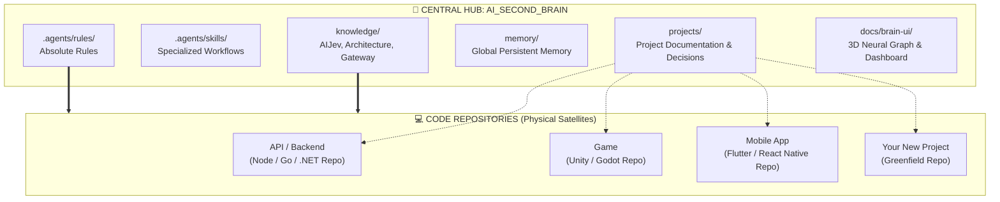
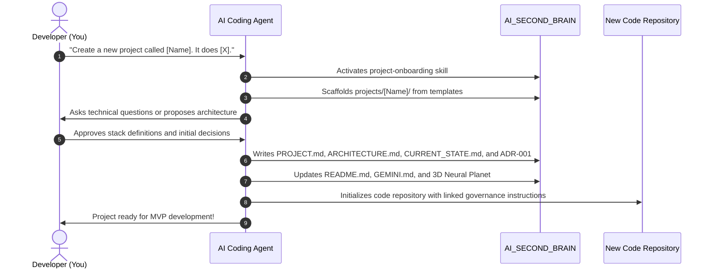
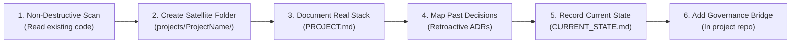
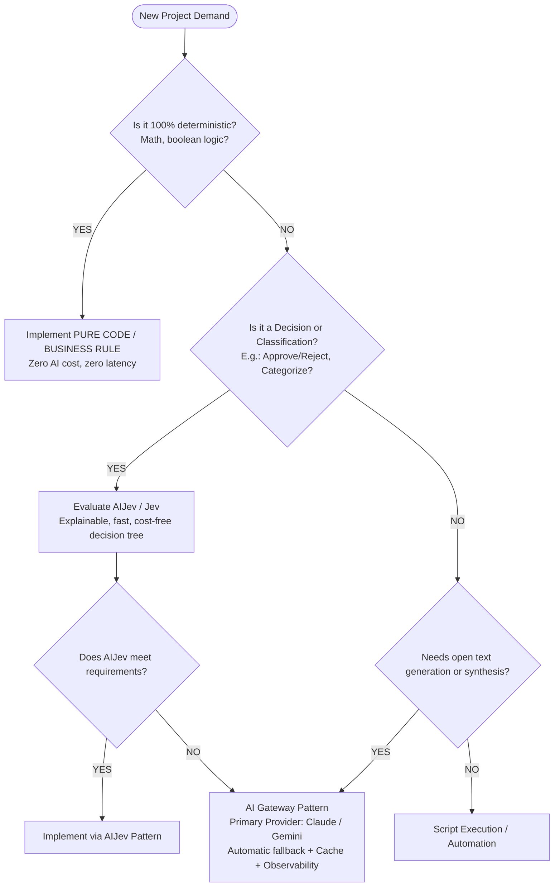

# How to Use AI Second Brain in Practice
## Definitive Guide: Greenfield Project Creation and Brownfield Project Integration

> **This document is the official governance, onboarding, and daily operations manual of AI Second Brain (Alfredo AI OS).**  
> It guides step by step how to initiate new projects from scratch (*greenfield*) and how to couple existing repositories (*brownfield*), ensuring persistent memory, AI governance, technical standardization, and total decision traceability.

---

## 📑 Table of Contents

1. [The Mental Model: Central Hub vs. Satellite Repositories](#1-the-mental-model-central-hub-vs-satellite-repositories)
2. [Scenario A: Creating a NEW Project from Scratch (Greenfield)](#2-scenario-a-creating-a-new-project-from-scratch-greenfield)
3. [Scenario B: Integrating an ALREADY EXISTING Project (Brownfield)](#3-scenario-b-integrating-an-already-existing-project-brownfield)
4. [Daily Operation: The Lifecycle of a Work Session](#4-daily-operation-the-lifecycle-of-a-work-session)
5. [AI Governance & Routing in Practice (AIJev First)](#5-ai-governance--routing-in-practice-aijev-first)
6. [Ready-to-Use Developer Prompt Catalog](#6-ready-to-use-developer-prompt-catalog)
7. [Quick Reference Operational Checklists](#7-quick-reference-operational-checklists)

---

## 1. The Mental Model: Central Hub vs. Satellite Repositories

The largest flaw in AI-assisted development is keeping instructions stranded in disposable chat sessions or loose files that vanish. In **AI Second Brain**, we adopt the **Central Knowledge Hub & Implementation Repositories** architecture:



### Where does each piece of data live?

| Data Type | Location | Purpose |
| :--- | :--- | :--- |
| **Executable Source Code** | In physical project repository (e.g. `C:\Projects\SaaS\MyProject`) | Builds, tests, Dockerfiles, CI/CD pipelines. |
| **Your Project Memory** | `AI_SECOND_BRAIN/projects/<name>/CURRENT_STATE.md` & `MEMORY/` | What was completed, active tasks, blockers, and sessions of your app. |
| **Project Overview & Stack** | `AI_SECOND_BRAIN/projects/<name>/PROJECT.md` | Business context, technical stack, constraints, and architecture. |
| **Architectural Decisions (ADRs)** | `AI_SECOND_BRAIN/projects/<name>/DECISIONS/` | Immutable log of why technical choices were made in your project. |
| **AI Use-Case Mapping** | `AI_SECOND_BRAIN/projects/<name>/AI/` | Where and how AI is applied (AIJev, rules, or LLM) in your app. |
| **Global Framework Memory** | `AI_SECOND_BRAIN/memory/` | State and history of AI Second Brain itself (server, viewer, AI engine). |
| **Universal Quality Rules** | `AI_SECOND_BRAIN/.agents/rules/` | Engineering, C#, SQL Server, Security standards shared by all projects. |

> 💡 **Isolation Guarantee:** The root `memory/` directory tracks the history of AI Second Brain as a platform. Each project you create or link keeps its memory and decisions **strictly isolated** inside `projects/<name>/`, ensuring zero pollution between projects.

---

## 2. Scenario A: Creating a NEW Project from Scratch (Greenfield)

When creating a new SaaS product, mobile app, background automation, or game, you have two ways to start: **directly through the Web Cockpit (Quickstart Studio)** or **chatting with the agent in your IDE**.

### Method 1: Quickstart Studio in the Web Cockpit (Recommended)

In the web portal (`http://localhost:3333/`), click **`+ New Project`** in the top navigation. The modal provides two clear paths in **Step 2**:

1. **⚡ Express Mode (50ms)**:
   - Instant, 100% deterministic disk scaffold.
   - Generates the canonical structure with the 4 standard governance contracts ready for later manual editing.
   - Ideal when your architecture is already crystal clear and you want to start coding immediately.

2. **🎯 AI-Assisted Mode (Grill Studio & Focused Interview)**:
   - The AI Architect asks 3 to 4 dynamic questions adapted to your stack (e.g. ORM, Messaging, Authentication strategy).
   - **Smart Accordion / Focused Mode**: Only 1 question is expanded at a time. Clicking a quick chip fills the input and smoothly advances (220ms) to the next question, eliminating scrolls.
   - **Answer Audit**: Validates that answers are coherent and non-empty prior to contract synthesis.
   - **Real-Time Neural Synthesis Cockpit (Zero Frozen Screen & SSE)**:
     - Clicking *"Generate Contracts with AI"* opens the 4-card pipeline carousel (`📑 Requirements Extraction`, `📄 PROJECT.md`, `🏗️ ARCHITECTURE.md`, `⚖️ CURRENT_STATE.md & ADR-0001`).
     - Progress streams via Server-Sent Events (SSE) with live stopwatch, generation speed, and live telemetry log.
   - **Surgical Refinement with "Live Prompt" & JEV Engine**:
     - **JEV-First Governance (Level 4 Composite)**: The local `RulesDecisionProvider` engine (`scripts/decision-provider.js`) evaluates user prompts in 0ms before calling generative models.
     - **Isolation Guardrails**: Directives on tables, SQL schemas, or endpoints affect **exclusively** `ARCHITECTURE.md` without leaking into `PROJECT.md` or `CURRENT_STATE.md`.
     - **Human-in-the-Loop Clarification**: If ambiguous requests are detected in critical areas (vague payments, messaging, auth, deploy), the system prompts with `#qsClarificationModal` and 1-click option chips.
     - **Tab Auto-Switch**: Switches automatically to the modified document tab with visual highlight animation (`tab-flash-active`).
     - **`↺ Undo` Button**: Instantly reverts any AI modification back to the previous draft.
   - **Involuntary Dismissal Guard**:
     - Protects against accidental dismissal via outside clicks, close button, or `Escape` with a dark glass confirmation dialog.
   - **Mandatory Human Approval**: The project is only committed to disk upon explicit click on `💾 Approve and Create Project on Disk`.

---

### Method 2: Requesting Onboarding from the Agent in IDE Chat

If you prefer operating inside Antigravity, Claude Code, or Cursor:



#### Step 1: Request Onboarding in IDE Chat
In the chat prompt, send:

> *"I want to create a new project called **BillingFlow**. It is a .NET 9 payment reconciliation API with SQL Server, RabbitMQ messaging, and rule validation via AIJev. Execute onboarding for this project in the Second Brain."*

The agent activates the `project-onboarding` skill.

#### Step 2: Structure created under `projects/BillingFlow/`
The agent scaffolds the canonical project directory:

```text
projects/BillingFlow/
├── PROJECT.md                # Overview, business goals, tech stack, constraints
├── ARCHITECTURE.md           # Architecture design (Clean Arch, endpoints, database)
├── CURRENT_STATE.md          # Starting state (Phase: Inception / Setup)
├── DECISIONS/                # Architectural Decision Records (ADRs)
│   └── ADR-001-initial-stack.md
├── AI/                       # Project AI governance
│   ├── AI_USE_CASES.md       # Classification per case (AIJev vs LLM)
│   └── AI_ARCHITECTURE.md    # AI Gateway integration scheme
├── DATABASE/                 # Planned SQL schemas, tables, and indices
├── API/                      # OpenAPI / Swagger contracts
├── TESTS/                    # Test pyramid (Unit, Integration)
└── MEMORY/                   # Project work sessions
    └── sessions/
```

### Step 3: Create the Physical Code Repository
In your designated code storage folder (e.g. `C:\Projects\SaaS\BillingFlow`):
1. Create the project or run your framework scaffolding (e.g. `dotnet new webapi -n BillingFlow`).
2. Add a `GEMINI.md` (or `CLAUDE.md` / `.cursorrules`) in the root pointing to Second Brain:

```markdown
# BillingFlow — Development Instructions

> Governed by Alfredo's **AI Second Brain**.
> Before implementing code or making decisions, consult the official documentation at:
> C:\Projects\SaaS\AI_SECOND_BRAIN\projects\BillingFlow\

## Mandatory Guidelines
1. Follow global .NET rules in: `AI_SECOND_BRAIN/.agents/rules/04-dotnet.md`
2. Follow database rules in: `AI_SECOND_BRAIN/.agents/rules/05-sql-server.md`
3. AI decisions must follow: `AI_SECOND_BRAIN/knowledge/ai/AIJEV.md`
4. Do not alter architecture without recording a new ADR in `AI_SECOND_BRAIN/projects/BillingFlow/DECISIONS/`.
```

### Step 4: Record AI Governance (AI Decision Gate)
If the new project uses AI:
1. Open `projects/BillingFlow/AI/AI_USE_CASES.md`.
2. For each requirement, fill in the decision table:
   - *Example 1:* "Identify invoice payment discrepancy" → **Deterministic Code** (`Math.Abs(paid - expected) > 0`).
   - *Example 2:* "Classify chargeback risk based on history" → **AIJev / Jev Decision Tree**.
   - *Example 3:* "Generate friendly reconciliation email to customer" → **LLM** (via AI Gateway with fallback).

---

## 3. Scenario B: Integrating an ALREADY EXISTING Project (Brownfield)

If you already maintain an active codebase with existing git history and production deployment, **you do not need to rewrite your code or move your physical repository folder**.

The Second Brain acts as the **governing memory and intelligence layer** for that project.

### Brownfield Adoption Flow:



### Step 1: Run Initial Scan with Agent
Open the existing codebase in Antigravity or provide the path to the agent:

> *"I have an existing project at `C:\Projects\SaaS\MyLegacyApp`. Onboard it into AI Second Brain. Analyze stack, database, and endpoints, then create matching documentation under `projects/MyLegacyApp/`."*

The agent runs `project-onboarding` in brownfield mode:
1. Reads `.csproj`, `package.json`, SQL scripts, and Dockerfiles.
2. Identifies ORMs, third-party services, and authentication.
3. Modifies **zero lines** of your legacy source code.

### Step 2: Create Retroactive ADRs (Crucial!)
A major danger of coding with AI on legacy codebases is the agent attempting to "rewrite everything" using modern defaults that break production (e.g. replacing Dapper with EF Core or PostgreSQL with SQL Server).

Shield the project with retroactive ADRs:
- `DECISIONS/001-use-of-dapper-and-procedures.md`:
  > *"Decision: Project uses Dapper with Stored Procedures for high performance and legacy compatibility. AI agents must NEVER attempt to replace Dapper with Entity Framework without explicit authorization."*

### Step 3: Record Blockers and Technical Debt in `CURRENT_STATE.md`
List actual operational status:
- What is 100% verified and working.
- Fragile legacy hotspots (touch with care).
- Known unfixed bugs.
- Next immediate priority.

### Step 4: Where to Open the IDE? Central Cockpit vs. Standalone Repo

A common question when cloning this framework:  
**"If I open my project folder alone in another editor window, will Second Brain rules still apply?"**

#### Mode 1: AI Second Brain as Central Cockpit (RECOMMENDED ⭐)
Open the root `AI_SECOND_BRAIN` folder in your IDE (Antigravity, VS Code, Cursor).
- Access code through the NTFS junction/symlink at `projects/<project-name>/`.
- AI automatically reads root `GEMINI.md` and all `.agents/rules/`.
- **ABSOLUTE RULES** (no hardcoded model catalogs, Decision Gate, Zero Fabrication) apply automatically.
- 3D Neural Planet, Research Lab, and skills remain active in the same workspace.

#### Mode 2: Standalone Project Repo in Another Window
If you open only `C:\Projects\MyProject` in a separate window:
- The AI agent in that window will not see the root `AI_SECOND_BRAIN` folder by default.
- **Solution (Agnostic Governance Bridge):**
  Add a governance bridge in your repo root:

  | Your Tool / IDE | Bridge File | Function |
  | :--- | :--- | :--- |
  | **Universal Open Standard** | `AGENTS.md` | Read natively by Claude Code, OpenAI Codex, Cursor, etc. |
  | **Cursor AI** | `.cursorrules` | Injected automatically into Cursor context |
  | **Claude Code** | `CLAUDE.md` | Injected at session startup in Claude Code |
  | **Google Antigravity** | `GEMINI.md` | Injected into all prompt turns in Antigravity |
  | **Windsurf (Cascade)** | `.windsurfrules` | Injected into Cascade context |
  | **GitHub Copilot** | `.github/copilot-instructions.md` | Read by Copilot Chat in VS Code |
  | **Cline / Roo Code** | `.clinerules` | Injected into Cline sessions |

> 💡 **Native Automation**: Running `npm run project:link <name> <path>` creates the NTFS junction and **automatically generates** the contractual bridges (`AGENTS.md`, `GEMINI.md`, `.cursorrules`, `CLAUDE.md`) in your repository root.

---

## 4. Daily Operation: The Lifecycle of a Work Session

Every development session follows a 3-stage lifecycle:

```
┌─────────────────────────────────────────────────────────────┐
│ 1. INGRESS (Context Loading & Bootstrap)                    │
│ Cockpit: "Copy Agent Prompt" + Open VS Code / Cursor        │
│ Or in chat: "Working on [Project]. Load current state."     │
└──────────────────────────────┬──────────────────────────────┘
                               │
                               ▼
┌─────────────────────────────────────────────────────────────┐
│ 2. DEVELOPMENT (Skills & Governance)                        │
│ Implementation -> Tests -> Validation -> Review             │
└──────────────────────────────┬──────────────────────────────┘
                               │
                               ▼
┌─────────────────────────────────────────────────────────────┐
│ 3. EGRESS (AI-Assisted Session Capture: Draft & Commit)     │
│ Cockpit: "Record Session" (Reads Git + AI Draft + Review)   │
│ Or in chat: "Wrap up today. Commit session memory."         │
└─────────────────────────────────────────────────────────────┘
```

### Option A: Visual Flow via Web Cockpit (Recommended ⭐)
1. **Session Kickoff (Prompt Bootstrap & IDE Hooks)**:
   - In your project card, click **`✨ Copy Agent Prompt`**.
   - Click **`💻 VS Code`** or **`⚡ Cursor`** to open the repo.
   - Paste prompt into agent chat and start coding.
2. **During the Session**:
   - Work with agent using skills (`new-feature`, `bug-investigation`, `database-review`).
   - Commit normally to Git.
3. **Session Wrap-Up (AI-Assisted Session Capture)**:
   - Return to Cockpit and click **`🧠 Record Session`**.
   - Cockpit queries AI Gateway, inspects recent Git diffs, and drafts deliverables, lessons, and next steps.
   - Review and edit draft.
   - Click **`💾 Commit to Memory`**: writes `MEMORY/sessions/YYYY-MM-DD-title.md` and syncs `CURRENT_STATE.md`.

---

### Option B: Conversational Flow via Terminal / IDE Chat
1. **Kickoff**:
   > *"I will work on [ProjectName]. Show me current state and next priorities."*
2. **During Session**:
   - Creating endpoints → `new-feature`
   - Fixing errors → `bug-investigation`
   - Database queries → `database-review`
   - AI features → `ai-decision-gate`
3. **Session Wrap-Up**:
   > *"Wrapping up today on [ProjectName]. Commit session memory and update CURRENT_STATE."*

---

## 5. AI Governance & Routing in Practice (AIJev First)

Whenever a project requires decision-making, classification, or intelligence, follow the routing tree:



### Practical Technology Selection Table:

| Requirement | Recommended Tech | Rationale |
| :--- | :--- | :--- |
| Form validation, tax calculations, auth rules | **Pure C# / TypeScript Code** | Zero cost, zero misinterpretation, 100% deterministic. |
| SQL Job error severity classification | **AIJev / Jev First** | Far faster than LLMs, zero token cost, 100% auditable. |
| Transaction volume anomaly detection | **AIJev / Statistical Algorithm** | Millisecond latency and predictable behavior. |
| Contract routing & ambiguity detection in Live Prompt | **RulesDecisionProvider (`scripts/decision-provider.js`)** | Native JEV pattern (0ms / 100% offline), zero token waste. |
| Natural language diagnosis of failed jobs | **LLM (Claude 3.5 Sonnet / Gemini 1.5 Pro)** | Open reasoning and stack trace contextualization. |
| End-user customer support chatbot | **LLM with RAG via AI Gateway** | Conversational responses grounded in knowledge base. |

> 💡 **Native Decision Engine**: AI Second Brain includes canonical `RulesDecisionProvider` in [`scripts/decision-provider.js`](file:///c:/Projetos/SaaS/Google%20Antigravity/Projetos/AI_SECOND_BRAIN/scripts/decision-provider.js) implementing `IDecisionProvider` with `ruleId`, numerical `confidence`, and natural language `rationale`.

---

## 6. Ready-to-Use Developer Prompt Catalog

### To Start a New Project:
```text
Activate project-onboarding skill. I want to create a new project called [NAME].
Objective: [Describe in 2 sentences what it does].
Intended stack: [.NET / React / Python / SQL Server / etc.].
AI usage: [Describe where intelligence enters, if any].
Create complete structure in projects/[NAME]/ with filled templates.
```

### To Link an Existing Project:
```text
Activate project-onboarding skill for an existing project at [PROJECT_PATH].
Analyze current structure without modifying code, identify tech stack, and create
matching documentation in projects/[PROJECT_NAME]/. Then extract top 3 consolidated
architectural decisions to save as initial ADRs.
```

### 1-Click Bootstrap Prompt (Generated by Cockpit):
```text
You are the official development agent for this project.
Before proposing or writing any code:
1. Read engineering rules in .agents/rules/
2. Respect CURRENT_STATE.md and architectural decisions in DECISIONS/
3. Never invent business rules or nonexistent context.
4. Deterministic priority always: pure code first, AIJev for decisions, LLM only for open generation.
Active Project: [PROJECT_NAME]
Physical Path: [PROJECT_PATH]
Stack: [TECH_STACK]

Consult CURRENT_STATE.md and tell me where we left off and what the next priority is.
```

### To End Session & Save Memory:
```text
Activate session-memory skill. Wrapping up work session on project [NAME].
What was done: [Brief summary or let agent inspect git diff].
Decisions made: [List if any].
Next steps: [List priorities for next session].
Commit session file and update project CURRENT_STATE.md.
```

---

## 7. Quick Reference Operational Checklists

### ✅ Checklist: New Project (Greenfield)
- [ ] Created `projects/<project-name>/` in Second Brain.
- [ ] Completed `PROJECT.md` with objectives, stack, and constraints.
- [ ] Completed `ARCHITECTURE.md` with component diagrams.
- [ ] Completed `CURRENT_STATE.md` with initial milestone.
- [ ] Recorded `DECISIONS/001-initial-stack.md`.
- [ ] If AI is used, completed `AI/AI_USE_CASES.md` evaluating AIJev First.
- [ ] Created code repository and added `GEMINI.md` / `AGENTS.md` bridge.
- [ ] Added project to projects table in root `README.md`.
- [ ] Verified new node on **3D Neural Planet** (`docs/brain-ui/`).

### ✅ Checklist: Existing Project (Brownfield)
- [ ] Scanned original repo without code modifications.
- [ ] Created satellite folder `projects/<existing-name>/`.
- [ ] Documented actual stack in `PROJECT.md` (exact runtime and library versions).
- [ ] Recorded retroactive ADRs for decisions that **must not be violated**.
- [ ] Recorded technical debt and hotspots in `CURRENT_STATE.md`.
- [ ] Added governance bridge in code repo (`AGENTS.md` / `.cursorrules`).
- [ ] Evaluated AI enhancement opportunities with AI Gateway.

### ✅ Checklist: End of Session / Continuous Maintenance
- [ ] Code tested with green build in repo.
- [ ] `session-memory` skill executed to create daily session file.
- [ ] `CURRENT_STATE.md` updated with actual progress.
- [ ] No architectural decision left only in chat — all recorded as ADRs.
- [ ] Git commit and push completed in project repo and `AI_SECOND_BRAIN`.
