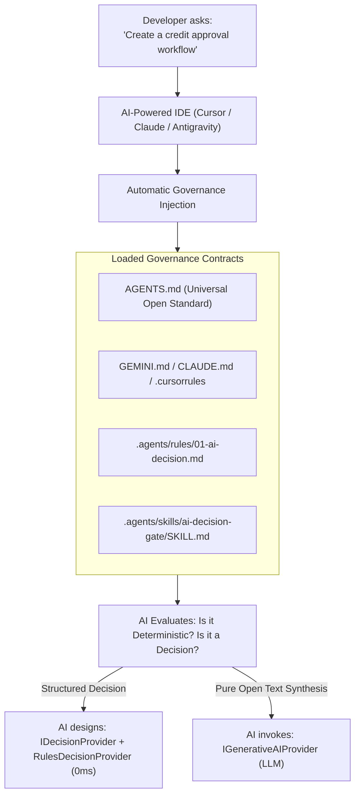

# Technical Guide & Engineering FAQ: AI Decision Gate & JEV Engine
## Token Governance, Deterministic Routing, and Practical Implementation in AI-Assisted IDEs

> **Target Audience**: Developers, Software Engineers, Solutions Architects, and AI Coding Agents operating across any IDE (Google Antigravity, Cursor AI, Claude Code, Windsurf, VS Code, or Cline).  
> **Architectural Reference**: ADR-G001, ADR-G002, and ADR-G009 of AI Second Brain.  
> **Status**: Canonical / Verified in Production.

---

## 📑 Table of Contents

1. [The Real Developer Question](#1-the-real-developer-question)
2. [Part 1: Will the IDE's AI Actually Observe this Promise?](#2-part-1-will-the-ides-ai-actually-observe-this-promise)
3. [Part 2: What is the AI Decision Gate & JEV Engine in Practice](#3-part-2-what-is-the-ai-decision-gate--jev-engine-in-practice)
4. [Part 3: Step-by-Step Implementation in Your Project](#4-part-3-step-by-step-implementation-in-your-project)
   - [Step 1: Canonical Contract (`IDecisionProvider`)](#step-1-canonical-contract-idecisionprovider)
   - [Step 2: Local Deterministic Engine (`RulesDecisionProvider`)](#step-2-local-deterministic-engine-rulesdecisionprovider)
   - [Step 3: Integrating the Decision Gate into Business Workflows](#step-3-integrating-the-decision-gate-into-business-workflows)
5. [Part 4: Real Production Example in this Repository](#5-part-4-real-production-example-in-this-repository)
6. [Part 5: Ready-to-Use Prompts for Your IDE Chat](#6-part-5-ready-to-use-prompts-for-your-ide-chat)
7. [Part 6: Comparative Analysis of Cost, Latency, and Reliability](#7-part-6-comparative-analysis-of-cost-latency-and-reliability)
8. [Technical Compliance Checklist](#8-technical-compliance-checklist)

---

## 1. The Real Developer Question

When reviewing the **AI Second Brain** governance cards, a legitimate, high-impact engineering question emerges:

> ### ❓ Developer's Question:
> *"The JEV card promises that the local decision engine `RulesDecisionProvider` classifies tasks before calling LLMs at 0ms latency and zero cost, saving thousands of tokens.  
> **When a developer clones this repo and is coding via Claude Code, Cursor, or any other AI IDE, asking it to build a flow, will the model actually observe this promise?**  
> **And what will the developer practically need to do to implement the 'AI Decision Gate & JEV Engine' in their own application code?**"*

This document answers both questions comprehensively, pragmatically, and grounded in real executable code.

---

## 2. Part 1: Will the IDE's AI Actually Observe this Promise?

### The Short Answer
**Yes, as long as the IDE loads the project's governance contracts.**

### How Does the AI "Know" This Under the Hood?
Language models like Claude 3.5 Sonnet, GPT-4o, or Gemini 1.5 Pro running inside IDEs (Cursor, Claude Code, Antigravity, Windsurf) have no independent willpower or telepathy. Model behavior is rigorously conditioned by the **System Context (System Prompt & Rule Files)** injected automatically by the IDE with every interaction.

In **AI Second Brain**, this mechanism functions across 4 pillars:



1. **Universal Open Standard ([`AGENTS.md`](file:///c:/Projetos/SaaS/Google%20Antigravity/Projetos/AI_SECOND_BRAIN_CENTRAL/AI_SECOND_BRAIN/AGENTS.md))**:
   Read natively by Claude Code, Cursor, Windsurf, Cline, and modern agents. Contains **Absolute Rule #1**:
   > *"Deterministic Priority: NEVER use an LLM when deterministic code or business rules solve the problem."*
2. **Triage Skill ([`.agents/skills/ai-decision-gate/SKILL.md`](file:///c:/Projetos/SaaS/Google%20Antigravity/Projetos/AI_SECOND_BRAIN_CENTRAL/AI_SECOND_BRAIN/.agents/skills/ai-decision-gate/SKILL.md))**:
   Provides a 5-step triage algorithm for the AI to classify any flow: Deterministic (A), Classification/Decision (B/C), Open Generation (D/E), or Execution (F/G).
3. **AI Decision Rule ([`.agents/rules/01-ai-decision.md`](file:///c:/Projetos/SaaS/Google%20Antigravity/Projetos/AI_SECOND_BRAIN_CENTRAL/AI_SECOND_BRAIN/.agents/rules/01-ai-decision.md))**:
   Explicitly defines as an architectural violation:
   - ❌ *Using an LLM for deterministic tasks.*
   - ❌ *Calling generative AI on every event/job in a loop.*
   - ❌ *Ignoring the AIJev pattern when the task is decision or classification.*

---

### ⚠️ Critical Note: Where the Developer Opens the Project

For the promise to be 100% fulfilled, the developer must be aware of the workspace context:

| Working Scenario | What Happens in the IDE? | How the Promise is Guaranteed |
| :--- | :--- | :--- |
| **Scenario A: AI Second Brain as Central Cockpit** *(Recommended)* | Root `AI_SECOND_BRAIN` folder is open in the IDE. Dev edits satellite code via `projects/<name>/`. | **100% Automatic**. Claude / Cursor reads root [`AGENTS.md`](file:///c:/Projetos/SaaS/Google%20Antigravity/Projetos/AI_SECOND_BRAIN_CENTRAL/AI_SECOND_BRAIN/AGENTS.md) and enforces Decision Gate on every prompt. |
| **Scenario B: Standalone Repo in Another Window** | Dev opens only `C:\Projects\SaaS\MyProject` in a separate editor window. | **Requires Governance Bridge**. The separate window cannot read external folders without a bridge file. |

#### Creating the "Governance Bridge" for Scenario B:
Place a root governance bridge file in the project repository (as specified in [Section 3 of the Manual](file:///c:/Projetos/SaaS/Google%20Antigravity/Projetos/AI_SECOND_BRAIN_CENTRAL/AI_SECOND_BRAIN/docs/COMO_UTILIZAR_O_PROJETO.md)):

*For Cursor (`.cursorrules`), Claude Code (`CLAUDE.md`), or Universal Agents (`AGENTS.md`):*
```markdown
# AI Governance — Connected Project
This project is governed by AI Second Brain rules.
Before architecting or implementing any flow with AI:
1. Strictly follow deterministic priority (Golden Rule in .agents/rules/01-ai-decision.md).
2. Do not use an LLM directly for decisions or classifications.
3. Use the AI Decision Gate pattern with IDecisionProvider and RulesDecisionProvider.
4. Reserve LLM calls exclusively for open text generation or creative synthesis.
```

With this bridge, **any AI agent in any editor will honor the AI Decision Gate promise rigorously**.

---

## 3. Part 2: What is the AI Decision Gate & JEV Engine in Practice

Many developers mistakenly assume "adding AI" means issuing an HTTP `POST https://api.openai.com/v1/chat/completions` on every user interaction.

This is the **"Naive LLM Calling Anti-Pattern"**, which causes:
- Astronomical cloud bills ($1,000 to $10,000+/month unnecessarily).
- Unacceptable latency of 1,500ms to 4,000ms for end users.
- Hallucinations in critical business logic (e.g. incorrect transaction approvals).
- System crashes from Rate Limits (HTTP 429) and dropped connections.

### The JEV Pattern Philosophy (AIJev.org):
The JEV pattern structures intelligence into distinct phases:

$$\text{TYPED STATE} \longrightarrow \mathbf{IDENTIFY} \longrightarrow \mathbf{DECIDE} \longrightarrow \mathbf{VALIDATE} \longrightarrow [\mathbf{GENERATE \text{ (Optional)}}]$$

1. **Identify**: Software gathers application state (e.g. request data, form inputs, error codes).
2. **Decide**: A typed decision layer assesses state and returns a categorical choice with confidence score and auditable rationale (`ruleId`, `confidence`, `rationale`).
3. **Validate**: Deterministic rules confirm the decision is safe before executing side effects.
4. **Generate (Only if necessary)**: Expensive generative models are invoked only if natural language text synthesis is strictly required.

---

## 4. Part 3: Step-by-Step Implementation in Your Project

Developers do not need heavy proprietary libraries. The engine runs on **three clean contracts** implementable in any language.

### Execution Architecture Diagram

```
[ APPLICATION REQUEST / EVENT ]
                 │
                 ▼
     ┌───────────────────────┐
     │ IS IT DETERMINISTIC?  │─── YES ──► [ DIRECT CODE / SQL ] (0ms, 0 tokens)
     └───────────┬───────────┘
                 │ NO
                 ▼
     ┌───────────────────────┐
     │ IDecisionProvider     │
     │ (RulesDecisionProvider│─── Confident Decision ──► [ EXECUTE TYPED ACTION ] (0ms, 0 tokens)
     │  Local JEV Engine)    │
     └───────────┬───────────┘
                 │ Ambiguity or Open Synthesis Needed
                 ▼
     ┌───────────────────────┐
     │ IGenerativeAIProvider │
     │ (LLM / AI Gateway)    │─── Text Synthesis ──► [ VALIDATION ] ──► [ RESULT ]
     └───────────────────────┘
```

---

### Step 1: Canonical Contract (`IDecisionProvider`)

Define decoupled decision interfaces in your project:

#### In C# / .NET:
```csharp
namespace MyProject.Core.AI;

public interface IDecisionProvider
{
    Task<DecisionResult> DecideAsync(DecisionRequest request, CancellationToken ct = default);
    DecisionResult DecideSync(DecisionRequest request); // For 0ms synchronous execution
}

public record DecisionRequest(
    string Context,
    string Question,
    Dictionary<string, object> State,
    string[] Options
);

public record DecisionResult(
    string Decision,       // "PROCEED", "REJECT", "CLARIFY", "ESCALATE"
    string RuleId,         // E.g.: "JEV-RULE-001" (Auditability and traceability)
    double Confidence,     // 0.0 to 1.0 (Typed probability)
    string Rationale,      // Human-readable deterministic rationale
    string[] TargetActions // Impacted targets
);
```

#### In TypeScript / Node.js:
```typescript
export interface DecisionRequest {
    context: string;
    question: string;
    state?: Record<string, any>;
    options?: string[];
}

export interface DecisionResult {
    decision: 'PROCEED' | 'REJECT' | 'CLARIFY' | 'ESCALATE';
    ruleId: string;
    confidence: number;
    rationale: string;
    targetActions?: string[];
}

export interface IDecisionProvider {
    decide(request: DecisionRequest): Promise<DecisionResult>;
    decideSync(request: DecisionRequest): DecisionResult;
}
```

---

### Step 2: Local Deterministic Engine (`RulesDecisionProvider`)

Implement the local engine that resolves predictable decisions locally (0ms latency, zero tokens):

#### Example in C# / .NET (Refund Triage):
```csharp
public class RulesDecisionProvider : IDecisionProvider
{
    public DecisionResult DecideSync(DecisionRequest request)
    {
        var state = request.State;
        
        // 1. Local Deterministic Rule: Under $50 with low fraud score
        if (state.TryGetValue("amount", out var amountObj) && 
            Convert.ToDecimal(amountObj) <= 50.00m &&
            state.TryGetValue("fraudScore", out var fraudObj) && 
            Convert.ToDouble(fraudObj) < 0.1)
        {
            return new DecisionResult(
                Decision: "PROCEED",
                RuleId: "JEV-RULE-AUTO-REFUND-LOW",
                Confidence: 1.0,
                Rationale: "Low-value refund automatically approved by local rules.",
                TargetActions: new[] { "EXECUTE_REFUND" }
            );
        }

        // 2. High Risk Detection: Direct escalation to human auditor
        if (Convert.ToDouble(state.GetValueOrDefault("fraudScore", 0.0)) > 0.8)
        {
            return new DecisionResult(
                Decision: "ESCALATE",
                RuleId: "JEV-RULE-FRAUD-RISK",
                Confidence: 0.99,
                Rationale: "Elevated fraud score detected. Mandatory escalation to human auditor.",
                TargetActions: new[] { "HUMAN_AUDIT" }
            );
        }

        // 3. Fallback: Requires deeper contextual analysis
        return new DecisionResult(
            Decision: "CLARIFY",
            RuleId: "JEV-RULE-AMBIGUOUS-CASE",
            Confidence: 0.50,
            Rationale: "Case falls outside automated bands; requires textual reasoning.",
            TargetActions: new[] { "REQUIRES_LLM_EVALUATION" }
        );
    }

    public Task<DecisionResult> DecideAsync(DecisionRequest request, CancellationToken ct = default)
        => Task.FromResult(DecideSync(request));
}
```

---

### Step 3: Integrating the Decision Gate into Business Workflows

In your application Service or Controller, **never** call the LLM directly. Query `RulesDecisionProvider` first:

```csharp
public class RefundService
{
    private readonly IDecisionProvider _decisionEngine;
    private readonly IGenerativeAIProvider _llmGateway;

    public RefundService(IDecisionProvider decisionEngine, IGenerativeAIProvider llmGateway)
    {
        _decisionEngine = decisionEngine;
        _llmGateway = llmGateway;
    }

    public async Task<RefundResponse> ProcessRefundAsync(RefundRequest dto)
    {
        // 1. JEV STAGE: Local Prior Classification (0ms, 0 tokens)
        var decision = _decisionEngine.DecideSync(new DecisionRequest(
            Context: "refund-processing",
            Question: "What action to take for this refund request?",
            State: new() { ["amount"] = dto.Amount, ["fraudScore"] = dto.FraudScore },
            Options: new[] { "PROCEED", "ESCALATE", "CLARIFY" }
        ));

        // 2. IF DECIDED WITH CONFIDENCE: Execute directly without spending 1 single token!
        if (decision.Decision == "PROCEED")
        {
            await ExecutePaymentReversal(dto.TransactionId);
            return new RefundResponse(Status: "Approved", Rationale: decision.Rationale);
        }

        if (decision.Decision == "ESCALATE")
        {
            await SendToHumanAuditorQueue(dto);
            return new RefundResponse(Status: "Under Human Review", Rationale: decision.Rationale);
        }

        // 3. ONLY IF OPEN REASONING OR SYNTHESIS IS REQUIRED: Invoke LLM
        var llmExplanation = await _llmGateway.GenerateAsync(new GenerationRequest(
            Prompt: $"Analyze customer rationale: '{dto.CustomerReason}' and suggest technical verdict."
        ));

        return new RefundResponse(Status: "Under Evaluation", Rationale: llmExplanation.Text);
    }
}
```

---

## 5. Part 4: Real Production Example in this Repository

AI Second Brain **practices what it preaches**. This exact engine runs in production inside this repository:

### 1. Canonical Engine:
- File: [`scripts/decision-provider.js`](file:///c:/Projetos/SaaS/Google%20Antigravity/Projetos/AI_SECOND_BRAIN_CENTRAL/AI_SECOND_BRAIN/scripts/decision-provider.js)
- Class: `RulesDecisionProvider` implementing `IDecisionProvider`.
- Latency: **0ms**, pure synchronous CPU execution (`decideSync`), 100% offline.

### 2. Real Production Case in Quickstart Studio Live Prompt:
In [`scripts/quickstart-grill.js`](file:///c:/Projetos/SaaS/Google%20Antigravity/Projetos/AI_SECOND_BRAIN_CENTRAL/AI_SECOND_BRAIN/scripts/quickstart-grill.js), when the developer prompts changes to governance contracts:

1. **Ambiguity Detection Without Calling LLM**:
   If the developer types something vague like:  
   *`"add payments"`* or *"put login"*
   
   The `RulesDecisionProvider` intercepts the request in **0ms** with rule `JEV-RULE-AMB-PAYMENT`:
   ```json
   {
     "decision": "CLARIFY",
     "ruleId": "JEV-RULE-AMB-PAYMENT",
     "intentClass": "AMBIGUOUS_PAYMENTS",
     "confidence": 0.95,
     "rationale": "Payment request without specifying provider or methods.",
     "clarification": {
       "question": "Which payment provider do you want to use and which payment methods should be supported?",
       "suggestedOptions": [
         "Stripe (Cards + Pix)",
         "Mercado Pago (Pix + Boleto + Cards)",
         "Asaas (Pix + Bank Invoices)",
         "Simulation / Mock for MVP"
       ]
     }
   }
   ```
   **Practical Result**: The web portal instantly launches the interactive clarification modal with 1-click option chips **without spending a single token** on external models.

2. **Surgical Document Isolation**:
   If the user asks *"add column tax_id to customers table"*, the engine classifies the intent in 0ms as `ARCHITECTURE_DATA` (`targetDocs: ['ARCHITECTURE.md']`).  
   Only the architecture contract is updated, shielding `PROJECT.md` and `CURRENT_STATE.md` from cross-contamination.

---

## 6. Part 5: Ready-to-Use Prompts for Your IDE Chat

When coding in Claude Code, Cursor, Windsurf, or Antigravity, use these templates:

### Prompt 1: Creating a New Feature with Decision Gate
```text
I need to build the workflow for [e.g. Subscription Cancellations / Support Triage / Failure Alerts].
Follow AI Second Brain governance:
1. Implement the AI Decision Gate pattern with IDecisionProvider and RulesDecisionProvider.
2. Resolve predictable business rules and known edge cases locally with 0ms and zero token cost.
3. Do not call an LLM for deterministic tasks or classifications that code and regex solve with 100% confidence.
4. Reserve generative LLM calls exclusively for steps requiring free text synthesis or open contextual reasoning.
5. Provide typed code with auditable traceability (ruleId, confidence, and rationale).
```

### Prompt 2: Refactoring Code that Wastes Tokens (Naive Anti-Pattern)
```text
Analyze the file [path/to/file].
I noticed it is invoking the LLM for every request, generating high costs and latency.
Refactor this flow applying the AI Decision Gate & JEV Engine pattern:
- Extract a local RulesDecisionProvider class to triage and resolve frequent cases in 0ms.
- Encapsulate the LLM call behind an abstraction that only triggers as a fallback or when local decision is 'CLARIFY'.
- Include unit tests covering the local rules engine without network mocks.
```

---

## 7. Part 6: Comparative Analysis of Cost, Latency, and Reliability

| Engineering Metric | Traditional Approach *(Naive LLM Call)* | AI Second Brain Approach *(AI Decision Gate + JEV)* | Real Gain |
| :--- | :--- | :--- | :--- |
| **Token Cost** | 100% of requests incur billable input/output tokens | **Up to 70% of requests resolved locally at $0.00** | **-70% cloud bill reduction** |
| **Average Latency** | 1,200ms to 3,500ms per request (network + inference) | **0ms (synchronous CPU execution)** for known cases | **Instant response speed** |
| **Uptime Resilience** | Outage if OpenAI/Anthropic API has downtime (503/429) | **100% Offline and Functional** even without internet | **Zero downtime on local rules** |
| **Hallucination / Determinism** | Inconsistent outputs or violated business invariants | **100% Deterministic**: code executes exact rules | **Zero hallucination in business rules** |
| **Audit & Compliance** | Difficult to explain why the model made a choice | Every decision logs `ruleId`, numerical `confidence`, and `rationale` | **100% auditable logs** |

---

## 8. Technical Compliance Checklist

Before declaring an AI-enabled feature ready for staging or production, verify:

- [ ] **Prior Classification**: Was the task classified into Deterministic, Decision/Classification, or Generation?
- [ ] **Deterministic Priority**: Confirmed that logic could not be solved with SQL or simple code?
- [ ] **Decoupled Abstraction**: Uses `IDecisionProvider` rather than hardcoded vendor SDKs?
- [ ] **Local Engine Present**: `RulesDecisionProvider` covers known business cases with 0ms latency?
- [ ] **Human Clarification (*Human-in-the-Loop*)**: Ambiguous requests trigger `CLARIFY` instead of hallucinating with LLMs?
- [ ] **Safe Fallback**: If external AI provider fails (HTTP 429 or 500), does application continue via local rules?
- [ ] **Recorded Governance**: Was architectural decision documented in `projects/<name>/DECISIONS/`?

---

> 💡 **Conclusion**:  
> The **"AI Decision Gate & JEV Engine"** promise is not decorative marketing. It is a **concrete engineering discipline**, formalized in universal contracts (`AGENTS.md`) and backed by executable code in [`scripts/decision-provider.js`](file:///c:/Projetos/SaaS/Google%20Antigravity/Projetos/AI_SECOND_BRAIN_CENTRAL/AI_SECOND_BRAIN/scripts/decision-provider.js).  
> Any developer cloning this repository has the exact scaffolding to save thousands of tokens and build faster, cheaper, and more reliable software.
