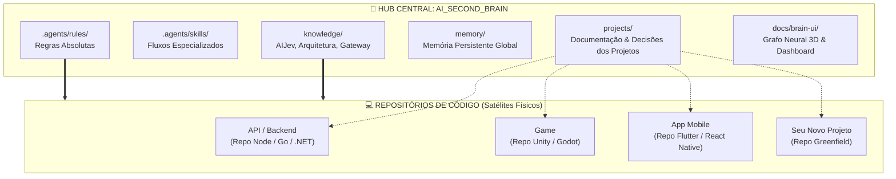
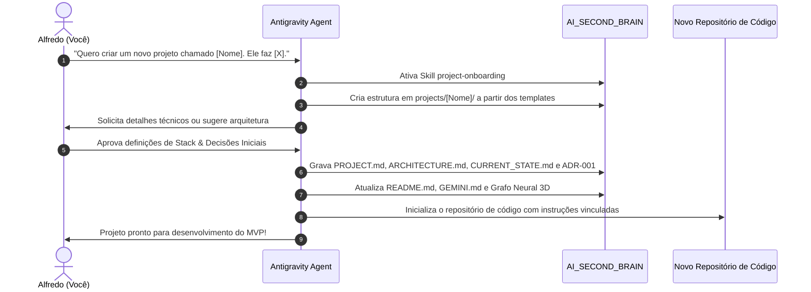
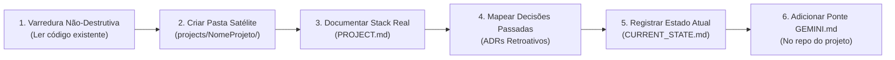
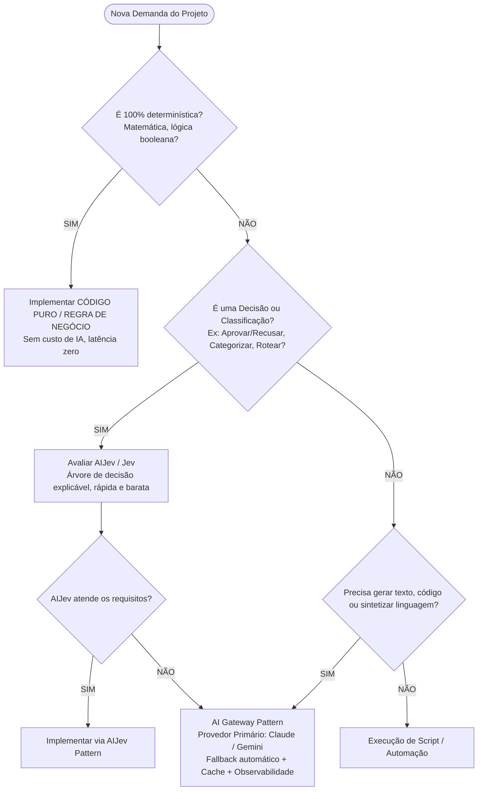

# Como Utilizar o AI Second Brain na Prática
## Guia Definitivo: Criação de Novos Projetos e Integração de Projetos Existentes

> **Este documento é o manual oficial de governança, onboarding e operação diária do AI Second Brain (Alfredo AI OS).**  
> Ele orienta passo a passo como iniciar novos projetos do zero (*greenfield*) e como acoplar projetos existentes (*brownfield*), garantindo persistência de memória, governança de IA, padronização técnica e rastreabilidade total de decisões.

---

## 📑 Sumário

1. [O Modelo Mental: Hub Central vs. Repositórios Satélites](#1-o-modelo-mental-hub-central-vs-repositórios-satélites)
2. [Cenário A: Criação de um NOVO Projeto do Zero (Greenfield)](#2-cenário-a-criação-de-um-novo-projeto-do-zero-greenfield)
3. [Cenário B: Integração de um Projeto JÁ EXISTENTE (Brownfield)](#3-cenário-b-integração-de-um-projeto-já-existente-brownfield)
4. [Operação do Dia a Dia: O Ciclo de Vida de uma Sessão de Trabalho](#4-operação-do-dia-a-dia-o-ciclo-de-vida-de-uma-sessão-de-trabalho)
5. [Governança e Roteamento de IA na Prática (AIJev First)](#5-governança-e-roteamento-de-ia-na-prática-aijev-first)
6. [Catálogo de Prompts Prontos para o Desenvolvedor](#6-catálogo-de-prompts-prontos-para-o-desenvolvedor)
7. [Checklists Operacionais de Consulta Rápida](#7-checklists-operacionais-de-consulta-rápida)

---

## 1. O Modelo Mental: Hub Central vs. Repositórios Satélites

O maior erro no desenvolvimento assistido por IA é manter instruções isoladas em chats temporários ou arquivos soltos que se perdem. No **AI Second Brain**, adotamos a arquitetura de **Hub de Conhecimento Central & Repositórios de Implementação**:



### Onde mora cada informação?

| Tipo de Dado | Onde Fica? | Finalidade |
| :--- | :--- | :--- |
| **Código-Fonte Executável** | No repositório físico do projeto (ex: `C:\Projetos\SaaS\MeuProjeto`) | Compilação, testes, Dockerfiles, builds de CI/CD. |
| **Memória do Seu Projeto** | `AI_SECOND_BRAIN/projects/<nome>/CURRENT_STATE.md` & `MEMORY/` | O que foi feito, tarefas ativas, bloqueios e sessões do seu software. |
| **Visão Geral e Stack do Projeto** | `AI_SECOND_BRAIN/projects/<nome>/PROJECT.md` | Contexto de negócio, regras e definições técnicas do seu software. |
| **Decisões Arquiteturais (ADRs)** | `AI_SECOND_BRAIN/projects/<nome>/DECISIONS/` | Histórico imutável de por que certas escolhas foram feitas no seu projeto. |
| **Mapeamento de Casos de IA** | `AI_SECOND_BRAIN/projects/<nome>/AI/` | Onde e como a IA é usada (AIJev, regras ou LLM) no seu software. |
| **Memória Global do Framework** | `AI_SECOND_BRAIN/memory/` | Estado e histórico do próprio AI Second Brain (servidor, visualizador, motor de IA). |
| **Regras Universais de Qualidade** | `AI_SECOND_BRAIN/.agents/rules/` | Padrões de C#, SQL Server, Segurança, etc. compartilhados por todos os projetos. |

> 💡 **Nota de Isolamento:** A pasta raiz `memory/` registra o histórico da **plataforma** AI Second Brain como produto. Cada projeto que você criar ou conectar terá sua memória e decisões mantidas **estritamente isoladas** dentro de `projects/<nome>/`, garantindo zero poluição ou interferência entre projetos.

---

## 2. Cenário A: Criação de um NOVO Projeto do Zero (Greenfield)

Quando você for criar um novo produto SaaS, aplicativo, automação ou jogo, siga este roteiro exato.

### Fluxo Passo a Passo:



### Passo 1: Solicitar o Onboarding ao Agente no Antigravity
No chat do Antigravity, envie a seguinte mensagem:

> *"Quero criar um novo projeto chamado **BillingFlow**. É uma API .NET 9 de conciliação de pagamentos com SQL Server, mensageria RabbitMQ e validação de regras com AIJev. Execute o onboarding desse projeto no Second Brain."*

O agente acionará a skill `project-onboarding`.

### Passo 2: Estrutura que o Agente cria em `projects/BillingFlow/`
O agente criará a pasta canônica do projeto dentro do Segundo Cérebro:

```text
projects/BillingFlow/
├── PROJECT.md                # Visão geral, objetivos de negócio, stack, restrições
├── ARCHITECTURE.md           # Desenho arquitetural (Clean Arch, endpoints, banco)
├── CURRENT_STATE.md          # Estado de partida (Fase: Concepção / Setup inicial)
├── DECISIONS/                # Registro de Decisões Arquiteturais (ADRs)
│   └── ADR-001-stack-inicial.md
├── AI/                       # Governança de IA do projeto
│   ├── AI_USE_CASES.md       # Classificação de cada caso (AIJev vs LLM)
│   └── AI_ARCHITECTURE.md    # Como o AI Gateway será plugado
├── DATABASE/                 # Schemas SQL, tabelas planejadas e índices
├── API/                      # Contratos OpenAPI / Swagger / Endpoints
├── TESTS/                    # Pirâmide de testes (Unitários, Integração)
└── MEMORY/                   # Sessões diárias de trabalho deste projeto
    └── sessions/
```

### Passo 3: Criar o Repositório Físico do Código
No diretório onde você armazena seus códigos (ex: `C:\Projetos\SaaS\BillingFlow`):
1. Crie o projeto ou rode o scaffolding do framework (ex: `dotnet new webapi -n BillingFlow`).
2. Crie na raiz do repositório um arquivo `GEMINI.md` (ou `CLAUDE.md` / `.cursorrules`) apontando para o Segundo Cérebro:

```markdown
# BillingFlow — Instruções de Desenvolvimento

> Este projeto é governado pelo **AI Second Brain** do Alfredo.
> Antes de implementar código ou tomar decisões, consulte a documentação oficial em:
> C:\Projetos\SaaS\Google Antigravity\Projetos\AI_SECOND_BRAIN\projects\BillingFlow\

## Diretrizes Mandatórias
1. Siga as regras globais de .NET em: `AI_SECOND_BRAIN/.agents/rules/04-dotnet.md`
2. Siga as regras de banco de dados em: `AI_SECOND_BRAIN/.agents/rules/05-sql-server.md`
3. Decisões de IA devem seguir: `AI_SECOND_BRAIN/knowledge/ai/AIJEV.md`
4. Não altere arquitetura sem registrar um novo ADR em `AI_SECOND_BRAIN/projects/BillingFlow/DECISIONS/`.
```

### Passo 4: Registrar a Governança de IA (AI Decision Gate)
Se o novo projeto for utilizar qualquer forma de inteligência:
1. Abra `projects/BillingFlow/AI/AI_USE_CASES.md`.
2. Para cada necessidade, preencha a tabela de decisão:
   - *Exemplo 1:* "Identificar divergência no valor do boleto" → **Código Determinístico** (`Math.Abs(pago - esperado) > 0`).
   - *Exemplo 2:* "Classificar risco de chargeback por padrão de histórico" → **AIJev / Jev Decision Tree**.
   - *Exemplo 3:* "Gerar e-mail amigável explicando a conciliação ao cliente" → **LLM** (Gemini / Claude via AI Gateway com fallback).

---

## 3. Cenário B: Integração de um Projeto JÁ EXISTENTE (Brownfield)

Se você já possui um projeto com repositório próprio, código em produção e anos de desenvolvimento (como uma API legado, um app existente ou qualquer outro sistema da sua empresa), **você não precisa reescrever o código nem mover a pasta física do repositório**. 

O objetivo do Segundo Cérebro é ser a **memória e inteligência governante** desse projeto.

### Fluxo de Adoção para Projetos Existentes:



### Passo 1: Executar a Varredura Inicial com o Agente
Abra o repositório existente no Antigravity ou passe o caminho do projeto para o agente:

> *"Tenho um projeto existente em `C:\Projetos\SaaS\MeuSistemaLegado`. Preciso que faça o onboarding dele no AI Second Brain. Analise a stack, o banco de dados, os endpoints e crie a documentação correspondente em `projects/MeuSistemaLegado/`."*

O agente executará a skill `project-onboarding` em modo brownfield:
1. Lê o `.csproj`, `package.json`, scripts SQL e Dockerfiles existentes.
2. Identifica bibliotecas de ORM (ex: Dapper, EF Core), serviços externos e autenticação.
3. Não modifica **nenhuma linha** de código do sistema legado.

### Passo 2: Criar os ADRs Retroativos (Crucial!)
Um dos maiores riscos ao usar IA em código legado é o agente tentar "reescrever tudo" usando padrões modernos que quebram o sistema em produção (por exemplo, querer substituir Dapper por EF Core ou trocar SQL Server por PostgreSQL).

Para blindar o projeto contra isso, crie ADRs retroativos:
- `DECISIONS/001-uso-de-dapper-e-procedures.md`:
  > *"Decisão: O projeto utiliza Dapper com Stored Procedures por requisitos de alta performance e compatibilidade com o legado. O agente de IA NUNCA deve tentar substituir Dapper por Entity Framework sem autorização expressa do Alfredo."*

### Passo 3: Registrar Bloqueios e Débitos Técnicos em `CURRENT_STATE.md`
No arquivo `projects/<nome>/CURRENT_STATE.md`, liste exatamente o estado operacional real:
- O que está 100% testado e funcionando.
- Quais são os "pontos sensíveis" (onde mexer com cuidado).
- Quais são os bugs conhecidos que ainda não foram corrigidos.
- Qual é o próximo objetivo prioritário.

### Passo 4: Onde Abrir a IDE? Cockpit Central vs. Repositório Isolado (Ponto de Atenção Crucial)

Uma dúvida frequente de qualquer desenvolvedor ao clonar o projeto é:  
**"Se eu abrir a pasta do meu projeto de forma isolada em outro editor/janela, as regras do Segundo Cérebro continuam funcionando?"**

A resposta depende do modo de trabalho escolhido:

#### Modo 1: AI Second Brain como Cockpit Central (RECOMENDADO ⭐)
Neste modo, você abre a pasta raiz `AI_SECOND_BRAIN` na sua IDE (Google Antigravity, VS Code, Cursor).
* **Como funciona:** Você acessa o seu código através do atalho/junção em `projects/<nome-do-projeto>/`.
* **Por que é o modo ideal:**
  * O agente de IA lê o `GEMINI.md` da raiz e todas as regras em `.agents/rules/` de forma nativa e automática.
  * Todas as **REGRAS ABSOLUTAS** (zero listas fixas de modelos de IA, Decision Gate, AIJev first, proibição de inventar contexto) se aplicam instantaneamente ao seu projeto.
  * Você mantém o Grafo Neural 3D, o Research Lab e as skills ativas no mesmo ambiente.
  * As lições aprendidas globais (`memory/lessons-learned.md`) protegem o seu código contra erros já documentados no passado.

#### Modo 2: Repositório Aberto Isoladamente em Outra Janela (Standalone)
Se você fechar o AI Second Brain e abrir **apenas a pasta física original do seu projeto** (ex: `C:\Projetos\MeuProjeto`) em uma nova janela:
* **O que acontece:** O agente de IA daquela nova janela **não** lerá o `GEMINI.md` da raiz do Segundo Cérebro por padrão, pois a IDE só enxerga as diretrizes da pasta raiz aberta naquele momento!
* **Como resolver (Criando a Ponte de Governança Agnóstica):**
  O **AI Second Brain é 100% agnóstico a qualquer IDE ou provedor de IA**. Ele não é exclusivo do Google Antigravity ou Gemini; ele oferece suporte nativo e idêntico para **Cursor AI, Claude Code, OpenAI Codex, Windsurf, GitHub Copilot e Cline**.

  Para que o agente da sua ferramenta favorita continue respeitando as regras e a memória mesmo trabalhando na pasta isolada, basta manter uma **Ponte de Governança** na raiz do seu repositório:
  
  | Sua Ferramenta / IDE | Arquivo de Ponte Lido | O que faz |
  | :--- | :--- | :--- |
  | **Padrão Aberto Universal** | `AGENTS.md` | Padrão agnóstico lido por agentes modernos (OpenAI, Codex, etc.) |
  | **Cursor AI** | `.cursorrules` | Injetado automaticamente no contexto do Cursor |
  | **Claude Code** | `CLAUDE.md` | Injetado na inicialização das sessões do Claude Code |
  | **Google Antigravity** | `GEMINI.md` | Injetado em todos os turnos de prompt no Antigravity |
  | **Windsurf (Cascade)** | `.windsurfrules` | Injetado no contexto do Windsurf |
  | **GitHub Copilot** | `.github/copilot-instructions.md` | Lidas pelo Copilot Chat no VS Code |
  | **Cline / Roo Code** | `.clinerules` | Injetado nas sessões do Cline |

  **Exemplo de Conteúdo da Ponte (`AGENTS.md` / `GEMINI.md` / `CLAUDE.md` / `.cursorrules`):**
  ```markdown
  # Governança de IA — Projeto Conectado ao AI Second Brain
  
  > Este projeto é governado pelas regras e decisões do AI Second Brain.
  > Cérebro Central: <caminho_absoluto_da_pasta_AI_SECOND_BRAIN>
  
  ## ANTES DE EXECUTAR QUALQUER TAREFA
  1. Consulte o estado atual em: CURRENT_STATE.md
  2. Consulte a visão geral e arquitetura em: PROJECT.md
  3. Consulte as decisões arquiteturais em: DECISIONS/
  4. Consulte as lições aprendidas em: <caminho_absoluto>/memory/lessons-learned.md
  5. REGRAS ABSOLUTAS:
     - NUNCA crie catálogos ou listas fixas/hardcoded de modelos de IA no código ou HTML.
     - Sempre utilize código determinístico antes de recorrer a LLMs.
     - NUNCA invente contexto ou regras especulativas sem solicitação expressa do desenvolvedor.
  ```

> 💡 **Automação Nativa Total**: Ao executar `npm run project:link <nome> <caminho>`, o AI Second Brain cria a junção NTFS e **já gera automaticamente** as pontes contratuais (`AGENTS.md`, `GEMINI.md`, `.cursorrules`, `CLAUDE.md`) na raiz do seu repositório, garantindo conformidade imediata qualquer que seja a sua ferramenta de IA.

---

## 4. Operação do Dia a Dia: O Ciclo de Vida de uma Sessão de Trabalho

Para que o Segundo Cérebro funcione como uma extensão real da sua memória, toda sessão de desenvolvimento deve seguir o ciclo de 3 fases:

```
┌─────────────────────────────────────────────────────────────┐
│ 1. ENTRADA (Context Loading)                                │
│ "Vou trabalhar no [NomeDoProjeto] na feature de autenticação.│
│ Carregue o estado atual e decisões pendentes."               │
└──────────────────────────────┬──────────────────────────────┘
                               │
                               ▼
┌─────────────────────────────────────────────────────────────┐
│ 2. DESENVOLVIMENTO (Skills & Governança)                    │
│ Implementação -> Testes -> Validação -> Revisão             │
└──────────────────────────────┬──────────────────────────────┘
                               │
                               ▼
┌─────────────────────────────────────────────────────────────┐
│ 3. SAÍDA (Memory Flush & Sync)                              │
│ "Finalizamos por hoje. Atualize CURRENT_STATE.md e registre │
│ a sessão na memória."                                       │
└─────────────────────────────────────────────────────────────┘
```

### 1. Início da Sessão
Antes de pedir código, peça o contexto:
> *"Vou trabalhar no [Nome do Projeto]. Me apresente o estado atual e os próximos passos."*

O agente lê:
- `projects/[Nome]/CURRENT_STATE.md`
- As últimas 3 sessões em `projects/[Nome]/MEMORY/sessions/`
- As decisões relevantes em `projects/[Nome]/DECISIONS/`

### 2. Durante a Sessão
O agente utiliza as skills adequadas para cada atividade:
- **Vai criar endpoint ou serviço?** → Aciona a skill `new-feature`.
- **Apareceu um erro/bug?** → Aciona a skill `bug-investigation`.
- **Vai adicionar uma consulta SQL pesada?** → Aciona a skill `database-review`.
- **A feature envolve inteligência ou decisão?** → Aciona a skill `ai-decision-gate`.

### 3. Fim da Sessão (Memory Flush)
Nunca encerre o Antigravity sem registrar a sessão. Envie:
> *"Fechando os trabalhos de hoje no [Nome do Projeto]. Salve a memória da sessão e atualize o CURRENT_STATE."*

O agente:
1. Cria `projects/[Nome]/MEMORY/sessions/YYYY-MM-DD-resumo.md`.
2. Atualiza `CURRENT_STATE.md` com os itens concluídos e o que ficou pendente.
3. Se foi tomada uma decisão arquitetural relevante, cria o novo ADR correspondente.

---

## 5. Governança e Roteamento de IA na Prática (AIJev First)

Uma das diretrizes centrais do seu sistema é a **política AIJev First**. Quando um projeto precisa resolver um problema de decisão, classificação ou automação, o agente deve seguir rigorosamente a árvore de roteamento:



### Tabela Prática de Escolha Técnica:

| Necessidade | Tecnologia Recomendada | Por quê? |
| :--- | :--- | :--- |
| Validação de formulários, cálculos tributários, regras de autenticação | **Código C# / TypeScript Puro** | Custo zero, sem falhas de interpretação, determinismo 100%. |
| Classificação de severidade de erros de SQL Jobs | **AIJev / Jev First** | Muito mais rápido que LLM, sem custo de tokens, 100% auditável. |
| Detecção de anomalias em volume de transações | **AIJev / Algoritmo Estatístico** | Latência em milissegundos e comportamento previsível. |
| Diagnóstico detalhado em linguagem natural de por que um job falhou | **LLM (Claude 3.5 Sonnet / Gemini 1.5 Pro)** | Capacidade de raciocínio aberto e contextualização de stack traces. |
| Chatbot de suporte ao usuário final | **LLM com RAG via AI Gateway** | Respostas conversacionais alimentadas pela base de conhecimento. |

---

## 6. Catálogo de Prompts Prontos para o Desenvolvedor

Guarde esta seção para copiar e colar no Antigravity:

### Para Iniciar um Novo Projeto:
```text
Ative a skill project-onboarding. Quero criar um novo projeto chamado [NOME].
Objetivo: [Descreva em 2 frases o que ele faz].
Stack pretendida: [.NET / React / Python / SQL Server / etc.].
Ele utilizará IA para: [Descreva onde entra a inteligência, se houver].
Crie a estrutura completa em projects/[NOME]/ com os templates preenchidos.
```

### Para Plugar um Projeto Existente:
```text
Ative a skill project-onboarding para um projeto existente localizado em [CAMINHO_DO_PROJETO].
Analise a estrutura atual sem alterar código, identifique a stack e crie a documentação
correspondente em projects/[NOME_DO_PROJETO]/. Em seguida, extraia as 3 principais
decisões de arquitetura já consolidadas para salvar como ADRs iniciais.
```

### Para Iniciar o Dia de Trabalho:
```text
Vou focar no projeto [NOME] hoje.
Leia o CURRENT_STATE.md e as últimas decisões em DECISIONS/.
Me apresente:
1. O que foi feito recentemente.
2. Quais são as tarefas prioritárias de hoje.
3. Há algum bloqueio registrado?
```

### Para Implementar uma Nova Feature com IA:
```text
Quero adicionar a seguinte funcionalidade no projeto [NOME]:
[Descreva a feature].
Passe pela skill ai-decision-gate: analise se ela deve ser determinística, usar AIJev ou LLM.
Apresente a proposta de implementação antes de escrever o código.
```

### Para Encerrar a Sessão e Salvar a Memória:
```text
Ative a skill session-memory. Finalizamos a sessão de trabalho no projeto [NOME].
O que fizemos: [Breve lista ou deixe o agente listar a partir do git diff].
Decisões tomadas: [Liste se houver].
Próximos passos: [Liste o que faremos amanhã].
Grave o arquivo de sessão e atualize o CURRENT_STATE.md do projeto.
```

---

## 7. Checklists Operacionais de Consulta Rápida

### ✅ Checklist: Novo Projeto (Greenfield)
- [ ] Criada a pasta `projects/<nome-do-projeto>/` no Second Brain.
- [ ] Preenchido `PROJECT.md` com objetivo, stack e restrições.
- [ ] Preenchido `ARCHITECTURE.md` com os diagramas de componentes.
- [ ] Preenchido `CURRENT_STATE.md` com a milestone inicial.
- [ ] Registrado `DECISIONS/001-stack-inicial.md`.
- [ ] Se tiver IA, preenchido `AI/AI_USE_CASES.md` avaliando AIJev First.
- [ ] Criado o repositório de código e adicionado `GEMINI.md` apontando para o Second Brain.
- [ ] Adicionado o projeto à tabela de projetos em `README.md` e `GEMINI.md` raiz.
- [ ] Visualizado e testado o novo nó no **Grafo Neural 3D** (`docs/brain-ui/`).

### ✅ Checklist: Projeto Existente (Brownfield)
- [ ] Mapeado repositório original sem modificar código.
- [ ] Criada pasta satélite `projects/<nome-existente>/`.
- [ ] Documentada a stack real em `PROJECT.md` (versões exatas de runtime e libs).
- [ ] Registrados os ADRs retroativos das decisões que **não podem ser violadas**.
- [ ] Registrados os débitos técnicos e pontos críticos em `CURRENT_STATE.md`.
- [ ] Adicionado arquivo de contexto no repositório de código (`GEMINI.md` / `.cursorrules`).
- [ ] Avaliadas oportunidades de melhoria de IA com AI Gateway.

### ✅ Checklist: Fim de Turno / Manutenção Contínua
- [ ] Código testado e com build verde no repositório.
- [ ] Skill `session-memory` executada para gerar o arquivo diário.
- [ ] `CURRENT_STATE.md` atualizado com o progresso real.
- [ ] Nenhuma decisão arquitetural ficou "apenas no chat" — todas viraram ADR.
- [ ] Commit e push realizados no repositório do projeto e no `AI_SECOND_BRAIN`.
