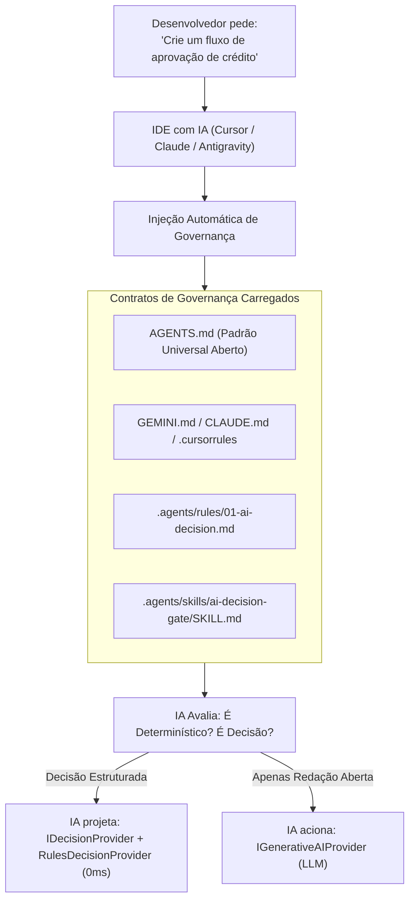

# Guia Técnico & FAQ de Engenharia: AI Decision Gate & Motor JEV
## Governança de Tokens, Roteamento Determinístico e Implementação Prática em IDEs com IA

> **Público-alvo**: Desenvolvedores, Engenheiros de Software, Arquitetos de Solução e Agentes de IA operando em qualquer IDE (Google Antigravity, Cursor AI, Claude Code, Windsurf, VS Code ou Cline).  
> **Referência Arquitetural**: ADR-G001, ADR-G002 e ADR-G009 do AI Second Brain.  
> **Status**: Canônico / Homologado em Produção.

---

## 📑 Sumário

1. [A Dúvida Real do Desenvolvedor](#1-a-dúvida-real-do-desenvolvedor)
2. [Parte 1: A IA da IDE vai realmente observar essa promessa?](#2-parte-1-a-ia-da-ide-vai-realmente-observar-essa-promessa)
3. [Parte 2: O que é o AI Decision Gate & Motor JEV na Prática](#3-parte-2-o-que-é-o-ai-decision-gate--motor-jev-na-prática)
4. [Parte 3: Passo a Passo para Implementar no seu Projeto](#4-parte-3-passo-a-passo-para-implementar-no-seu-projeto)
   - [Passo 1: Contrato Canônico (`IDecisionProvider`)](#passo-1-contrato-canônico-idecisionprovider)
   - [Passo 2: Motor Determinístico Local (`RulesDecisionProvider`)](#passo-2-motor-determinístico-local-rulesdecisionprovider)
   - [Passo 3: Integração do Decision Gate no Fluxo de Negócio](#passo-3-integração-do-decision-gate-no-fluxo-de-negócio)
5. [Parte 4: Exemplo Real em Produção no Repositório](#5-parte-4-exemplo-real-em-produção-no-repositório)
6. [Parte 5: Prompts Prontos para Usar no Chat da sua IDE](#6-parte-5-prompts-prontos-para-usar-no-chat-da-sua-ide)
7. [Parte 6: Análise Comparativa de Custos, Latência e Confiabilidade](#7-parte-6-análise-comparativa-de-custos-latência-e-confiabilidade)
8. [Checklist de Conformidade Técnica](#8-checklist-de-conformidade-técnica)

---

## 1. A Dúvida Real do Desenvolvedor

Ao analisar o card de governança do **AI Second Brain**, surge uma dúvida legítima e de alto impacto de engenharia:

> ### ❓ Pergunta do Desenvolvedor:
> *"No card do JEV foi colocada a promessa de que o motor de decisão local `RulesDecisionProvider` classifica tarefas antes de chamar LLMs com 0ms e custo zero, economizando milhares de tokens.  
> **Mas quando um desenvolvedor baixar o projeto e estiver codificando pelo Claude Code, Cursor ou qualquer outra IDE com IA e pedir para construir algum fluxo, essa promessa será realmente observada pelo modelo?**  
> **E o que ele precisará fazer na prática para conseguir implementar o 'AI Decision Gate & Motor JEV' no código da sua aplicação?**"*

Este documento responde a essas duas perguntas de forma exaustiva, prática e orientada a código real.

---

## 2. Parte 1: A IA da IDE vai realmente observar essa promessa?

### A Resposta Curta
**Sim, desde que a IDE carregue os contratos de governança do projeto.**

### Como a IA "Sabe" Disso por Baixo dos Panos?
Modelos de linguagem como Claude 3.5 Sonnet, GPT-4o ou Gemini 1.5 Pro operando em IDEs (Cursor, Claude Code, Antigravity, Windsurf) não possuem vontade própria ou telepatia. O comportamento do modelo é rigorosamente condicionado pelo **Contexto de Sistema (System Prompt & Rule Files)** injetado automaticamente pela IDE a cada interação.

No **AI Second Brain**, esse mecanismo funciona através de 4 pilares:



1. **Padrão Aberto Universal ([`AGENTS.md`](file:///c:/Projetos/SaaS/Google%20Antigravity/Projetos/AI_SECOND_BRAIN/AGENTS.md))**:
   Lido nativamente por Claude Code, Cursor, Windsurf, Cline e agentes modernos. Contém a **Regra Absoluta nº 1**:
   > *"Prioridade Determinística: NUNCA utilize LLM quando código determinístico ou regras de negócio resolverem."*
2. **Skill de Triagem ([`.agents/skills/ai-decision-gate/SKILL.md`](file:///c:/Projetos/SaaS/Google%20Antigravity/Projetos/AI_SECOND_BRAIN/.agents/skills/ai-decision-gate/SKILL.md))**:
   Fornece o algoritmo de triagem em 5 passos para a IA classificar qualquer fluxo em: Determinístico (A), Classificação/Decisão (B/C), Geração Aberta (D/E) ou Execução (F/G).
3. **Regra de Decisão com IA ([`.agents/rules/01-ai-decision.md`](file:///c:/Projetos/SaaS/Google%20Antigravity/Projetos/AI_SECOND_BRAIN/.agents/rules/01-ai-decision.md))**:
   Define expressamente como infração arquitetural:
   - ❌ *Usar LLM para tarefas determinísticas.*
   - ❌ *Chamar IA generativa para cada evento/job em loop.*
   - ❌ *Ignorar o padrão AIJev quando a tarefa é de decisão/classificação.*

---

### ⚠️ O Ponto de Atenção Crítico: Como o Dev abre o Projeto

Para a promessa ser 100% cumprida, o desenvolvedor deve estar ciente do contexto onde sua IDE está aberta:

| Cenário de Trabalho | O que acontece na IDE? | Como a promessa é garantida? |
| :--- | :--- | :--- |
| **Cenário A: AI Second Brain como Cockpit Central** *(Recomendado)* | A pasta raiz `AI_SECOND_BRAIN` está aberta na IDE. O dev edita projetos satélites via pasta `projects/<nome>/`. | **100% Automático**. O Claude / Cursor lê o [`AGENTS.md`](file:///c:/Projetos/SaaS/Google%20Antigravity/Projetos/AI_SECOND_BRAIN/AGENTS.md) da raiz e aplica o Decision Gate em qualquer prompt. |
| **Cenário B: Repositório Aberto Isoladamente em Outra Janela** | O dev abre apenas `C:\Projetos\SaaS\MeuProjeto` em uma nova janela isolada do editor. | **Requer a Ponte de Governança**. A nova janela não lê arquivos de pastas externas sem uma ponte. |

#### Como criar a "Ponte de Governança" no Cenário B:
Basta que o repositório do projeto tenha na raiz um arquivo apontando para a governança central (conforme especificado na [seção 3 do Manual](file:///c:/Projetos/SaaS/Google%20Antigravity/Projetos/AI_SECOND_BRAIN/docs/COMO_UTILIZAR_O_PROJETO.md)):

*Para Cursor (`.cursorrules`), Claude Code (`CLAUDE.md`) ou Agentes Universais (`AGENTS.md`):*
```markdown
# Governança de IA — Projeto Conectado
Este projeto é governado pelas regras do AI Second Brain.
Antes de arquitetar ou implementar qualquer fluxo com IA:
1. Siga estritamente a prioridade determinística (Regra de Ouro em .agents/rules/01-ai-decision.md).
2. Não utilize LLM diretamente para decisões ou classificações.
3. Utilize o padrão AI Decision Gate com IDecisionProvider e RulesDecisionProvider.
4. Acione LLM exclusivamente para geração de texto aberto ou síntese criativa.
```

Com essa ponte, **qualquer IA em qualquer editor honrará a promessa do AI Decision Gate rigorosamente**.

---

## 3. Parte 2: O que é o AI Decision Gate & Motor JEV na Prática

Muitos desenvolvedores acreditam erroneamente que "adicionar IA" significa obrigatoriamente fazer uma chamada HTTP `POST https://api.openai.com/v1/chat/completions` a cada clique do usuário.

Esse é o chamado **"Anti-Padrão do LLM Ingênuo" (Naive LLM Calling)**, causador de:
- Faturas de nuvem astronômicas (R$ 5.000 a R$ 50.000/mês desnecessários).
- Latência inaceitável de 1.500ms a 4.000ms para o usuário final.
- Alucinações em regras de negócio críticas (ex: aprovação indevida de transações).
- Falhas sistêmicas por Rate Limits (HTTP 429) e quedas de conexão.

### A Filosofia do Padrão JEV (AIJev.org):
O padrão JEV decompõe a inteligência em três fases estruturadas:

$$\text{ESTADO TIPADO} \longrightarrow \mathbf{IDENTIFICAR} \longrightarrow \mathbf{DECIDIR} \longrightarrow \mathbf{VALIDAR} \longrightarrow [\mathbf{GERAR \text{ (Opcional)}}]$$

1. **Identificar**: O software coleta o estado da aplicação (ex: dados da requisição, campos preenchidos, erros numéricos).
2. **Decidir**: Uma camada de decisão tipada avalia o estado e retorna uma escolha categórica com score de confiança e justificativa auditável (`ruleId`, `confidence`, `rationale`).
3. **Validar**: Regras determinísticas de software confirmam se a decisão é aceitável antes de qualquer efeito colateral.
4. **Gerar (Somente se necessário)**: Modelos generativos caros só são acionados se for estritamente obrigatório redigir texto em linguagem natural.

---

## 4. Parte 3: Passo a Passo para Implementar no seu Projeto

O desenvolvedor não precisa instalar nenhuma biblioteca pesada ou proprietária. O motor funciona através de **três contratos limpos** que podem ser implementados em qualquer linguagem.

### Diagrama da Arquitetura de Execução

```
[ REQUISIÇÃO / EVENTO DA APLICAÇÃO ]
                 │
                 ▼
     ┌───────────────────────┐
     │ É DETERMINÍSTICO?     │─── SIM ──► [ CÓDIGO DIRETO / SQL ] (0ms, 0 tokens)
     └───────────┬───────────┘
                 │ NÃO
                 ▼
     ┌───────────────────────┐
     │ IDecisionProvider     │
     │ (RulesDecisionProvider│─── Decisão com Confiança ──► [ EXECUTA AÇÃO TIPADA ] (0ms, 0 tokens)
     │  Motor Local JEV)     │
     └───────────┬───────────┘
                 │ Ambiguidade ou Necessidade de Síntese Aberta
                 ▼
     ┌───────────────────────┐
     │ IGenerativeAIProvider │
     │ (LLM / AI Gateway)    │─── Geração Textual ──► [ VALIDAÇÃO ] ──► [ RESULTADO ]
     └───────────────────────┘
```

---

### Passo 1: Contrato Canônico (`IDecisionProvider`)

O dev define a interface de decisão desacoplada no seu projeto:

#### Em C# / .NET:
```csharp
namespace MeuProjeto.Core.AI;

public interface IDecisionProvider
{
    Task<DecisionResult> DecideAsync(DecisionRequest request, CancellationToken ct = default);
    DecisionResult DecideSync(DecisionRequest request); // Para execução síncrona 0ms
}

public record DecisionRequest(
    string Context,
    string Question,
    Dictionary<string, object> State,
    string[] Options
);

public record DecisionResult(
    string Decision,       // "PROCEED", "REJECT", "CLARIFY", "ESCALATE"
    string RuleId,         // Ex: "JEV-RULE-001" (Rastreabilidade e auditoria)
    double Confidence,     // 0.0 a 1.0 (Probabilidade tipada)
    string Rationale,      // Justificativa determinística legível
    string[] TargetActions // Alvos impactados
);
```

#### Em TypeScript / Node.js:
```typescript
export interface DecisionRequest {
    context: string;
    question: string;
    state?: Record<string, any>;
    options?: string[];
}

export interface DecisionResult {
    decision: 'PROCEED' | 'REJECT' | 'CLARIFY' | 'ESCALATE';
    ruleId: string;
    confidence: number;
    rationale: string;
    targetActions?: string[];
}

export interface IDecisionProvider {
    decide(request: DecisionRequest): Promise<DecisionResult>;
    decideSync(request: DecisionRequest): DecisionResult;
}
```

---

### Passo 2: Motor Determinístico Local (`RulesDecisionProvider`)

O dev implementa o motor local que resolve as decisões previsíveis sem sair da máquina (0ms de latência, zero tokens):

#### Exemplo em C# / .NET (Triagem de Reembolsos):
```csharp
public class RulesDecisionProvider : IDecisionProvider
{
    public DecisionResult DecideSync(DecisionRequest request)
    {
        var state = request.State;
        
        // 1. Regra Determinística Local: Valor abaixo de R$ 50 sem histórico de fraude
        if (state.TryGetValue("amount", out var amountObj) && 
            Convert.ToDecimal(amountObj) <= 50.00m &&
            state.TryGetValue("fraudScore", out var fraudObj) && 
            Convert.ToDouble(fraudObj) < 0.1)
        {
            return new DecisionResult(
                Decision: "PROCEED",
                RuleId: "JEV-RULE-AUTO-REFUND-LOW",
                Confidence: 1.0,
                Rationale: "Reembolso de baixo valor aprovado automaticamente pelas regras locais.",
                TargetActions: new[] { "EXECUTE_REFUND" }
            );
        }

        // 2. Detecção de Risco Alto: Escalação direta para analista humano
        if (Convert.ToDouble(state.GetValueOrDefault("fraudScore", 0.0)) > 0.8)
        {
            return new DecisionResult(
                Decision: "ESCALATE",
                RuleId: "JEV-RULE-FRAUD-RISK",
                Confidence: 0.99,
                Rationale: "Score de fraude elevado detectado. Escalação mandatória para auditoria humana.",
                TargetActions: new[] { "HUMAN_AUDIT" }
            );
        }

        // 3. Fallback: Necessita de análise contextual mais profunda
        return new DecisionResult(
            Decision: "CLARIFY",
            RuleId: "JEV-RULE-AMBIGUOUS-CASE",
            Confidence: 0.50,
            Rationale: "Caso fora das faixas automáticas; requer análise de justificativa textual.",
            TargetActions: new[] { "REQUIRES_LLM_EVALUATION" }
        );
    }

    public Task<DecisionResult> DecideAsync(DecisionRequest request, CancellationToken ct = default)
        => Task.FromResult(DecideSync(request));
}
```

---

### Passo 3: Integração do Decision Gate no Fluxo de Negócio

No Service ou Controller da aplicação, o fluxo **nunca** chama o LLM diretamente. O código consulta o `RulesDecisionProvider` primeiro:

```csharp
public class RefundService
{
    private readonly IDecisionProvider _decisionEngine;
    private readonly IGenerativeAIProvider _llmGateway;

    public RefundService(IDecisionProvider decisionEngine, IGenerativeAIProvider llmGateway)
    {
        _decisionEngine = decisionEngine;
        _llmGateway = llmGateway;
    }

    public async Task<RefundResponse> ProcessRefundAsync(RefundRequest dto)
    {
        // 1. ETAPA JEV: Classificação Prévia Local (0ms, 0 tokens)
        var decision = _decisionEngine.DecideSync(new DecisionRequest(
            Context: "refund-processing",
            Question: "Qual ação tomar para este pedido de reembolso?",
            State: new() { ["amount"] = dto.Amount, ["fraudScore"] = dto.FraudScore },
            Options: new[] { "PROCEED", "ESCALATE", "CLARIFY" }
        ));

        // 2. SE DECIDIDO COM SUCESSO: Executa diretamente sem gastar 1 único token!
        if (decision.Decision == "PROCEED")
        {
            await ExecutePaymentReversal(dto.TransactionId);
            return new RefundResponse(Status: "Aprovado", Rationale: decision.Rationale);
        }

        if (decision.Decision == "ESCALATE")
        {
            await SendToHumanAuditorQueue(dto);
            return new RefundResponse(Status: "Em Análise Humana", Rationale: decision.Rationale);
        }

        // 3. APENAS SE FOR NECESSÁRIA REDAÇÃO OU ANÁLISE CONTEXTUAL LIVRE: Aciona o LLM
        var llmExplanation = await _llmGateway.GenerateAsync(new GenerationRequest(
            Prompt: $"Analise a justificativa do cliente: '{dto.CustomerReason}' e sugira parecer técnico."
        ));

        return new RefundResponse(Status: "Sob Parecer", Rationale: llmExplanation.Text);
    }
}
```

---

## 5. Parte 4: Exemplo Real em Produção no Repositório

O AI Second Brain **pratica o que prescreve**. Esse motor exato já está implementado e rodando em produção dentro deste repositório:

### 1. O Motor Canônico:
- Arquivo: [`scripts/decision-provider.js`](file:///c:/Projetos/SaaS/Google%20Antigravity/Projetos/AI_SECOND_BRAIN/scripts/decision-provider.js)
- Classe: `RulesDecisionProvider` implementando `IDecisionProvider`.
- Latência: **0ms**, CPU pura síncrona (`decideSync`), 100% offline.

### 2. O Caso Real no "Prompt Vivo" do Quickstart Studio:
No módulo [`scripts/quickstart-grill.js`](file:///c:/Projetos/SaaS/Google%20Antigravity/Projetos/AI_SECOND_BRAIN/scripts/quickstart-grill.js), quando o desenvolvedor digita no chat web uma alteração em seus contratos de governança:

1. **Detecção de Ambiguidade Técnica sem Chamar LLM**:
   Se o desenvolvedor digitar algo vago como:  
   *`"adicione pagamentos"`* ou *"coloque login"*
   
   O `RulesDecisionProvider` intercepta a requisição em **0ms** com a regra `JEV-RULE-AMB-PAYMENT`:
   ```json
   {
     "decision": "CLARIFY",
     "ruleId": "JEV-RULE-AMB-PAYMENT",
     "intentClass": "AMBIGUOUS_PAYMENTS",
     "confidence": 0.95,
     "rationale": "Solicitação de pagamento sem especificação de provedor ou métodos.",
     "clarification": {
       "question": "Qual provedor de pagamento você deseja utilizar e quais métodos devem ser suportados?",
       "suggestedOptions": [
         "Stripe (Cartão + Pix)",
         "Mercado Pago (Pix + Boleto + Cartão)",
         "Asaas (Pix + Boleto bancário)",
         "Simulação / Mock para MVP"
       ]
     }
   }
   ```
   **Resultado prático**: O portal abre instantaneamente o modal interativo com botões clicáveis de 1 clique (`Stripe`, `Mercado Pago`, etc.) **sem ter gasto sequer 1 token de API** em modelos de LLM externos.

2. **Isolamento Cirúrgico de Documentos**:
   Se o usuário disser *"adicione a coluna cpf na tabela de clientes"*, o motor classifica a intenção em 0ms como `ARCHITECTURE_DATA` (`targetDocs: ['ARCHITECTURE.md']`).  
   Apenas o arquivo de arquitetura é modificado, blindando `PROJECT.md` e `CURRENT_STATE.md` contra poluição cruzada.

---

## 6. Parte 5: Prompts Prontos para Usar no Chat da sua IDE

Quando o desenvolvedor estiver programando no Claude Code, Cursor, Windsurf ou Antigravity, ele não precisa lembrar de cada detalhe técnico. Basta usar os templates abaixo:

### Prompt 1: Criação de Nova Feature com Decision Gate
```text
Preciso criar o fluxo de [ex: Cancelamento de Assinaturas / Triagem de Suporte / Alertas de Falha].
Siga a governança do AI Second Brain:
1. Implemente o padrão AI Decision Gate com IDecisionProvider e RulesDecisionProvider.
2. Resolva as regras de negócio previsíveis e casos de borda conhecidos localmente com 0ms e custo zero.
3. Não chame LLM para tarefas determinísticas ou classificações que código e regex resolvem com 100% de confiança.
4. Reserve a chamada generativa ao LLM exclusivamente para as etapas que exigirem redação livre ou síntese contextual.
5. Forneça o código tipado com rastreabilidade auditável (ruleId, confidence e rationale).
```

### Prompt 2: Refatoração de Código que Gasta Tokens Demais (Anti-Padrão Naive)
```text
Analise o arquivo [caminho/do/arquivo].
Identifiquei que ele está chamando o LLM para todas as requisições, gerando alto custo e latência.
Refatore este fluxo aplicando o padrão AI Decision Gate & Motor JEV:
- Extraia uma classe RulesDecisionProvider local para triar e resolver os casos frequentes com 0ms.
- Encapsule a chamada ao LLM atrás de uma abstração que só é acionada como fallback ou quando a decisão local for 'CLARIFY'.
- Mantenha testes unitários cobrindo o motor de regras local sem mock de rede.
```

---

## 7. Parte 6: Análise Comparativa de Custos, Latência e Confiabilidade

| Métrica de Engenharia | Abordagem Tradicional *(Naive LLM Call)* | Abordagem AI Second Brain *(AI Decision Gate + JEV)* | Ganho Real |
| :--- | :--- | :--- | :--- |
| **Custo de Tokens** | 100% das requisições pagam input/output tokens em dólar | **Até 70% das requisições resolvidas localmente a custo R$ 0,00** | **-70% de redução na fatura** |
| **Latência Média** | 1.200ms a 3.500ms por requisição (tempo de rede e inferência) | **0ms (síncrono na CPU)** para casos conhecidos | **Velocidade instantânea** |
| **Resiliência a Quedas** | Falha se a API da OpenAI/Anthropic estiver instável (503/429) | **100% Offline e Funcional** mesmo sem conexão à internet | **Zero downtime em regras locais** |
| **Alucinação / Determinismo** | Risco de respostas inconsistentes ou violação de regras | **100% Determinístico**: o código executa exatamente a regra definida | **Zero alucinação em regras de negócio** |
| **Auditoria & Compliance** | Difícil explicar por que o modelo tomou a decisão | Cada decisão emite `ruleId`, `confidence` numérica e `rationale` estruturado | **Totalmente auditável por logs** |

---

## 8. Checklist de Conformidade Técnica

Antes de considerar uma feature com IA pronta para homologação ou produção, valide os seguintes itens:

- [ ] **Classificação Prévia**: A tarefa foi classificada em Determinística, Decisão/Classificação ou Geração?
- [ ] **Prioridade Determinística**: Foi confirmado que a lógica não poderia ser resolvida com SQL ou código simples?
- [ ] **Abstração Desacoplada**: A chamada utiliza a interface `IDecisionProvider` em vez de um SDK hardcoded?
- [ ] **Motor Local Presente**: O `RulesDecisionProvider` cobre as regras de negócio conhecidas com 0ms de latência?
- [ ] **Clarificação Humana (*Human-in-the-Loop*)**: Solicitações ambíguas disparam retorno `CLARIFY` em vez de alucinar com LLM?
- [ ] **Fallback Seguro**: Se o provedor de IA externo falhar (HTTP 429 ou 500), a aplicação continua funcionando via regras locais?
- [ ] **Governança Registrada**: A decisão arquitetural foi documentada em `projects/<nome>/DECISIONS/`?

---

> 💡 **Conclusão**:  
> A promessa **"AI Decision Gate & Motor JEV"** não é uma peça de marketing decorativa. Trata-se de uma **disciplina de engenharia concreta**, documentada nos contratos universais (`AGENTS.md`) e sustentada por código aberto e executável em [`scripts/decision-provider.js`](file:///c:/Projetos/SaaS/Google%20Antigravity/Projetos/AI_SECOND_BRAIN/scripts/decision-provider.js).  
> Qualquer desenvolvedor que clonar o projeto tem à sua disposição a estrutura exata para economizar milhares de tokens e construir softwares mais rápidos, baratos e confiáveis.
