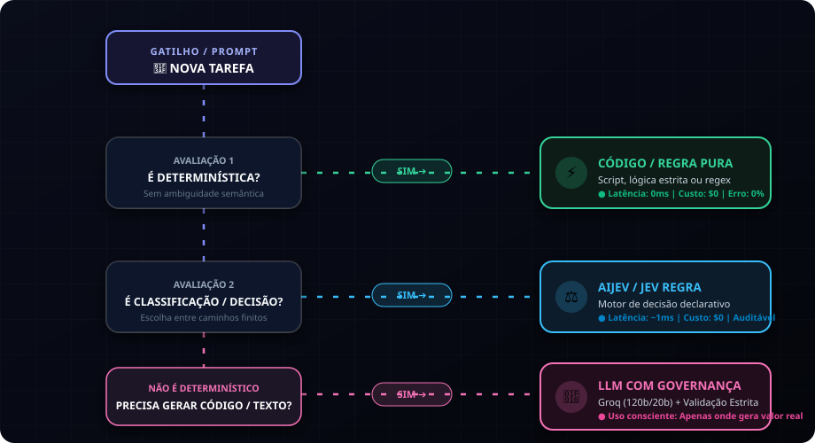
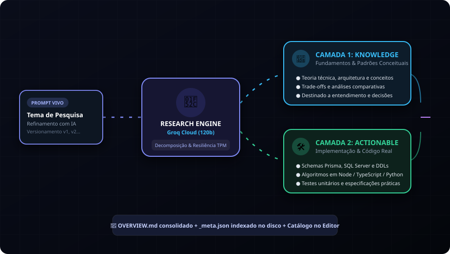

# AI Second Brain — Documentação Oficial da Solução
## O Sistema Operacional de Governança, Memória Persistente e Pesquisa Autônoma para Desenvolvimento com IA

> **Autor / Criador:** Alfredo AI OS  
> **Arquitetura:** Hub Central de Conhecimento & Repositórios Satélites  
> **Status:** 🟢 Operacional & UX/UI Avançado  
> **Versão:** 2.0 (Com Research Lab Autônomo e Grafo Neural 3D)

---

## 📑 Sumário

1. [Visão Geral & O Problema Real](#1-visão-geral--o-problema-real)
2. [Arquitetura da Solução & Camadas do Cérebro](#2-arquitetura-da-solução--camadas-do-cérebro)
3. [Governança & Roteamento de IA (AIJev First)](#3-governança--roteamento-de-ia-aijev-first)
4. [O Laboratório de Pesquisa Autônomo (Research Lab)](#4-o-laboratório-de-pesquisa-autônomo-research-lab)
5. [Ciclo de Vida de um Projeto na Prática (Hands-on)](#5-ciclo-de-vida-de-um-projeto-na-prática-hands-on)
6. [Grafo Neural 3D & Recursos Visuais](#6-grafo-neural-3d--recursos-visuais)
7. [Checklists de Governança & FAQ Técnico](#7-checklists-de-governança--faq-técnico)

---

## 1. Visão Geral & O Problema Real

### O Dilema do Desenvolvimento com IA: "Vibe Coding" vs. Engenharia de Longo Prazo

O avanço de agentes de inteligência artificial (Google Antigravity, Cursor, Claude Code, Windsurf) permitiu que desenvolvedores escrevessem milhares de linhas de código em minutos. No entanto, surgiu uma armadilha silenciosa: o **vibe coding** (programar no improviso a partir de chats soltos).

Sem uma arquitetura estruturada, projetos mantidos por IA sofrem de três males crônicos:

1. **Amnésia e Perda de Contexto**: Cada nova janela de contexto ou sessão reinicia a mente do agente. Ele esquece por que certa biblioteca foi escolhida, quais bugs já foram corrigidos e quais decisões de arquitetura foram tomadas na semana anterior.
2. **"Context Drift" e Degradação de Código**: Sem regras absolutas de governança, a IA tende a reinventar a roda a cada interação, gerando classes duplicadas, violando padrões de design e introduzindo regressões silenciosas.
3. **Desperdício e Latência Excessiva**: Desenvolvedores despreparados tendem a enviar qualquer tarefa para modelos generativos pesados, pagando em latência e dinheiro por algo que um algoritmo determinístico resolveria em 0 milissegundos.

### A Solução: AI Second Brain (Alfredo AI OS)

O **AI Second Brain** foi concebido como um **Hub Central de Conhecimento e Governança** agnóstico à linguagem ou framework. Ele atua como o cérebro permanente do desenvolvedor e de seus agentes, desacoplando o conhecimento, as decisões e as regras dos repositórios de código físicos.

---

## 2. Arquitetura da Solução & Camadas do Cérebro

A arquitetura opera no modelo **Hub Central & Repositórios Satélites**:

### As Camadas do Hub Central

| Camada | Diretório | Papel e Finalidade |
|---|---|---|
| **Regras Inegociáveis** | `.agents/rules/` | Diretrizes estritas de desenvolvimento, segurança, roteamento de IA e documentação. |
| **Habilidades do Agente** | `.agents/skills/` | Fluxos de trabalho reutilizáveis (gate de IA, onboarding de projetos, revisão arquitetural, persistência de memória). |
| **Base de Conhecimento** | `knowledge/` | Padrões conceituais universais (AI Gateway, AIJev, OWASP, Arquitetura). |
| **Memória Global** | `memory/` | Persistência entre sessões (`current-state.md` e `lessons-learned.md`). |
| **Projetos Governados** | `projects/` | Hub de contratos de cada projeto (`PROJECT.md`, `CURRENT_STATE.md`, `ARCHITECTURE.md`, `BACKUPS/`, `RESEARCH/`). |
| **Research Lab** | `projects/<nome>/RESEARCH/` | Síntese autônoma de documentação técnica em duas camadas. |
| **Portal Web Interativo** | `docs/brain-ui/` | Visualizador web em tempo real com Grafo Neural 3D, Dashboard e Live Markdown Editor. |

---

## 3. Governança & Roteamento de IA (AIJev First)

Uma das diretrizes absolutas do AI Second Brain é: **NUNCA queime tokens com LLM quando uma regra determinística ou motor de regras resolver com perfeição.**

### As Três Faixas de Execução

1. **Faixa A (Determinística)**: Se a tarefa não possui ambiguidade semântica (cálculos matemáticos, filtros, validação de schema, regex, scripts), use código puro.
   - **Latência**: 0ms | **Custo**: $0 | **Confiabilidade**: 100%
2. **Faixa B (Decisão & Classificação)**: Se a tarefa exige escolher entre alternativas finitas de negócio ou categorizar eventos, use **AIJev** ou motores de regras declarativos.
   - **Latência**: ~1ms | **Custo**: $0 | **Auditabilidade**: Total
3. **Faixa C (Geração & Raciocínio Aberto)**: Somente quando há necessidade explícita de gerar prosa, sintetizar documentação ou criar código inédito, aciona-se um LLM (Groq Cloud).
   - **Validação Obrigatória**: Todo output de IA generativa passa por validação antes da aplicação.

---

## 4. O Laboratório de Pesquisa Autônomo (Research Lab)

O **Research Lab** é o motor de aceleração técnica do AI Second Brain. Ele permite explorar temas complexos de arquitetura ou engenharia através de uma taxonomia estruturada em duas camadas:

### A Taxonomia de Duas Camadas

1. **📘 Camada `knowledge/` (Fundamentos & Conceitos)**:
   - Focada no entendimento conceitual, teorias técnicas, diagramas, padrões de mercado e trade-offs.
   - Exemplo: Fundamentos do algoritmo ELO, perfil nutricional, arquitetura orientada a eventos.
2. **🛠️ Camada `actionable/` (Implementações Práticas & Código)**:
   - Focada em código executável, schemas de banco de dados (SQL Server, Prisma, PostgreSQL), testes automatizados e procedimentos passo a passo.
   - Exemplo: Implementação do cálculo ELO em TypeScript, schemas DDL, endpoints Express.

### Resiliência do Motor Autônomo (Groq Cloud)

O motor (`scripts/research-engine.js` + `scripts/groq-client.js`) opera com zero dependências externas:
- **Tratamento Dinâmico de TPM (Tokens por Minuto)**: Detecta erros de rate limit, calcula a pausa exata exigida pelo servidor da Groq, adiciona +2s de margem de segurança e retenta até 3 vezes automaticamente.
- **Cadência Estratégica**: Pausa automática de 6 segundos entre requisições para garantir estabilidade contínua na camada gratuita.
- **Resumabilidade Inteligente**: Se uma pesquisa for interrompida, ao ser reiniciada ela detecta arquivos já gerados no disco e não gasta tokens novamente.
- **Streaming em Tempo Real**: Envio de eventos via Server-Sent Events (SSE) para a interface com indicador visual passo a passo.

---

## 5. Ciclo de Vida de um Projeto na Prática (Hands-on)

A governança do AI Second Brain funciona em um ciclo contínuo sem perda de memória:

### O Ciclo em 4 Etapas:
1. **Início da Sessão**: O agente e o desenvolvedor abrem a sessão lendo o `CURRENT_STATE.md` do projeto em questão. O contexto é retomado em segundos.
2. **Desenvolvimento Focado**: Toda alteração de código respeita as regras em `.agents/rules/` e a arquitetura formalizada em `ARCHITECTURE.md`.
3. **Validação & Testes**: Execução de scripts, checagem de integridade e testes de regressão.
4. **Fechamento & Persistência**: Ao encerrar, aciona-se a skill `session-memory` que registra as decisões tomadas, tarefas concluídas e próximos passos.

---

## 6. Grafo Neural 3D & Recursos Visuais

O portal web do AI Second Brain (`docs/brain-ui/`) oferece três modos de trabalho:

1. **Dashboard & Métricas**: Visão panorâmica dos projetos conectados, status de governança e atalhos rápidos.
2. **Grafo Neural 3D (Three.js)**: Grafo orbital espacial que mapeia projetos como estrelas centrais e seus arquivos, regras e laboratórios de pesquisa como satélites gravitando ao redor.
3. **Project Workspace**: Painel dedicado de cada projeto com 5 abas integradas:
   - Visão Geral & Contratos
   - 🔬 Research Lab
   - 🧮 Diagnóstico de Memória & Saúde
   - 🔮 Grafo Neural 3D Dedicado
   - 📦 Backup, Dossiê & Windows Explorer

---

## 7. Checklists de Governança & FAQ Técnico

### Checklist de Início de Tarefa
- [ ] Ler o `PROJECT.md` e o `CURRENT_STATE.md` do projeto relevante.
- [ ] Verificar `.agents/rules/` para restrições técnicas.
- [ ] Classificar a tarefa antes de agir (Determinística, Decisão ou Geração).

### Checklist de Encerramento de Sessão
- [ ] Testar as alterações implementadas.
- [ ] Atualizar o `CURRENT_STATE.md` do projeto.
- [ ] Atualizar a memória persistente (`memory/current-state.md`).
- [ ] Registrar decisões arquiteturais relevantes em `DECISIONS/`.
