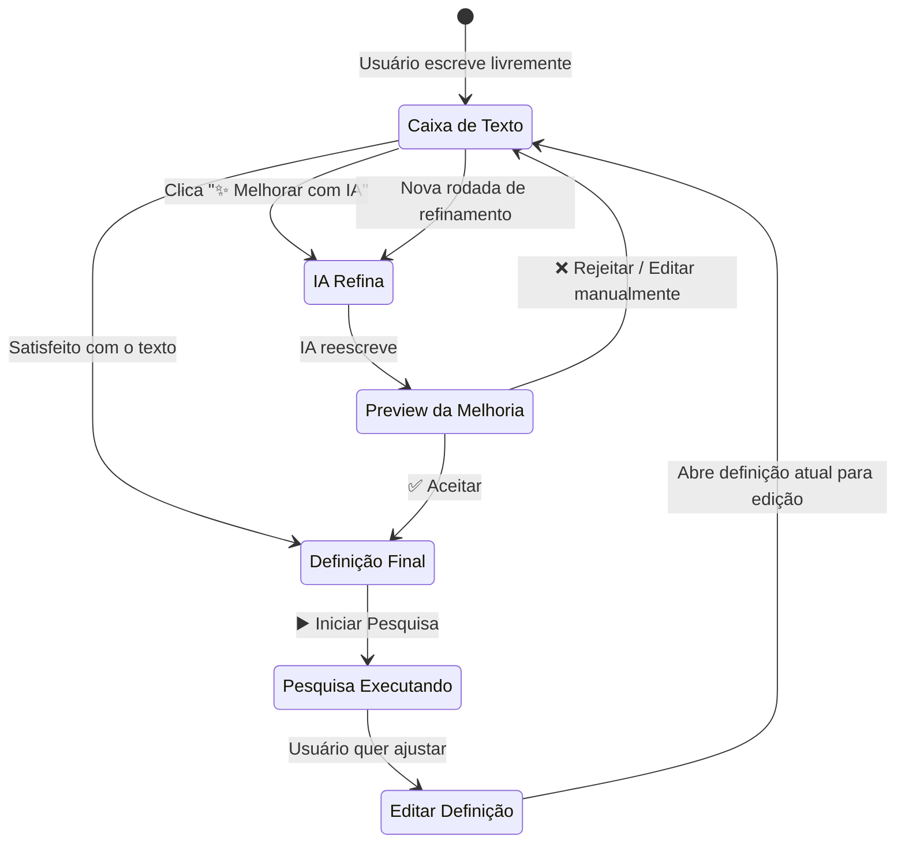
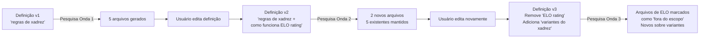
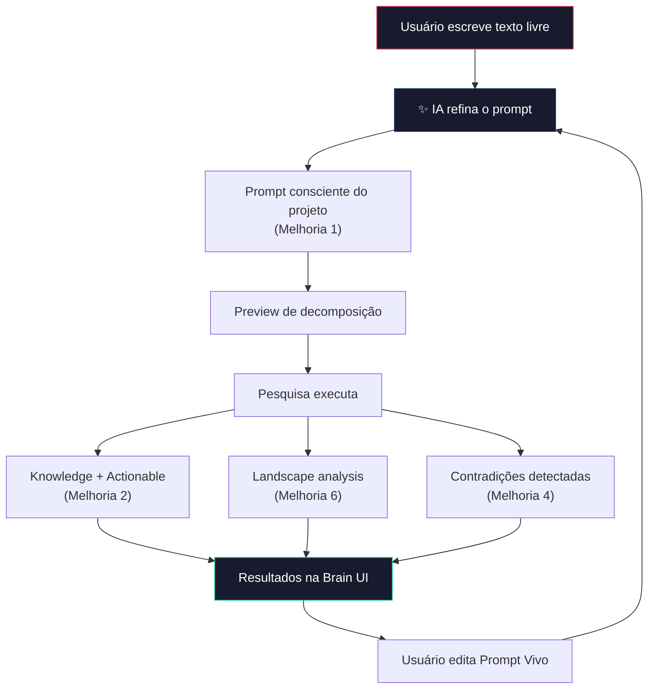

# 🧠 Análise: AI-Assisted Prompt Refinement

> Avaliação da ideia de incluir assistência de IA na caixa de definição da pesquisa.

---

## Veredito: ✅ Melhoria Crítica — Resolve o Problema que Ninguém Vê

### O problema silencioso

O maior gargalo de qualquer sistema de pesquisa por IA não é a busca, não é a organização, não é a síntese. É o **input**. 

A qualidade do output é diretamente proporcional à qualidade da definição. E a maioria dos usuários vai escrever algo assim:

```
❌ "pesquisar regras de xadrez"
```

Quando o que o sistema precisaria para entregar algo realmente bom é algo assim:

```
✅ "Pesquisar as regras oficiais do xadrez (FIDE) com foco em:
    - Movimentação de cada peça com casos especiais
    - Regras frequentemente esquecidas (en passant, promoção, empate por repetição)
    - Condições de vitória, empate e derrota
    - Como representar estado do jogo programaticamente
    Excluir: história, campeonatos, aberturas famosas
    Profundidade: intermediária, com pseudo-código quando aplicável"
```

O usuário **sabe** o que quer, mas não sabe **expressar** de forma que o sistema entenda bem. Sua ideia resolve exatamente essa lacuna — a IA funciona como um **tradutor de intenção**.

---

## O Fluxo que Eu Visualizo



---

## Conceito de Interface

```
┌─────────────────────────────────────────────────────────────────┐
│  🔬 Nova Pesquisa — Projeto: meu-jogo-xadrez                   │
├─────────────────────────────────────────────────────────────────┤
│                                                                 │
│  O que você quer pesquisar?                                     │
│  ┌─────────────────────────────────────────────────────────┐    │
│  │ quero entender as regras do xadrez pra poder            │    │
│  │ programar o jogo, tipo como cada peça anda,             │    │
│  │ quando é xeque mate, essas coisas                       │    │
│  │                                                         │    │
│  │                                                         │    │
│  └─────────────────────────────────────────────────────────┘    │
│                                                                 │
│  ┌──────────────────────┐                                       │
│  │ ✨ Melhorar com IA   │                                       │
│  └──────────────────────┘                                       │
│                                                                 │
│ ─ ─ ─ ─ ─ ─ ─ após clicar ─ ─ ─ ─ ─ ─ ─ ─ ─ ─ ─ ─ ─ ─ ─ ─  │
│                                                                 │
│  ┌─ ✨ Sugestão da IA ─────────────────────────────────────┐    │
│  │                                                         │    │
│  │  Pesquisar as regras oficiais do xadrez com foco em     │    │
│  │  implementação para jogo digital:                       │    │
│  │                                                         │    │
│  │  • Movimentação de cada peça (rei, rainha, bispo,       │    │
│  │    cavalo, torre, peão) com restrições e validações     │    │
│  │  • Regras especiais: roque, en passant, promoção        │    │
│  │    de peão                                              │    │
│  │  • Condições de fim de jogo: xeque-mate, empate por     │    │
│  │    afogamento, repetição, regra dos 50 movimentos       │    │
│  │  • Representação de estado do jogo (notação FEN,        │    │
│  │    estruturas de dados para tabuleiro)                   │    │
│  │                                                         │    │
│  │  Excluir: história do xadrez, aberturas famosas,        │    │
│  │  biografias de jogadores.                               │    │
│  │                                                         │    │
│  └─────────────────────────────────────────────────────────┘    │
│                                                                 │
│  ┌───────────┐  ┌───────────┐  ┌──────────────────┐            │
│  │ ✅ Aceitar │  │ ❌ Manter  │  │ ✏️ Editar e       │            │
│  │  sugestão  │  │  original │  │    refinar mais  │            │
│  └───────────┘  └───────────┘  └──────────────────┘            │
│                                                                 │
├─────────────────────────────────────────────────────────────────┤
│                                     ┌────────────────────────┐  │
│                                     │ ▶️ Iniciar Pesquisa     │  │
│                                     └────────────────────────┘  │
└─────────────────────────────────────────────────────────────────┘
```

---

## O Que a IA Deve Considerar ao Refinar

A IA não deve simplesmente "reescrever bonito". Ela deve:

| Ação | Por quê |
|------|---------|
| **Ler o `PROJECT.md`** do projeto | Para entender contexto, stack, objetivos |
| **Extrair intenção implícita** | "essas coisas" → quais coisas exatamente? |
| **Adicionar foco técnico** | O usuário está construindo, não estudando |
| **Sugerir exclusões** | Remover ruído antes que ele entre |
| **Estruturar em tópicos** | Transformar texto livre em bullet points claros |
| **Manter a linguagem acessível** | Não parecer um prompt de engenheiro — parecer a ideia do usuário, refinada |

### Princípio fundamental

> A sugestão da IA deve parecer que o **próprio usuário** escreveu, só que com mais clareza. 
> Nunca deve parecer robotizada ou excessivamente formal.

---

## "Prompt Vivo" — A Sacada Extra

Sua ideia de que a definição pode ser **modificada a qualquer momento** e a pesquisa se baseia no texto atual é particularmente inteligente. Isso cria um conceito que eu chamaria de **"Prompt Vivo"**:



### Comportamentos importantes do Prompt Vivo

| Cenário | Comportamento esperado |
|---------|----------------------|
| Usuário **amplia** o escopo | Sistema pesquisa **só o que é novo**, não refaz tudo |
| Usuário **reduz** o escopo | Arquivos fora do novo escopo são **marcados**, não deletados |
| Usuário **refina** o foco | Sistema **reavalia** relevância dos arquivos existentes |
| Usuário pede IA para **melhorar** novamente | IA considera os arquivos já gerados para refinar melhor |

---

## 3 Extensões que Eu Adicionaria

### 1. Preview de Decomposição

Depois que o usuário aceita a definição (antes de pesquisar), mostrar um **preview dos sub-tópicos** que seriam pesquisados:

```
📋 Preview: A pesquisa vai investigar estes tópicos

  ✅ Movimentação de peças (6 sub-tópicos)
  ✅ Regras especiais — roque, en passant, promoção
  ✅ Condições de fim de jogo
  ✅ Representação de estado em código

  Estimativa: ~8 a 12 arquivos | Tempo: ~3 min

  [ ▶️ Confirmar e Pesquisar ]   [ ✏️ Ajustar tópicos ]
```

Isso dá ao usuário **controle fino** sem exigir que ele saiba escrever prompts perfeitos.

### 2. Sugestão de Escopo Automática

Com base no texto, a IA sugere automaticamente parâmetros:

```
⚙️ Escopo sugerido pela IA:
  Profundidade: Intermediária (com pseudo-código)
  Foco: Implementação > Teoria
  Limite: ~12 arquivos
  Validade estimada: Longa (regras estáveis)
```

### 3. Modo Perguntas (Opcional)

Em vez de só reescrever, a IA pode fazer **2-3 perguntas rápidas** para refinar:

```
🤔 Duas perguntas para melhorar sua pesquisa:

  1. Você quer incluir regras de variantes (xadrez 960, blitz)?
     [ Sim ] [ Não ] [ Não sei, inclua uma visão geral ]

  2. Quer que a pesquisa inclua pseudo-código ou manter só conceitual?
     [ Com pseudo-código ] [ Só conceitual ]
```

Rápido, sem fricção, mas clarifica muito o output.

---

## Como Isso Se Conecta às Melhorias Anteriores



Sua ideia do refinamento por IA é o **ponto de entrada** de todo o pipeline. Sem ela, o usuário precisa ser bom em escrever prompts. Com ela, qualquer pessoa consegue extrair o máximo do sistema.

---

## Resumo

| Aspecto | Avaliação |
|---------|-----------|
| **A ideia é boa?** | ✅ Sim — resolve o gap entre intenção e expressão |
| **Complexidade de implementar?** | 🟢 Baixa-média — é basicamente uma chamada LLM com contexto |
| **Impacto na experiência?** | 🔴 Alto — democratiza o uso do sistema |
| **Deve entrar no MVP?** | ✅ Sim — é o que faz o MVP ser **usável** por qualquer pessoa |
| **O "Prompt Vivo" vale?** | ✅ Sim — transforma pesquisa estática em processo iterativo |
