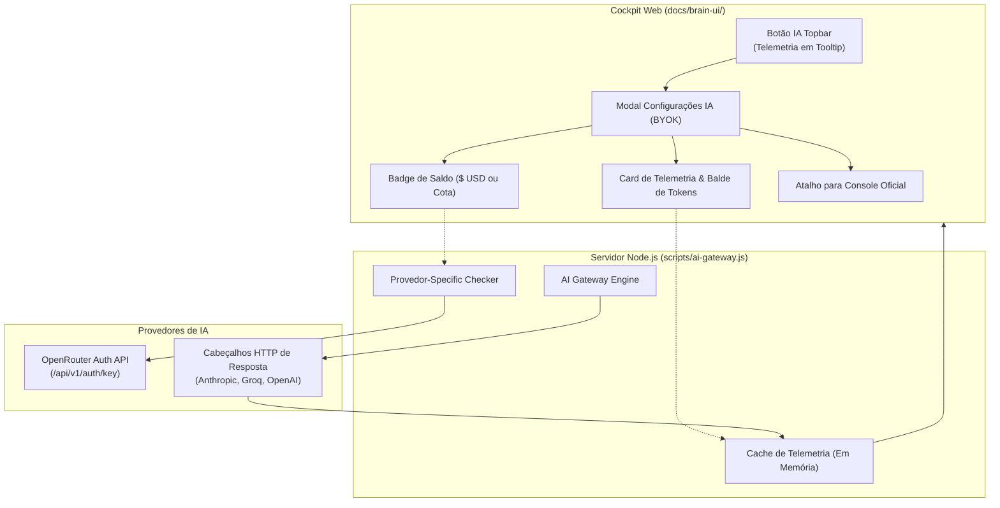

# Proposta: Telemetria de Créditos, Gestão de Cota (Rate Limits) e Monitoramento no Modal de IA (BYOK)

> **Status**: 🟡 Em Análise / Ideia Futura  
> **Data**: 2026-10-19  
> **Autor**: Alfredo & Antigravity  
> **Domínio**: AI Gateway • Cockpit Web • UX/UI • BYOK (Bring Your Own Key)  
> **Arquivo**: `docs/ideias-futuras/proposta-telemetria-e-gestao-de-creditos-ia.md`

---

## 1. Contexto & Motivação

Durante testes com múltiplos provedores de IA (Anthropic Claude, Google Gemini, Groq Cloud, OpenAI) em tarefas intensivas de arquitetura e pesquisa, observou-se uma necessidade comum a desenvolvedores que utilizam suas próprias chaves de API (**BYOK**):

1. **A incerteza sobre créditos disponíveis**: O usuário não sabe de antemão se sua conta de API ainda possui saldo financeiro em dólares ($) ou se a chave atingirá o limite de requisições no meio de um processo crítico (como a síntese de documentos ou sabatina Grill).
2. **A distinção entre Saldo Financeiro ($ USD) e Limite de Taxa (Rate Limits)**:
   - Uma chave pode ter $50,00 de crédito em saldo, mas bater no teto de 6.000 tokens por minuto (TPM), recebendo erro 429.
   - Ou uma chave pode ter limite generoso de taxa (100.000 TPM), mas estar sem saldo na conta ($0,00), recebendo erro 429 ou 402/400.
3. **Experiência Visual Proativa**: Em vez de alertar apenas *após o erro ocorrer* (o que já implementamos com o botão vermelho `.quota-exceeded` e o banner `#aiSettingsQuotaBanner`), o sistema pode apresentar **telemetria preditiva e saldo estimado** no próprio modal de IA.

---

## 2. Diagnóstico Técnico por Provedor de IA

Nem todas as APIs tratam saldo e consumo da mesma forma. A análise abaixo detalha a viabilidade técnica para cada provedor suportado no AI Second Brain:

| Provedor | Saldo Financeiro ($ USD) via API? | Cota de Taxa (Rate Limits / Headers)? | Como Obter / Endpoint Oficial |
|---|---|---|---|
| **OpenRouter** | ✅ **Sim, 100% nativo** | ✅ Sim | `GET https://openrouter.ai/api/v1/auth/key`<br/>Retorna `usage` ($ gastos) e `limit` ($ teto configurado). |
| **Anthropic (Claude)** | ⚠️ **Não em chaves comuns** | ✅ **Sim, detalhado em cada resposta HTTP** | **Billing**: Chaves `sk-ant-api*` têm apenas escopo de inferência.<br/>**Headers**: Retorna `anthropic-ratelimit-tokens-remaining`, `tokens-limit`, `requests-remaining`. |
| **OpenAI** | ⚠️ **Requer chave administrativa** | ✅ **Sim, detalhado em cada resposta HTTP** | **Billing**: Endpoint `/v1/organization/usage` exige chave de admin com escopo organizacional.<br/>**Headers**: `x-ratelimit-remaining-tokens`, `x-ratelimit-remaining-requests`. |
| **Google Gemini** | ❌ **Não via chave de inferência** | ⚠️ Parcial / Via Código de Erro | **AI Studio / GCP**: Informações de cota financeira residem no Google Cloud Console / Quotas.<br/>No plano gratuito: cota fixa conhecida de 15 RPM e 1M TPM para Gemini Flash. |
| **Groq Cloud** | ❌ **Não (Tier gratuito/beta)** | ✅ **Sim, detalhado em cada resposta HTTP** | **Headers**: `x-ratelimit-remaining-tokens`, `x-ratelimit-remaining-requests`, `x-ratelimit-reset-tokens`. |
| **Ollama (Local)** | ♾️ **Ilimitado (Gratuito)** | ♾️ **Ilimitado (Sem limite)** | 100% offline, executa no hardware local do desenvolvedor. Custo $0,00. |

---

## 3. Arquitetura da Solução Proposta



---

## 4. Três Pilares da Melhoria Proposta

### Pilar 1: Saldo Financeiro em Dólares ($ USD) no OpenRouter
Para o OpenRouter, podemos consultar automaticamente o endpoint oficial no momento em que o usuário clica em "Testar Conexão" ou abre o modal:
- **Requisição**: `GET https://openrouter.ai/api/v1/auth/key` com header `Authorization: Bearer <key>`.
- **Exibição**:
  - Saldo disponível: `Limit - Usage` (ex: `$8,58 restantes de $10,00`).
  - Barra de progresso percentual (ex: 85,8% disponível).

### Pilar 2: Medidor de "Balde de Capacidade" em Tempo Real (TPM / RPM)
Para Anthropic, OpenAI e Groq, capturamos e persistimos a telemetria do último request no `scripts/ai-gateway.js`:
- **Tokens/minuto restantes** vs **Limite total**.
- **Requisições/minuto restantes**.
- **Tempo de recarga** (Reset em X segundos).
- **Indicador Visual semafórico**:
  - 🟢 **Verde**: > 30% do balde disponível.
  - 🟡 **Amarelo**: Entre 15% e 30% disponível (alerta de desaceleração).
  - 🔴 **Vermelho**: < 15% ou cota esgotada (sugere troca temporária de provedor).

### Pilar 3: Acesso Direto em 1 Clique ao Faturamento Oficial
Como as APIs não permitem recarregar créditos ou consultar faturas confidenciais por questões de segurança, incluímos no modal um **botão de atalho direto para o portal oficial de faturamento** do provedor ativo:
- **Anthropic**: `https://console.anthropic.com/settings/billing`
- **OpenAI**: `https://platform.openai.com/usage`
- **Google AI Studio**: `https://aistudio.google.com/`
- **Groq Cloud**: `https://console.groq.com/settings/limits`
- **OpenRouter**: `https://openrouter.ai/credits`

---

## 5. Mockup Conceitual da Interface

### Opção A: Card de Monitoramento dentro do Modal BYOK (Passo 4)

```text
┌────────────────────────────────────────────────────────────────────────┐
│ ⚙️ Configurações de IA (AI Gateway • BYOK)                         ✕  │
├────────────────────────────────────────────────────────────────────────┤
│ Provedor Ativo: Anthropic Claude (claude-3-7-sonnet)                   │
├────────────────────────────────────────────────────────────────────────┤
│                                                                        │
│ 📊 TELEMETRIA & SAÚDE DO PROVEDOR (EM TEMPO REAL)                      │
│ ┌────────────────────────────────────────────────────────────────────┐ │
│ │ Capacidade de Tokens por Minuto (TPM)                              │ │
│ │ [██████████████████████████████░░░░] 82% disponíveis (32.800/40.000)│ │
│ │                                                                    │ │
│ │ Requisições por Minuto (RPM)                                       │ │
│ │ [██████████████████████████████████] 98% disponíveis (49/50 reqs)  │ │
│ │                                                                    │ │
│ │ ⚡ Última Latência: 412ms  •  🔄 Reset do balde em: 18s             │ │
│ │ 💳 Saldo Financeiro da Conta: Gerenciado via Console Oficial        │ │
│ │    [🔗 Acessar Console de Faturamento da Anthropic ↗]               │ │
│ └────────────────────────────────────────────────────────────────────┘ │
│                                                                        │
│ [Passo 1: Selecionar Provedor]                                         │
│ [Passo 2: Inserir API Key]                                             │
│ [Passo 3: Escolher Modelo]                                             │
│                                                                        │
├────────────────────────────────────────────────────────────────────────┤
│ [Testar Conexão]                             [Salvar e Ativar Modelo]  │
└────────────────────────────────────────────────────────────────────────┘
```

### Opção B: Caso Específico OpenRouter (Com Saldo Financeiro em Dólar)

```text
│ ┌────────────────────────────────────────────────────────────────────┐ │
│ │ 💎 SALDO DE CRÉDITOS OPENROUTER                                    │ │
│ │ Saldo Restante: $ 8.58 USD (de $ 10.00 limite configurado)         │ │
│ │ [████████████████████████████████░░] 85.8% de créditos disponíveis │ │
│ │                                                                    │ │
│ │ [🔗 Recarregar Créditos no OpenRouter ↗]                            │ │
│ └────────────────────────────────────────────────────────────────────┘ │
```

---

## 6. Pontos para Decisão Futura (Quando Retomarmos o Tema)

1. **Localização na Tela**:
   - Manter a barra de telemetria apenas dentro do modal de configurações?
   - Ou exibir uma mini-pílula compacta também na barra superior (topbar) ao lado do botão de IA?
2. **Escopo de Provedores na Fase 1**:
   - Iniciar com o OpenRouter (que entrega saldo financeiro em dólares)?
   - Ou implementar o leitor de cabeçalhos (TPM/RPM) para todos os provedores simultaneamente?
3. **Persistência de Histórico de Consumo**:
   - Manter os números apenas voláteis na memória da sessão atual?
   - Ou registrar o total de tokens gastos em um arquivo local (ex: `memory/ai-consumption.json`) para auditoria de custos de longo prazo?

---

> 📝 **Nota de Continuidade**: Este documento fica preservado como referência formal para quando formos implementar a evolução da telemetria de créditos de IA.
