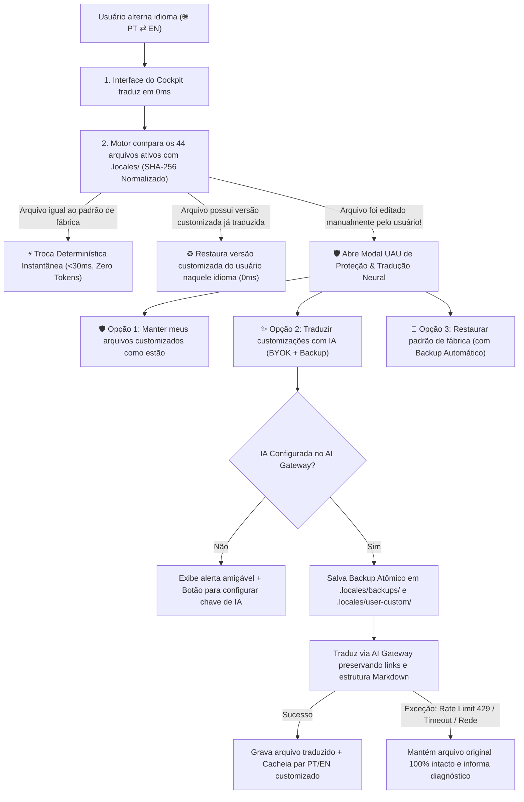

# 🧠 Decisão Arquitetural: Motor Bilíngue de Documentos com Cofre `.locales/` e Proteção Inteligente de Customizações

> **Status**: ✅ Aprovado e Implementado (v1.4.2)  
> **Data**: 2026-10-29  
> **Autores**: Alfredo (Idealizador & Arquitetura de Produto) & AI Second Brain Architecture Team  
> **Classificação**: Documento de Construção Interna / Debate de Engenharia (Mantido em `docs/internals/`)  
> **Registro Oficial Consolidado**: ADR-G013 em `decisions/GLOBAL_DECISIONS.md`  
> **Pilares Relacionados**: [01-ai-decision.md](../../.agents/rules/01-ai-decision.md) (JEV First: Código Determinístico antes de LLMs) · [04-documentation.md](../../.agents/rules/04-documentation.md)

---

## 1. Contexto e Problema

O **AI Second Brain** possui um conjunto de **44 documentos estruturais de governança** distribuídos em 9 categorias (`Rules`, `Skills`, `Agents`, `Knowledge`, `Decisions`, `Memory`, `Templates`, `Docs & Guides` e `System / Core`).

Quando um desenvolvedor baixa ou clona o projeto para utilizá-lo no dia a dia — seja em **Português (`PT`)** ou em **Inglês (`EN`)** — tanto a interface visual (**Cockpit** e **Landing Page**) quanto os **documentos Markdown lidos pelo humano e pelos Agentes de IA** (Antigravity, Cursor, Claude Code, Windsurf, Cline) precisam estar disponíveis no idioma desejado.

Contudo, uma abordagem ingênua causaria três problemas graves na arquitetura do projeto:
1. **Poluição do Grafo Neural 3D e da Barra Lateral**: Duplicar arquivos nas mesmas pastas (ex.: `00-core.md` e `00-core-en.md` dentro de `.agents/rules/`) dobraria o número de nós no Grafo 3D (de 44 para 88), duplicaria itens no menu lateral e poluiria os resultados semânticos do *Ask the Brain*.
2. **Quebra de Convenções de IDEs e Contratos Canônicos**: Agentes de IA exigem nomes estritos e imutáveis (`GEMINI.md`, `AGENTS.md`, `CLAUDE.md`, `.agents/skills/*/SKILL.md`). Além disso, o linter de integridade (`scripts/doctor.js`) valida dezenas de referências cruzadas baseadas nos caminhos canônicos.
3. **Risco de Perda de Customizações do Usuário**: Como o AI Second Brain é um sistema vivo, o desenvolvedor frequentemente edita regras (`.agents/rules/00-core.md`) ou registra aprendizados (`memory/lessons-learned.md`). Uma simples sobrescrita cega ao trocar de idioma apagaria o trabalho manual do usuário.

---

## 2. O Debate Arquitetural: Hipóteses Avaliadas

Durante a concepção desta funcionalidade, duas hipóteses principais foram propostas e debatidas:

### Hipótese 1: Repositórios ou Branches Separadas no Git por Idioma (Rejeitada)
- **Ideia analisada**: Permitir que o usuário, ao baixar o projeto no GitHub, escolhesse uma versão já predeterminada na língua desejada (via dois repositórios distintos ou duas branches `main-pt` e `main-en`).
- **Por que foi descartada**:
  - **Fragmentação de Comunidade e Métricas no GitHub**: Dois repositórios dividiriam as estrelas (*Stars*), *Forks*, *Issues* e *Pull Requests* em dois lugares diferentes, enfraquecendo a prova social do projeto open-source.
  - **Custo de Manutenção Exponencial (Drift de Código)**: Manter duas branches separadas exigiria *cherry-pick* ou *merge* manual a cada evolução no `server.js`, `app.js` ou nos scripts, gerando conflitos constantes de Git.
  - **Fricção no `git clone` Padrão**: Desenvolvedores costumam executar diretamente `git clone <url>`, baixando a branch principal sem procurar branches secundárias de idioma.

---

### Hipótese 2 (Escolhida): Cofre Oculto Bilíngue (`.locales/pt` e `.locales/en`) + Troca Determinística + Proteção de Customizações com Tradução Opcional via IA

- **Ideia concebida**:
  1. Criar uma pasta oculta na raiz do projeto (`.locales/pt/` e `.locales/en/`), invisível para o scanner do Grafo Neural 3D (`scan-vault.js` ignora pastas iniciadas por `.` exceto `.agents`), contendo os documentos oficiais de fábrica nas duas línguas com a mesma árvore de diretórios.
  2. Quando o usuário alterna o idioma (`PT ⇄ EN`), o sistema substitui os arquivos ativos na árvore principal pelos equivalentes da pasta `.locales/<idioma>/`.
  3. **Mecanismo de Proteção Inteligente**: Antes de substituir qualquer arquivo, o sistema verifica se o usuário modificou manualmente algum documento em relação ao padrão de fábrica.
  4. Caso detecte alterações manuais do usuário, o sistema **não sobrescreve** esses arquivos silenciosamente: ele exibe um **Modal de Proteção e Tradução** informando exatamente quais arquivos foram customizados e permitindo ao usuário escolher entre:
     - **Manter seus arquivos customizados intactos**;
     - **Traduzir seus arquivos customizados utilizando a IA conectada (AI Gateway / BYOK)**, verificando previamente se a IA está configurada e aplicando controles estritos de exceção e backup;
     - **Substituir pelo padrão de fábrica do novo idioma** (com backup automático prévio da versão customizada).

---

## 3. Fluxograma da Solução Implementada

---

## 4. Alinhamento com o AI Decision Gate (Filosofia *JEV First*)

Esta arquitetura é um caso de uso exemplar da regra fundamental [01-ai-decision.md](../../.agents/rules/01-ai-decision.md):

| Cenário | Camada Acionada | Custo de Tokens | Latência | Risco de Alucinação |
| :--- | :--- | :---: | :---: | :---: |
| **Troca dos 44 documentos originais de fábrica** | **Nível 1 — Código Determinístico** (`fs.copyFileSync` a partir de `.locales/pt` ou `.locales/en`) | **$0.00 (Zero)** | **< 30ms** | **0% (Zero)** |
| **Retorno a um idioma já traduzido anteriormente pelo usuário** | **Nível 1 — Cache Local Determinístico** (`.locales/user-custom/<lang>/`) | **$0.00 (Zero)** | **< 10ms** | **0% (Zero)** |
| **Tradução de documento inédito customizado pelo usuário** | **Nível 3/4 — SLM / LLM via AI Gateway** (somente sob autorização explícita no modal) | **Apenas os bytes dos arquivos editados** | **2s–6s com progresso SSE** | **Mitigado com validação de links e backup atômico** |

---

## 5. Controles de Segurança e Tratamento de Exceções

1. **Comparação Normalizada (`CRLF` vs `LF`)**:
   - O cálculo de hash SHA-256 normaliza quebras de linha (`\r\n` → `\n`) e espaços finais, garantindo que diferenças de sistema operacional (Windows vs Linux/macOS) ou configurações do Git (`core.autocrlf`) nunca gerem falsos positivos de arquivo modificado.
2. **Memória Bilíngue de Customizações (`.locales/user-custom/`)**:
   - Quando o usuário edita um arquivo em Português e pede para a IA traduzi-lo para Inglês, o sistema guarda a versão customizada em Português em `.locales/user-custom/pt/` e a versão traduzida em Inglês em `.locales/user-custom/en/`. Se o usuário voltar para Português depois, o sistema recupera a customização dele instantaneamente sem gastar tokens novamente.
3. **Backup Atômico Obrigatório (`.locales/backups/<timestamp>/`)**:
   - Nenhuma operação destrutiva (seja tradução por IA ou restauração de fábrica) ocorre sem antes gravar uma cópia integral do arquivo do usuário em `.locales/backups/`.
4. **Verificação Prévia de IA e Resiliência a Falhas (`429 Rate Limit`, `401 Auth`, `Timeout`)**:
   - Se o usuário escolher *"Traduzir com IA"* sem ter uma API Key ativa no `.env`, o modal bloqueia a chamada preventivamente e oferece atalho direto para o **Universal AI Gateway**.
   - Se ocorrer erro de cota (`HTTP 429`), queda de internet ou resposta incompleta durante a tradução de um arquivo, a escrita é abortada para aquele arquivo específico, preservando o conteúdo original intacto no disco.
5. **Compatibilidade Total com a Demo Online (GitHub Pages / Vercel)**:
   - Em ambientes estáticos sem servidor Node.js, o pacote `docs/brain-ui/vault-locales.js` fornece o espelho em memória dos 44 documentos, permitindo que visitantes online também leiam toda a documentação do Cérebro em Português ou Inglês.

---

## 6. 📊 Resumo das Ações Realizadas e Validação

### 6.1. Saneamento dos Documentos de Inicialização (Starter Framework)
- **Docs & Guias**: A pasta `docs/` foi consolidada com **exatamente os 6 guias oficiais voltados ao usuário da plataforma** (o menu lateral do Cockpit foi saneado de 19 para 6 itens limpos).
- **Isolamento de Documentos Internos**: Os 14 arquivos e pastas de construção interna, planos de sprint, relatórios de usabilidade e este registro de debate foram isolados em `docs/internals/` (com exclusão em `scan-vault.js` e `doctor.js`).
- **Memória Operacional Limpa**:
  - `memory/current-state.md`: Reduzido de 1.050 linhas para **30 linhas operacionais limpas** (versão v1.4.2, status dos subsistemas e tabela de papéis).
  - `memory/lessons-learned.md`: Estruturado com os **4 Princípios Dourados de Governança** e lições arquiteturais perenes (34 linhas).
  - **Histórico Preservado**: Mais de 1.000 linhas de transcrições de sessões anteriores foram arquivadas em `memory/sessions/2026-10-historical-sessions.md` e as lições de players de vídeo/CSS em `memory/archive/video-and-ui-lessons.md`.

### 6.2. Paridade Integral em Inglês (`.locales/en/` 100% Curado)
- **Eliminação de Resíduos**: Os 44 documentos do cofre `.locales/en/` possuem **conteúdo integral em inglês técnico fluente** (zero frases ou seções em português).
- **Módulos Curados Dedicados**: Criados em `scripts/locales-content/` (`en-core.js`, `en-guides.js`, `en-onboarding.js` e `en-decision-gate.js`) para garantir manutenção modular e zero perda de qualidade.

### 6.3. Censo de Arquivos Rigoroso (44 Arquivos Canônicos)
Tanto o diretório ativo quanto os cofres `.locales/pt/` e `.locales/en/` mantêm paridade exata de **44 arquivos**:

| Categoria no Cockpit | Qtd de Arquivos | Arquivos Incluídos |
|---|:---:|---|
| **Rules** | 5 | `00-core.md`, `01-ai-decision.md`, `02-aijev.md`, `03-security.md`, `04-documentation.md` |
| **Skills** | 9 | `ai-decision-gate`, `ai-integration`, `architecture-review`, `bug-investigation`, `database-review`, `grill-with-docs`, `new-feature`, `project-onboarding`, `session-memory` |
| **Knowledge** | 6 | `AIJEV.md`, `AI_GATEWAY.md`, `MODEL_SELECTION.md`, `PATTERNS.md`, `INDEX.md`, `OWASP.md` |
| **Decisions** | 1 | `GLOBAL_DECISIONS.md` (ADR-G001 a ADR-G013) |
| **Memory** | 3 | `README.md`, `current-state.md` (30 linhas), `lessons-learned.md` (34 linhas) |
| **Templates** | 6 | `ai-use-case.md`, `feature-spec.md`, `glossary.md`, `lessons-learned.md`, `project.md`, `session-memory.md` |
| **Docs & Guias** | 6 | `COMO_UTILIZAR_O_PROJETO.md`, `GUIA_PRATICO.md`, `GUIA_TECNICO_AI_DECISION_GATE_JEV.md`, `RESEARCH_LAB.md`, `SOLUCAO_AI_SECOND_BRAIN.md`, `VALOR_E_RELEVANCIA_DO_SEGUNDO_CEREBRO.md` |
| **Projects** | 1 | `projects/README.md` |
| **Core / Root** | 7 | `README.md`, `AGENTS.md`, `CLAUDE.md`, `GEMINI.md`, `CHANGELOG.md`, `CONTRIBUTING.md`, `CLA.md` |
| **Total** | **44** | **100% sincronizados em PT e EN** |

### 6.4. Testes de Validação e Integridade
1. **Teste de Troca Dinâmica (0ms)**:
   - Alternância `PT ➔ EN`: 44 arquivos trocados instantaneamente para suas versões em inglês.
   - Alternância `EN ➔ PT`: 44 arquivos restaurados instantaneamente para as versões canônicas em português.
   - **Zero customizações perdidas** e **zero falsos positivos**.
2. **Snapshot da Demo Pública**:
   - `sync-demo.js` gerou `vault-locales.js` com exatamente **44 chaves para PT** e **44 chaves para EN**.
3. **Linter de Integridade (`npm run doctor`)**:
   - 100% dos links e referências válidos, sem links quebrados.

