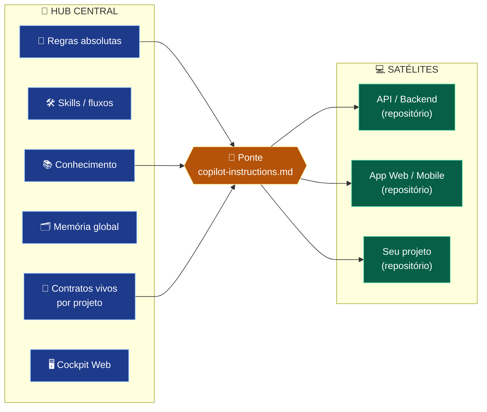
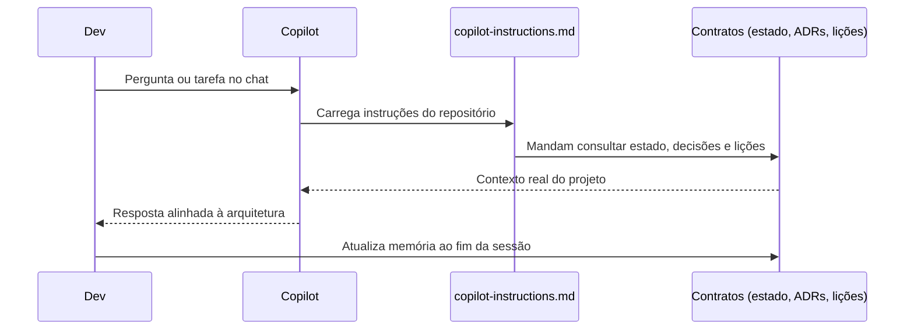
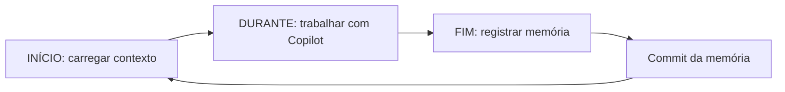

# Treinamento: AI Second Brain
## Memória Viva e Governança para Desenvolvimento com IA (GitHub Copilot)

| | |
|---|---|
| **Autor** | Alfredo R. Câmara |
| **Data** | 16/11/2026 |
| **Versão do documento** | 1.0 |
| **Versão da solução** | AI Second Brain 1.5.2 |
| **Público-alvo** | Desenvolvedores, tech leads e arquitetos |
| **Ferramenta de IA do cliente** | GitHub Copilot (VS Code / Visual Studio / JetBrains) |
| **Duração sugerida** | 3h (Parte I: 60 min · Parte II: 30 min · Parte III: 90 min) |
| **Repositório** | https://github.com/alfredorcamara/ai-second-brain |

---

## Sumário

**Parte I: Apresentação da Solução**
1. [Objetivos e resultado esperado](#1-objetivos-e-resultado-esperado)
2. [O problema](#2-o-problema)
3. [A solução em uma frase](#3-a-solução-em-uma-frase)
4. [Arquitetura: Hub Central e Repositórios Satélites](#4-arquitetura-hub-central-e-repositórios-satélites)
5. [Os contratos vivos (a memória)](#5-os-contratos-vivos-a-memória)
6. [Governança de IA: AI Decision Gate e AIJev](#6-governança-de-ia-ai-decision-gate-e-aijev)
7. [Como o GitHub Copilot consome a memória](#7-como-o-github-copilot-consome-a-memória)
8. [Cockpit Web e Research Lab](#8-cockpit-web-e-research-lab)

**Parte II: Guia do Desenvolvedor**
9. [Pré-requisitos e instalação](#9-pré-requisitos-e-instalação)
10. [Cenário A: projeto novo (greenfield)](#10-cenário-a-projeto-novo-greenfield)
11. [Cenário B: projeto existente (brownfield)](#11-cenário-b-projeto-existente-brownfield)
12. [Rotina diária: como manter a memória viva](#12-rotina-diária-como-manter-a-memória-viva)
13. [Referência rápida de comandos](#13-referência-rápida-de-comandos)

**Parte III: Laboratório Prático**
14. [Guia de caso de teste (hands-on)](#14-guia-de-caso-de-teste-hands-on)

**Anexos**
15. [Boas práticas e anti-padrões](#15-boas-práticas-e-anti-padrões)
16. [Solução de problemas (FAQ)](#16-solução-de-problemas-faq)
17. [Checklists](#17-checklists)
18. [Glossário](#18-glossário)

---

# PARTE I: APRESENTAÇÃO DA SOLUÇÃO

> **Roteiro do apresentador:** cada seção traz uma caixa "🎤 Fala sugerida" com a mensagem-chave e o tempo estimado.

## 1. Objetivos e resultado esperado

Ao final do treinamento, o participante será capaz de:

- [ ] Explicar o problema da "amnésia" de agentes de IA e como o AI Second Brain o resolve.
- [ ] Instalar e iniciar o Cockpit localmente.
- [ ] Criar um projeto novo com contratos de governança (greenfield).
- [ ] Acoplar um projeto já existente ao Second Brain (brownfield).
- [ ] Configurar o GitHub Copilot para ler a memória do projeto.
- [ ] Executar a rotina diária que mantém a memória atualizada.
- [ ] Usar o Research Lab para enriquecer a documentação.
- [ ] Validar a integridade da memória com `npm run doctor`.

## 2. O problema

> 🎤 **Fala sugerida (5 min):** "Quantas vezes você precisou explicar a mesma arquitetura para o Copilot em um novo chat?"

Desenvolver com assistentes de IA gera quatro dores recorrentes:

| Dor | Consequência no dia a dia |
|---|---|
| **Amnésia entre sessões** | Cada chat novo começa do zero; o dev reexplica o contexto. |
| **Prompts repetidos** | Perda de produtividade e respostas inconsistentes entre devs. |
| **Alucinação arquitetural** | A IA inventa bibliotecas, padrões e telas que não existem no projeto. |
| **Decisões perdidas** | O "porquê" das escolhas fica em chats efêmeros; ninguém sabe justificar depois. |

## 3. A solução em uma frase

> **O AI Second Brain transforma o conhecimento do projeto (regras, decisões, estado e lições) em arquivos Markdown versionados que o agente de IA lê no início de cada sessão, dando memória persistente e governança ao Copilot.**

Princípios:

- **100% Markdown**: legível por humanos, versionável no Git, auditável em revisão de código.
- **Agnóstico de ferramenta**: funciona com Copilot, Cursor, Claude Code, Antigravity, Windsurf e Cline (zero lock-in).
- **Zero fabricação**: a IA só afirma o que está documentado ou foi pedido.
- **Humano no controle**: nada é gravado automaticamente sem aprovação do desenvolvedor.
- **Zero dependências externas**: servidor em Node.js puro (sem `npm install` de pacotes).

## 4. Arquitetura: Hub Central e Repositórios Satélites

> 🎤 **Fala sugerida (10 min):** "O código fica no repositório do projeto. O conhecimento e a memória ficam no Hub. Os dois se conectam por uma ponte."



### Onde mora cada informação

| Tipo de dado | Local |
|---|---|
| Código executável, testes, CI/CD | Repositório do projeto |
| Visão e stack do projeto | `projects/<nome>/PROJECT.md` |
| Desenho técnico | `projects/<nome>/ARCHITECTURE.md` |
| **Estado atual e roadmap** | `projects/<nome>/CURRENT_STATE.md` |
| **Decisões (ADRs)** | `projects/<nome>/DECISIONS/` |
| **Lições aprendidas** | `projects/<nome>/LESSONS_LEARNED.md` |
| **Histórico de sessões** | `projects/<nome>/MEMORY/sessions/` |
| Pesquisas técnicas | `projects/<nome>/RESEARCH/` |
| Memória e lições globais | `memory/` |

### Estrutura do Hub

```
AI_SECOND_BRAIN/
├── start-brain.bat · server.js     ← inicia o Cockpit web
├── AGENTS.md · GEMINI.md · CLAUDE.md · .cursorrules · .windsurfrules · .clinerules
├── .github/copilot-instructions.md ← ponte para o GitHub Copilot
├── .agents/rules · skills          ← governança ativa
├── knowledge/                      ← base de conhecimento perene
├── projects/<seu-projeto>/         ← contratos vivos de cada projeto
├── memory/ · decisions/            ← memória e decisões globais
├── templates/ · scripts/ · docs/
```

## 5. Os contratos vivos (a memória)

> 🎤 **Fala sugerida (10 min):** "Estes cinco itens são a memória do projeto. Se eles estiverem atualizados, qualquer dev e qualquer IA começam a sessão sabendo onde o projeto está."

| Contrato | Responde à pergunta | Quando atualizar |
|---|---|---|
| `PROJECT.md` | O que é o projeto e qual a stack oficial? | Mudança de escopo ou stack |
| `ARCHITECTURE.md` | Como está desenhado? | Mudança de componentes, dados ou integrações |
| `CURRENT_STATE.md` | Onde estamos e o que vem agora? | **Ao fim de toda sessão relevante** |
| `DECISIONS/ADR-NNNN-*.md` | Por que escolhemos X e não Y? | A cada decisão técnica relevante |
| `LESSONS_LEARNED.md` | Que erros não podemos repetir? | Ao resolver bug ou incidente instrutivo |

> [!IMPORTANT]
> **Regra de ouro:** decisão tomada e não registrada é decisão perdida. ADRs são imutáveis: para mudar uma decisão, crie um novo ADR que substitui o anterior.

## 6. Governança de IA: AI Decision Gate e AIJev

> 🎤 **Fala sugerida (5 min):** "Nem tudo precisa de IA. Se uma regra determinística resolve, ela é mais rápida, barata e previsível."

- **AI Decision Gate**: antes de usar um LLM, avalia-se se o problema se resolve com código determinístico. A IA fica restrita ao que exige linguagem natural, como redação e síntese.
- **AIJev (Judge / Evaluate / Validate)**: validação das saídas da IA antes de aceitá-las.
- **Regras absolutas** (`.agents/rules/`): `00-core`, `01-ai-decision`, `02-aijev`, `03-security`, `04-documentation`.
- **Segurança**: o Session Capture nunca envia o conteúdo (patch) dos arquivos à IA, apenas mensagens de commit, nomes de arquivos e diffstat. Nomes de arquivos sensíveis (`.env`, tokens) são omitidos.

### Skills disponíveis (fluxos sob demanda)

| Skill | Uso |
|---|---|
| `project-onboarding` | Acoplar/entender um projeto |
| `session-memory` | Carregar e registrar memória de sessão |
| `new-feature` | Planejar nova funcionalidade |
| `bug-investigation` | Investigar defeitos |
| `architecture-review` · `database-review` | Revisões técnicas |
| `ai-decision-gate` · `ai-integration` | Decidir e integrar IA |
| `grill-with-docs` | Sabatina técnica com base na documentação |

## 7. Como o GitHub Copilot consome a memória

> 🎤 **Fala sugerida (10 min):** "O Copilot lê o arquivo `.github/copilot-instructions.md` do repositório automaticamente. É por ele que injetamos a memória."

O Copilot aplica instruções de repositório a partir de `.github/copilot-instructions.md` (e instruções adicionais em `.github/instructions/`). A solução usa esse mecanismo como **ponte**: o arquivo manda o Copilot consultar os contratos antes de agir.



> [!IMPORTANT]
> **Padronização Universal e Fonte Única de Verdade (SSOT)**:
> No AI Second Brain, **todas as 7 pontes** são geradas por um único motor (`scripts/bridge-templates.js`) e compartilham rigorosamente a **mesma estrutura e corpo de regras**, variando apenas o título da ferramenta.
> Por design, a ponte atua **estritamente como Roteador e Constituição de Regras (estática)**: ela **não** armazena cópia da stack nem do estado do projeto para evitar desatualização (*drift*) e o efeito "atalho preguiçoso" na IA — obrigando o agente a ler os contratos reais (`PROJECT.md`, `ARCHITECTURE.md`, `CURRENT_STATE.md`, `DECISIONS/` e `LESSONS_LEARNED.md`).

### Qual arquivo cada ferramenta lê automaticamente?

| Ferramenta / IDE | Arquivo de Ponte Nativo | Comportamento quando existem várias pontes |
|---|---|---|
| **GitHub Copilot** (Chat / Edits / Agent) | `.github/copilot-instructions.md` | Lê `.github/copilot-instructions.md` (e, no modo Agent, também pode ler `AGENTS.md`). |
| **Cursor AI** | `.cursorrules` | Lê `.cursorrules` e também suporta `AGENTS.md` de forma complementar. |
| **Claude Code** | `CLAUDE.md` | Lê `CLAUDE.md` e ignora os arquivos das demais IDEs. |
| **Google Antigravity** | `GEMINI.md` | Lê `GEMINI.md` (e `.agents/rules/`) e ignora os demais. |
| **Windsurf (Cascade)** | `.windsurfrules` | Lê `.windsurfrules` e ignora os demais. |
| **Cline / Roo Code** | `.clinerules` | Lê `.clinerules` (ou `AGENTS.md` como fallback). |
| **Padrão Aberto Universal** (Codex, Aider, Zed...) | `AGENTS.md` | Convenção universal para agentes que não possuem arquivo proprietário. |

### Gestão das Pontes no Cockpit Web
Na seção **🔌 Pontes de IA para IDEs** de qualquer projeto no Cockpit, o desenvolvedor tem controle total sem precisar abrir o Explorer:
- **Criar individualmente (`+`)**: clique em qualquer chip pendente (ex.: `+ 🐙 copilot-instructions.md`) para gerar apenas a ponte daquela ferramenta.
- **Visualizar / Editar**: clique sobre o chip ativo (`✓`) ou nos botões `👁️ Ver` / `✏️ Editar` na lista de Contratos de Governança (que abre diretamente no Editor Integrado).
- **Excluir individualmente (`×` ou `🗑️ Excluir`)**: remova qualquer ponte que o time não utilize (os contratos principais permanecem protegidos e não podem ser excluídos acidentalmente).
- **Ações em lote (`🌐 Todas as IDEs` / `🗑️ Limpar Todas`)**: gere todas as 7 pontes de uma vez para times mistos ou limpe todas em 1 clique para ativar somente a ponte padronizada pela empresa (ex.: apenas GitHub Copilot).
- **Prefixo dos caminhos (`📁 Prefixo dos caminhos nas pontes`)**: permite ajustar o caminho escrito antes dos contratos (vazio = `projects/<nome>/` para uso no Hub; ou ex.: `docs/second-brain/` / `./` para uso direto no repositório satélite).

## 8. Cockpit Web e Research Lab

**Cockpit (portal web local, porta padrão 3333):**

- Grafo Neural 3D de regras, skills, decisões e projetos.
- Omnisearch (`/`) e **Pergunte ao Cérebro** (`Ctrl+K`), com citação de ADRs e lições.
- **Quickstart Studio**: criação de projeto (modo Express ou Assistido com IA, com sabatina técnica).
- **Session Capture**: gera rascunho de memória a partir dos commits reais do Git; você aprova a gravação.
- **Prompt Bootstrap**: texto pronto para iniciar um chat do Copilot já contextualizado.
- AI Gateway BYOK: Google Gemini, OpenAI, Anthropic, Groq, OpenRouter e Ollama (local/offline). A chave fica no `.env` da sua máquina.

**Research Lab (aba "Research Lab" do projeto):**

Enriquece a documentação com pesquisas técnicas autônomas, em duas camadas:

| Camada | Pasta | Conteúdo |
|---|---|---|
| Conhecimento | `RESEARCH/<tema>/knowledge/` | Conceitos, estado da arte, referências |
| Acionável | `RESEARCH/<tema>/actionable/` | Como aplicar na stack real: especificações, schemas, regras |

- **Prompt Vivo**: a definição da pesquisa pode ser reescrita e melhorada com IA; cada versão fica em `definitionHistory` (`_meta.json`).
- O motor decompõe o tema em subtópicos, sintetiza artigos `.md`, retoma de onde parou e consolida tudo em `OVERVIEW.md`.

---

# PARTE II: GUIA DO DESENVOLVEDOR

## 9. Pré-requisitos e instalação

| Item | Requisito |
|---|---|
| Node.js | 18 ou superior (validado com v22) |
| Git | Instalado e no `PATH` |
| IDE | VS Code com extensão **GitHub Copilot** e **Copilot Chat** |
| Chave de IA | Opcional, para recursos assistidos (Groq, Gemini, OpenAI, etc.) |

**Instalação:**

```powershell
# 1. Clonar o Hub
git clone https://github.com/alfredorcamara/ai-second-brain.git
cd ai-second-brain

# 2. Configurar variáveis de ambiente
copy .env.example .env          # Windows
# cp .env.example .env          # Linux/Mac

# 3. Validar a instalação
npm run doctor

# 4. Iniciar o Cockpit
npm start                       # ou start-brain.bat no Windows
```

Abra o endereço exibido no terminal (padrão `http://localhost:3333`; se a porta estiver ocupada, o servidor escolhe a próxima).

> [!CAUTION]
> O arquivo `.env` guarda chaves de API e **nunca** deve ser versionado (já está no `.gitignore`). Nunca compartilhe a chave em tela durante a apresentação.

**Idioma:** `npm run lang:pt` · `npm run lang:en` · `npm run lang:auto`.

## 10. Cenário A: projeto novo (greenfield)

### 10.1 Criar o projeto no Hub

**Opção 1: Terminal (rápido e determinístico)**

```powershell
npm run project:new meu-projeto "API"
```

**Opção 2: Cockpit (recomendado para ideias novas)**: botão **`+ Novo Projeto`**:

- **Modo Express**: cria contratos limpos instantaneamente.
- **Modo Assistido (Grill Studio)**: a IA faz 3 a 4 perguntas técnicas, audita as respostas, sintetiza `PROJECT.md`, `ARCHITECTURE.md`, `CURRENT_STATE.md` e `ADR-0001`. **Nada é gravado até clicar em "Aprovar e Criar Projeto no Disco".**

Resultado em `projects/meu-projeto/`:

```
PROJECT.md · ARCHITECTURE.md · CURRENT_STATE.md · LESSONS_LEARNED.md
DECISIONS/  ·  MEMORY/sessions/
.github/copilot-instructions.md · .cursorrules · CLAUDE.md · GEMINI.md · .windsurfrules · .clinerules · AGENTS.md
```

### 10.2 Revisar e complementar os contratos

Abra `PROJECT.md` e `ARCHITECTURE.md`, ajuste a stack e as regras de negócio e confirme que `CURRENT_STATE.md` reflete o primeiro marco. Faça commit da pasta do projeto.

### 10.3 Criar o repositório de código

```powershell
mkdir C:\Projetos\meu-projeto
cd C:\Projetos\meu-projeto
git init
```

### 10.4 Configurar a ponte do Copilot no repositório de código

A ponte `.github/copilot-instructions.md` já é criada automaticamente em `projects/meu-projeto/.github/copilot-instructions.md`. Para utilizá-la no repositório satélite de código:

1. **No Cockpit (recomendado para times que só usam Copilot)**:
   - Se quiser manter apenas a ponte do Copilot no projeto, clique em **`🗑️ Limpar Todas`**.
   - No campo **`📁 Prefixo dos caminhos nas pontes`**, informe `docs/second-brain/` (ou `./` se os contratos ficarem na raiz).
   - Clique no chip **`+ 🐙 copilot-instructions.md`** para gerar a ponte com os caminhos já ajustados e copie-a para `.github/copilot-instructions.md` do repositório de código.
2. **Formato padronizado oficial gerado**:

```markdown
# Instruções para GitHub Copilot — meu-projeto

> Projeto governado pelo **AI Second Brain**. Estas regras valem para TODA resposta e TODA alteração de código neste repositório.
> **Fonte Única de Verdade (SSOT):** Esta ponte define apenas o roteamento e as regras inegociáveis. Ela **não** armazena estado nem stack para evitar desatualização. É obrigatório ler os contratos abaixo antes de agir.

## 1. Contratos de Leitura Obrigatória (nesta ordem)
1. `docs/second-brain/PROJECT.md` — visão do produto, stack oficial e regras de negócio
2. `docs/second-brain/ARCHITECTURE.md` — desenho de componentes, fluxos de dados e padrões
3. `docs/second-brain/CURRENT_STATE.md` — estado atual, o que está pronto, em andamento e bloqueado
4. `docs/second-brain/DECISIONS/` — decisões arquiteturais imutáveis (ADRs) vigentes
5. `docs/second-brain/LESSONS_LEARNED.md` — erros e incidentes que não podem ser repetidos

## 2. Regras Absolutas de Governança
- **Bloqueio de leitura:** NUNCA assuma a stack, proponha código ou altere a arquitetura sem antes ler `docs/second-brain/PROJECT.md`, `docs/second-brain/ARCHITECTURE.md` e `docs/second-brain/CURRENT_STATE.md`.
- **Zero fabricação:** NUNCA invente bibliotecas, telas, endpoints, tabelas ou regras de negócio que não estejam nos contratos ou no pedido explícito do desenvolvedor.
- **Transparência sobre lacunas:** Se uma informação não estiver documentada nos contratos, diga explicitamente: *"não consta nos contratos"* e pergunte antes de assumir.
- **Proteção de stack e arquitetura:** NUNCA proponha tecnologia fora da stack oficial nem altere a arquitetura sem antes sugerir o registro de um novo ADR em `docs/second-brain/DECISIONS/`.
- **Código determinístico primeiro (AI Decision Gate):** Prefira regras e código determinístico a chamadas de IA/LLM quando uma solução direta resolver.
- **Segurança:** NUNCA grave segredos, chaves de API, tokens ou senhas em código, logs ou documentação.
- **Catálogos dinâmicos:** NUNCA crie listas fixas (hardcoded) de modelos de IA; catálogos de modelos devem ser obtidos dinamicamente via API.

## 3. Ciclo de Atualização da Memória (ao concluir uma tarefa)
1. Proponha a atualização de `docs/second-brain/CURRENT_STATE.md` (itens concluídos, próximos passos e bloqueios).
2. Se houve decisão técnica ou escolha de biblioteca/padrão, proponha um novo ADR em `docs/second-brain/DECISIONS/`.
3. Se foi corrigido um bug ou incidente relevante, proponha o registro em `docs/second-brain/LESSONS_LEARNED.md`.
4. **Humano no controle:** Nunca grave alterações nos contratos sem a confirmação do desenvolvedor.

## 4. Verificação de Aderência
Se o desenvolvedor perguntar *"o que dizem suas instruções do projeto?"*, leia os contratos da Seção 1 e responda citando o nome do projeto, a stack oficial lida de `docs/second-brain/PROJECT.md`, o status atual lido de `docs/second-brain/CURRENT_STATE.md` e as regras das Seções 2 e 3.
```

> [!TIP]
> Opção recomendada para o Copilot enxergar a memória: copie (ou aponte por junção) a pasta `projects/meu-projeto/` para `docs/second-brain/` dentro do repositório de código. Assim a memória é versionada junto com o código e acessível a todo o time. Defina a estratégia (pasta no repositório ou Hub compartilhado) com o time antes do rollout.

### 10.5 Primeira sessão com o Copilot

Abra o repositório no VS Code e, no Copilot Chat, use o prompt:

```text
Leia .github/copilot-instructions.md e os contratos em docs/second-brain.
Resuma o projeto, a stack, o estado atual e as decisões vigentes.
Aponte lacunas na documentação antes de começarmos.
```

## 11. Cenário B: projeto existente (brownfield)

### 11.1 Vincular o projeto ao Hub (sem duplicar arquivos)

```powershell
npm run project:link meu-sistema "C:\Projetos\MeuSistema"
```

O comando:

- cria uma **junção NTFS** (Windows, sem privilégio de administrador) ou symlink (Linux/Mac) em `projects/meu-sistema` apontando para a pasta real;
- cria os arquivos contratuais iniciais que estiverem faltando (`PROJECT.md`, `CURRENT_STATE.md`, `LESSONS_LEARNED.md`);
- cria as pontes `AGENTS.md`, `GEMINI.md`, `.cursorrules` e `CLAUDE.md`, **sem sobrescrever** arquivos existentes.

### 11.2 Levantar o contexto (onboarding)

Faça o "retrato" do projeto existente. No Copilot Chat:

```text
Analise este repositório (estrutura, stack, módulos, banco, integrações, testes e deploy).
Preencha o rascunho de PROJECT.md e ARCHITECTURE.md com base SOMENTE no que existe no código.
Liste o que você não conseguiu confirmar como "A CONFIRMAR". Não invente nada.
```

Revise o resultado com um dev que conheça o sistema e grave nos contratos.

### 11.3 Registrar o passado relevante

| Ação | Onde |
|---|---|
| Decisões importantes já tomadas (ex.: "usamos PostgreSQL") | `DECISIONS/ADR-0001..` marcadas como "decisão histórica" |
| Dívidas técnicas e problemas conhecidos | `CURRENT_STATE.md` (seção de bloqueios/riscos) |
| Incidentes passados e correções | `LESSONS_LEARNED.md` |
| Roadmap em andamento | `CURRENT_STATE.md` |

### 11.4 Criar a ponte do Copilot

Repita o passo **10.4** no repositório existente (`.github/copilot-instructions.md`) e valide com o prompt do passo 10.5.

### 11.5 Validar

```powershell
npm run doctor
```

### 11.6 Enriquecer com o Research Lab

Abra o projeto no Cockpit → aba **Research Lab** → crie pesquisas para os temas críticos do sistema (ex.: "estratégia de cache", "modelo de autenticação"). Revise e mantenha os artigos relevantes.

## 12. Rotina diária: como manter a memória viva

Este é o coração do treinamento. A memória só vale se for atualizada. O ciclo tem três momentos:



### 12.1 Início da sessão (2 min)

1. `git pull` (traz a memória atualizada do time).
2. Abra o Cockpit (`npm start`) se quiser usar o Prompt Bootstrap, ou apenas abra o repositório no VS Code.
3. Prompt de abertura no Copilot Chat:

```text
Leia CURRENT_STATE.md, as últimas sessões em MEMORY/sessions e LESSONS_LEARNED.md.
Diga em 5 linhas onde paramos, o que está bloqueado e qual é a próxima tarefa.
```

### 12.2 Durante o trabalho: gatilhos de registro

| Aconteceu... | Registre em... |
|---|---|
| Escolheu tecnologia, padrão ou abordagem | Novo **ADR** em `DECISIONS/` |
| Resolveu bug difícil ou incidente | `LESSONS_LEARNED.md` |
| Concluiu ou bloqueou uma tarefa | `CURRENT_STATE.md` |
| Mudou componente, tabela ou integração | `ARCHITECTURE.md` |
| Mudou escopo ou stack | `PROJECT.md` |

Prompt para criar um ADR:

```text
Crie um ADR em DECISIONS/ no próximo número sequencial com: Contexto, Decisão,
Alternativas consideradas, Consequências e Status. Decisão: <descreva>.
```

### 12.3 Fim da sessão (3 min)

**Opção A: Session Capture no Cockpit (recomendado)**

1. Faça os commits do dia no repositório de código.
2. No Cockpit, abra o projeto e use **Session Capture**.
3. A ferramenta lê os commits reais do Git (sem enviar o conteúdo dos arquivos) e gera um **rascunho** de sessão, atualização do `CURRENT_STATE.md`, lições e ADRs sugeridos.
4. Revise, edite e **aprove**. Só então a gravação é feita.

**Opção B: Manual com o Copilot**

```text
Encerrando a sessão. Com base no que fizemos hoje:
1. Crie MEMORY/sessions/AAAA-MM-DD-descricao.md (contexto, o que foi feito, decisões, problemas, próximos passos).
2. Proponha o texto atualizado do CURRENT_STATE.md.
3. Liste lições aprendidas e ADRs que devem ser registrados.
Não grave nada que eu não tenha confirmado.
```

### 12.4 Fechamento

```powershell
npm run doctor          # valida links, contratos e ADRs
git add .
git commit -m "docs(memory): sessão AAAA-MM-DD - resumo curto"
git push
```

### 12.5 Cadência recomendada

| Frequência | Ação |
|---|---|
| **Toda sessão** | Atualizar `CURRENT_STATE.md` + registro em `MEMORY/sessions/` |
| **Toda decisão técnica** | ADR |
| **Toda lição relevante** | `LESSONS_LEARNED.md` |
| **Semanal** | Revisar `ARCHITECTURE.md`; rodar `npm run doctor`; limpar itens obsoletos |
| **A cada release/sprint** | Revisar `PROJECT.md` e o roadmap |
| **Na revisão de PR** | Checklist: "a memória foi atualizada?" (ver seção 17) |

## 13. Referência rápida de comandos

| Comando | Para que serve |
|---|---|
| `npm start` / `start-brain.bat` | Inicia o Cockpit web |
| `npm run project:new <nome> [tipo]` | Cria projeto novo com contratos (greenfield) |
| `npm run project:link <nome> <caminho>` | Acopla projeto existente (brownfield) |
| `npm run doctor` (ou `check`) | Valida links, contratos, ADRs e scripts |
| `npm run scan` | Re-varre o cofre e atualiza o grafo |
| `npm run lang:pt` / `lang:en` / `lang:auto` | Define o idioma |
| `npm run version:sync` | Sincroniza a versão nas interfaces |
| `git pull` / `git push` | Compartilha a memória com o time |

**Atalhos do Cockpit:** `/` busca · `Ctrl+K` Pergunte ao Cérebro.

---

# PARTE III: LABORATÓRIO PRÁTICO

## 14. Guia de caso de teste (hands-on)

**Cenário:** o time vai criar o projeto fictício **"Gestão de Pedidos"** (API de pedidos com Node.js e PostgreSQL), usar o Copilot com memória e enriquecer a documentação com o Research Lab.

**Duração:** ~90 min · **Formato:** cada participante no próprio computador.

### Resumo das etapas

| # | Etapa | Tempo | Resultado esperado |
|---|---|---|---|
| 1 | Clonar e subir o Hub | 10 min | Cockpit aberto no navegador |
| 2 | Criar o projeto | 15 min | Pasta `projects/gestao-pedidos` com contratos |
| 3 | Revisar contratos | 10 min | Contratos ajustados |
| 4 | Repositório + ponte do Copilot | 15 min | `.github/copilot-instructions.md` ativo |
| 5 | Sessão com Copilot | 15 min | Copilot responde com base na memória |
| 6 | Registrar memória (fim de sessão) | 10 min | Sessão, ADR e estado atualizados |
| 7 | Enriquecer com Research Lab | 15 min | Pesquisa gerada em `RESEARCH/` |
| 8 | Validar com `doctor` | 5 min | Zero erros |

### Etapa 1: Clonar e subir o Hub

```powershell
git clone https://github.com/alfredorcamara/ai-second-brain.git
cd ai-second-brain
copy .env.example .env
npm run doctor
npm start
```

✅ **Critério de aceite:** o Cockpit abre no navegador e o `doctor` não reporta erros.

### Etapa 2: Criar o projeto

Escolha **uma** das opções:

```powershell
# Opção A: rápida
npm run project:new gestao-pedidos API
```

Ou **Opção B (Assistida)**, no Cockpit: `+ Novo Projeto` → nome `gestao-pedidos` → **Modo Assistido** → descreva:
*"API REST para gestão de pedidos de e-commerce, com Node.js, PostgreSQL, autenticação JWT e integração com gateway de pagamento."* → responda à sabatina → revise os 4 cards → **Aprovar e Criar Projeto no Disco**.

✅ **Critério de aceite:** existe `projects/gestao-pedidos/` com `PROJECT.md`, `ARCHITECTURE.md`, `CURRENT_STATE.md`, `LESSONS_LEARNED.md` e `DECISIONS/`.

> 💡 **Ponto para discussão:** compare o resultado dos modos Express e Assistido (profundidade de `ARCHITECTURE.md` e `ADR-0001`).

### Etapa 3: Revisar contratos

Abra `PROJECT.md`, `ARCHITECTURE.md` e `CURRENT_STATE.md`. Corrija o que estiver impreciso e defina o **primeiro marco** em `CURRENT_STATE.md`: "CRUD de pedidos com autenticação".

✅ **Critério de aceite:** stack e marco inicial coerentes com o cenário.

### Etapa 4: Repositório e ponte do Copilot

1. No Cockpit, dentro do projeto `gestao-pedidos`, demonstre a gestão de pontes:
   - Clique em **`🗑️ Limpar Todas`** para remover as pontes de outras IDEs que a empresa não utiliza.
   - No campo **`📁 Prefixo dos caminhos nas pontes`**, digite `docs/second-brain/`.
   - Clique no chip **`+ 🐙 copilot-instructions.md`** para gerar exclusivamente a ponte do GitHub Copilot já apontando para `docs/second-brain/`.
2. No terminal, crie o repositório satélite e copie os contratos e a ponte gerada:

```powershell
mkdir ..\gestao-pedidos-api
cd ..\gestao-pedidos-api
git init
mkdir .github
mkdir docs\second-brain
xcopy "..\ai-second-brain\projects\gestao-pedidos" "docs\second-brain" /E /I /Y
copy "..\ai-second-brain\projects\gestao-pedidos\.github\copilot-instructions.md" ".github\copilot-instructions.md" /Y
code .
```

✅ **Critério de aceite:** `.github/copilot-instructions.md` existe no repositório satélite e a pasta `docs/second-brain` contém os contratos.

### Etapa 5: Sessão com o Copilot

No Copilot Chat (modo Ask ou Agent), execute em sequência:

**Prompt 1: contexto**
```text
Leia .github/copilot-instructions.md e docs/second-brain. Resuma o projeto, a stack,
o estado atual e as decisões vigentes.
```

**Prompt 2: teste de aderência à arquitetura**
```text
Quero criar o endpoint POST /pedidos. Proponha a estrutura de pastas e o fluxo
respeitando a arquitetura e os ADRs documentados.
```

**Prompt 3: teste anti-alucinação**
```text
Adicione cache com Redis ao projeto.
```
👉 **Comportamento esperado:** como Redis não está nos contratos, o Copilot deve apontar que a tecnologia não consta na stack e sugerir registrar um ADR antes de implementar.

✅ **Critério de aceite:** as respostas citam stack e decisões do projeto (e não genéricas).

### Etapa 6: Registrar memória (fim de sessão)

1. Faça um commit de exemplo no repositório de código:
   ```powershell
   git add .
   git commit -m "feat: estrutura inicial da API de pedidos"
   ```
2. **Opção A:** no Cockpit, use **Session Capture** no projeto `gestao-pedidos`, revise o rascunho e aprove.
   **Opção B:** use o prompt manual da seção 12.3.
3. Registre um ADR: *"Adoção de cache Redis para consulta de catálogo"* (status: Proposto).
4. Sincronize de volta a pasta de memória (`docs/second-brain` ↔ Hub) conforme a estratégia definida com o time.

✅ **Critério de aceite:** existe um arquivo em `MEMORY/sessions/`, o `CURRENT_STATE.md` mudou e há um novo ADR.

### Etapa 7: Enriquecer a documentação com o Research Lab

1. No Cockpit, abra o projeto `gestao-pedidos` → aba **Research Lab** → **Nova pesquisa**.
2. Tema sugerido: *"Estratégia de cache com Redis para catálogo em API de e-commerce Node.js"*.
3. Use **✨ Melhorar com IA** para refinar o Prompt Vivo e aceite a versão melhorada.
4. Confira a decomposição em subtópicos (`knowledge` e `actionable`) e execute a pesquisa.
5. Acompanhe a geração e abra `RESEARCH/<tema>/OVERVIEW.md`.
6. **Revisão humana:** avalie os artigos `actionable/`, aproveite o que for útil e atualize `ARCHITECTURE.md` e o ADR de cache (Proposto → Aceito ou Rejeitado).
7. Reexecute o Prompt do passo 5 (Redis) e observe a mudança no comportamento do Copilot.

> [!NOTE]
> Esta etapa exige um provedor de IA configurado (chave no `.env` ou Ollama local). O conteúdo gerado por IA deve sempre ser **revisado por um humano** antes de virar decisão.

✅ **Critério de aceite:** pesquisa concluída, `OVERVIEW.md` gerado e ADR atualizado com base nela.

### Etapa 8: Validar

```powershell
cd ..\ai-second-brain
npm run doctor
```

✅ **Critério de aceite:** sem links quebrados e sem erros de contratos.

### Variante do laboratório: projeto existente (brownfield)

Para quem quiser praticar o cenário B, use qualquer repositório local:

```powershell
npm run project:link meu-legado "C:\Projetos\MeuLegado"
```

Depois execute os passos 11.2 a 11.6.

### Avaliação final do laboratório

| Pergunta | OK? |
|---|---|
| O Copilot respondeu citando a stack e os ADRs do projeto? | ☐ |
| O pedido de tecnologia fora da stack foi sinalizado? | ☐ |
| A sessão foi registrada e o `CURRENT_STATE.md` atualizado? | ☐ |
| Há um ADR novo, com status coerente? | ☐ |
| A pesquisa gerou conteúdo acionável revisado por humano? | ☐ |
| O `npm run doctor` passou? | ☐ |

---

# ANEXOS

## 15. Boas práticas e anti-padrões

| ✅ Faça | ❌ Evite |
|---|---|
| Atualizar a memória **toda sessão** | Deixar para "depois" |
| Escrever ADRs curtos e objetivos | ADRs longos que ninguém lê |
| Revisar todo conteúdo gerado por IA | Aceitar sem leitura |
| Versionar a memória no Git e revisar em PR | Memória só na máquina de um dev |
| Registrar o *porquê* das decisões | Registrar só o *quê* |
| Manter o `.env` fora do Git | Commitar chaves ou colar segredos nos contratos |
| Usar `doctor` com frequência | Deixar links e contratos quebrarem |
| Pedir à IA "A CONFIRMAR" quando faltar dado | Deixar a IA preencher lacunas por suposição |

## 16. Solução de problemas (FAQ)

| Sintoma | Causa provável | Solução |
|---|---|---|
| Porta 3333 ocupada | Outro processo | O servidor usa a próxima porta; ou defina `PORT=4000` |
| `npm run doctor` aponta link quebrado | Arquivo movido/renomeado | Corrija o caminho indicado no relatório |
| Recursos de IA indisponíveis | Sem chave no `.env` | Configure o provedor no `.env` ou pelo Cockpit; ou use Ollama |
| Copilot ignora a memória | Ponte ausente ou contratos fora do workspace | Confirme `.github/copilot-instructions.md`; mantenha contratos no workspace; use o Prompt Bootstrap |
| Copilot não aplica as instruções | Recurso desativado | Verifique nas configurações do Copilot/organização o uso de instruções de repositório |
| `project:link` falha | Caminho inexistente ou junção já existe | Confira o caminho; remova a junção antiga em `projects/` |
| Memória divergente entre devs | Falta de `git pull` | Adote o ritual de início de sessão (seção 12.1) |
| Caracteres estranhos no terminal | Codificação | Use `chcp 65001` (o `start-brain.bat` já faz isso) |

## 17. Checklists

### Checklist de início de projeto
- [ ] Projeto criado (`project:new` ou `project:link`)
- [ ] `PROJECT.md` e `ARCHITECTURE.md` revisados por humano
- [ ] `CURRENT_STATE.md` com o primeiro marco
- [ ] `ADR-0001` registrado
- [ ] `.github/copilot-instructions.md` criado no repositório
- [ ] Estratégia de compartilhamento da memória definida (pasta no repositório ou Hub)
- [ ] `npm run doctor` sem erros

### Checklist de fim de sessão
- [ ] Commits do dia feitos
- [ ] Registro em `MEMORY/sessions/`
- [ ] `CURRENT_STATE.md` atualizado
- [ ] ADR criado para cada decisão relevante
- [ ] Lição aprendida registrada (se houve)
- [ ] `npm run doctor` executado
- [ ] Memória commitada e enviada (`git push`)

### Checklist de Pull Request
- [ ] A mudança altera arquitetura ou stack? → `ARCHITECTURE.md`/`PROJECT.md` atualizados
- [ ] Houve decisão técnica? → ADR incluído
- [ ] O estado e o roadmap refletem a entrega? → `CURRENT_STATE.md`
- [ ] Nenhum segredo nos arquivos de memória

## 18. Glossário

| Termo | Definição |
|---|---|
| **Second Brain / Hub** | Repositório central com governança, conhecimento e memória |
| **Satélite** | Repositório de código de um projeto |
| **Contrato vivo** | Documento Markdown que a IA e o time mantêm atualizado |
| **ADR** | Architecture Decision Record: registro imutável de uma decisão |
| **Greenfield / Brownfield** | Projeto novo / projeto já existente |
| **Ponte** | Arquivo que direciona cada ferramenta de IA aos contratos (ex.: `copilot-instructions.md`) |
| **Prompt Vivo** | Definição de pesquisa versionada que evolui com o tempo |
| **Session Capture** | Geração assistida do registro de sessão a partir dos commits |
| **AI Decision Gate** | Regra de usar código determinístico antes de recorrer a LLM |
| **AIJev** | Camada de julgamento e validação das saídas de IA |
| **BYOK** | Bring Your Own Key: o usuário usa a própria chave de IA |
| **Prompt Bootstrap** | Texto pré-pronto para iniciar um chat já contextualizado |

---

*Documento elaborado por **Alfredo R. Câmara**, 16/11/2026. Versão 1.0. Baseado no AI Second Brain v1.5.2.*
