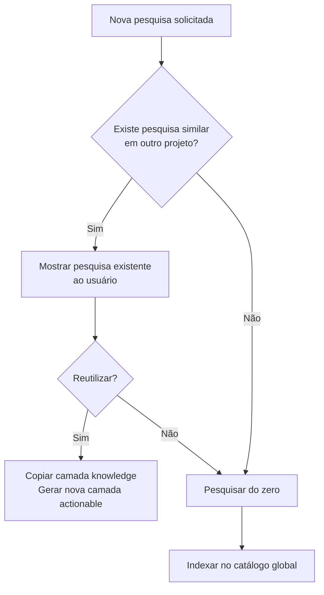
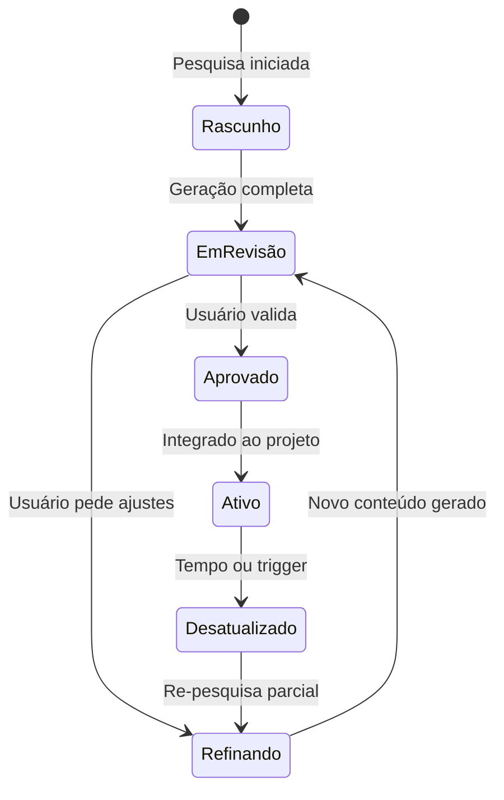

# 🔧 Melhorias Propostas para o Research Lab

> O que eu mudaria na ideia original e **por quê**.

---

## O Problema Central da Ideia Original

A ideia como está é: **"dê um tópico → IA pesquisa → gera .md organizados"**. 

Isso é essencialmente um **gerador de documentação de pesquisa**. Funciona, mas é **passivo e genérico**. É o equivalente a pedir para um estagiário "pesquise sobre xadrez e me entregue um relatório". Você vai receber um relatório... mas provavelmente vai ter que refazer boa parte do trabalho para que ele seja **útil de verdade** para o seu projeto específico.

As melhorias que proponho transformam o Research Lab de um **gerador de relatórios** em um **laboratório de conhecimento vivo e contextualizado**.

---

## Melhoria 1: Pesquisa Consciente do Projeto (não genérica)

### ❌ Como está
> "Pesquise sobre regras de xadrez" → gera conteúdo genérico sobre xadrez.

### ✅ Como deveria ser
> "Pesquise sobre regras de xadrez **no contexto de um jogo digital 2D em JavaScript**" → gera conteúdo filtrado pelo que importa para **esse** projeto.

### Por quê?

Se você está fazendo um **jogo de xadrez**, não precisa saber a história do xadrez na Pérsia no século VI. Precisa saber:
- Quais regras precisam ser codificadas
- Quais são os edge cases de movimentação
- Como representar o tabuleiro em memória
- Quais regras são frequentemente esquecidas por devs (en passant, promoção, empate por repetição)

A pesquisa deveria **ler o `PROJECT.md` e o `ARCHITECTURE.md`** antes de pesquisar e usar o contexto do projeto para **filtrar e priorizar** o que buscar.

### Exemplo Concreto

```
Sem contexto (genérico):
  📄 historia-do-xadrez.md          ← irrelevante
  📄 campeonatos-mundiais.md        ← irrelevante
  📄 regras-basicas.md              ← útil mas superficial
  📄 aberturas-famosas.md           ← irrelevante para MVP

Com contexto do projeto (JS, jogo 2D):
  📄 regras-como-logica.md          ← regras escritas como pseudo-código
  📄 movimentacao-por-peca.md       ← cada peça com validação de movimento
  📄 regras-especiais-edge-cases.md ← en passant, roque, promoção, empate
  📄 representacao-tabuleiro.md     ← arrays, bitboards, FEN notation
  📄 validacao-de-check.md          ← algoritmos para detectar xeque/xeque-mate
```

A segunda lista é **10x mais útil** porque sabe para quê a pesquisa serve.

---

## Melhoria 2: Camada "E Daí?" — Da Pesquisa à Ação

### ❌ Como está
A pesquisa gera **conhecimento**. Ponto. O desenvolvedor depois tem que traduzir esse conhecimento em código, entidades, regras de negócio.

### ✅ Como deveria ser
Cada pesquisa gera dois tipos de output:

| Camada | O que é | Exemplo |
|--------|---------|---------|
| **📚 Knowledge** | Conhecimento puro, factual | "O roque só pode ser feito se o rei e a torre nunca se moveram, não há peças entre eles, e o rei não está em xeque." |
| **⚡ Actionable** | Spec técnica derivada do conhecimento | "Implementar flag `hasMoved` em `King` e `Rook`. Método `canCastle(side)` deve verificar: `!king.hasMoved && !rook.hasMoved && pathClear(king, rook) && !isInCheck(king)`" |

### Por quê?

Porque o objetivo final não é **saber** sobre xadrez. É **construir** o jogo. Se a pesquisa já entrega specs acionáveis, o tempo entre "pesquisar" e "implementar" cai drasticamente.

### Estrutura de Pasta

```
RESEARCH/chess-rules/
├── OVERVIEW.md                    ← Mapa geral
├── knowledge/                     ← 📚 Camada de Conhecimento
│   ├── pieces-and-movement.md
│   ├── special-rules.md
│   └── game-end-conditions.md
├── actionable/                    ← ⚡ Camada Acionável
│   ├── entities-and-models.md     ← "Você vai precisar dessas classes/tipos"
│   ├── validation-rules.md        ← "Regras como pseudo-código"
│   ├── edge-cases-checklist.md    ← "Não esqueça de implementar isso"
│   └── suggested-tests.md        ← "Casos de teste derivados da pesquisa"
└── SOURCES.md
```

---

## Melhoria 3: Reutilização Cross-Project

### ❌ Como está
Cada pesquisa é isolada dentro do projeto. Se o Projeto A pesquisou "WebSocket protocols" e o Projeto B precisa da mesma coisa, pesquisa do zero.

### ✅ Como deveria ser
O sistema mantém um **índice global de pesquisas** em `knowledge/research-index.md`. Quando uma nova pesquisa é solicitada, antes de sair buscando na internet, ele verifica:

1. Já existe pesquisa sobre este tópico em outro projeto?
2. Qual o grau de sobreposição?
3. O que pode ser reutilizado vs. o que precisa ser contextualizado?

### Por quê?

Porque conhecimento factual é **universal**. As regras do xadrez não mudam entre projetos. O que muda é a **camada acionável** (Melhoria 2). Então o sistema poderia:

- **Copiar** a camada knowledge de outro projeto
- **Gerar nova** camada actionable específica para o projeto atual

Isso economiza tempo, tokens e custo de API.

### Fluxo



---

## Melhoria 4: Detecção de Contradições

### ❌ Como está
O sistema sintetiza informação e entrega como verdade única. Se duas fontes discordam, ele silenciosamente escolhe uma.

### ✅ Como deveria ser
Quando o sistema encontra informação conflitante, ele deve **explicitar a contradição** em vez de escondê-la.

### Por quê?

Porque contradições são **informação valiosa**. Elas revelam:
- Regras que variam entre contextos (xadrez FIDE vs. xadrez online rápido)
- Padrões de design que têm trade-offs legítimos
- Áreas onde a decisão é do desenvolvedor, não de uma "verdade objetiva"

### Exemplo

```markdown
## ⚠️ Contradição Detectada: Empate por Repetição

**Fonte A** (FIDE Official Rules):
> O empate por repetição ocorre quando a MESMA POSIÇÃO se repete 3 vezes,
> considerando o mesmo jogador na vez, mesmas possibilidades de roque,
> e mesmo estado de en passant.

**Fonte B** (Chess.com FAQ):
> O empate acontece automaticamente na terceira repetição da posição.

**Análise**: 
A regra FIDE exige que o jogador REIVINDIQUE o empate (não é automático).
No Chess.com, é aplicado automaticamente por simplicidade.

**Decisão necessária**: 
→ Registrada em `DECISIONS/` como pendente.
→ Seu jogo vai aplicar empate automaticamente ou exigir que o jogador reivindique?
```

Isso é **muito** mais valioso do que o sistema silenciosamente escolher uma das versões.

---

## Melhoria 5: Pesquisa como Documento Vivo

### ❌ Como está
A pesquisa é gerada uma vez e fica estática. Se o usuário descobre algo novo, ou se informação fica desatualizada, os `.md` não refletem isso.

### ✅ Como deveria ser
Cada pesquisa tem um **ciclo de vida**:



### Por quê?

Porque conhecimento **envelhece**. Uma pesquisa sobre "melhores práticas de React" feita em janeiro pode estar desatualizada em junho. O sistema deveria:

- Marcar pesquisas com data de validade estimada (tecnologia = curta, regras de xadrez = longa)
- Permitir anotações do usuário sem sobrescrever o conteúdo gerado
- Suportar **re-pesquisa incremental** (atualizar só o que mudou, não recriar tudo)

### Metadado no frontmatter

```yaml
---
topic: "Regras do Xadrez - Movimentação de Peças"
created: 2026-10-02
lastVerified: 2026-10-02
estimatedShelfLife: "long"  # long | medium | short
status: "active"            # draft | review | active | stale
confidence: 92
sources: 3
userAnnotations: 0
project: "meu-jogo-xadrez"
---
```

---

## Melhoria 6: Análise de Landscape — "O Que Já Existe?"

### ❌ Como está
A pesquisa foca apenas no **conhecimento do domínio** (regras do xadrez). Ignora completamente o que já existe como solução implementada.

### ✅ Como deveria ser
Toda pesquisa deveria incluir uma seção (opcional) de **análise de landscape**:

- Que soluções open-source já existem para isso?
- Que bibliotecas/pacotes resolvem parte do problema?
- O que concorrentes/similares fizeram?

### Por quê?

Porque antes de implementar do zero, o desenvolvedor precisa saber **se vale a pena**. Talvez já exista uma lib `chess.js` que implementa todas as regras e o projeto deveria usá-la em vez de recodificar.

### Exemplo de output

```markdown
## 🌍 Landscape: Engines e Bibliotecas de Xadrez

| Projeto | Linguagem | Stars | Cobre regras? | Cobre IA? | Licença |
|---------|-----------|-------|---------------|-----------|---------|
| chess.js | JavaScript | 3.2k | ✅ Completo | ❌ Não | BSD |
| stockfish.js | C++/WASM | 1.8k | ✅ Completo | ✅ Sim | GPL |
| chessboard.js | JavaScript | 2.1k | ❌ Só UI | ❌ Não | MIT |

### Recomendação
Para um jogo 2D em JS, considere usar `chess.js` para lógica de regras
e focar o desenvolvimento na UI e experiência do jogador.
Isso economizaria ~40h de implementação de regras.
```

Isso pode **evitar semanas de trabalho** desnecessário.

---

## Resumo das Melhorias

| # | Melhoria | Impacto | Complexidade |
|---|----------|---------|--------------|
| 1 | Pesquisa consciente do projeto | 🔴 Alto — muda a qualidade de tudo | 🟡 Média |
| 2 | Camada "E Daí?" (knowledge + actionable) | 🔴 Alto — ponte entre saber e fazer | 🟡 Média |
| 3 | Reutilização cross-project | 🟡 Médio — economia de tempo/custo | 🟢 Baixa |
| 4 | Detecção de contradições | 🟡 Médio — evita bugs silenciosos | 🟡 Média |
| 5 | Documento vivo com ciclo de vida | 🟡 Médio — mantém relevância | 🔴 Alta |
| 6 | Análise de landscape | 🔴 Alto — pode evitar trabalho inútil | 🟢 Baixa |

### Ordem de implementação sugerida

```
Fase 1 (MVP):  Melhoria 1 (contexto do projeto) + Melhoria 6 (landscape)
Fase 2:        Melhoria 2 (knowledge + actionable) + Melhoria 4 (contradições)
Fase 3:        Melhoria 3 (cross-project) + Melhoria 5 (documento vivo)
```

> As melhorias 1 e 6 são as que dão mais valor com menos esforço.
> A melhoria 2 é a que transforma o sistema de "útil" para "indispensável".
