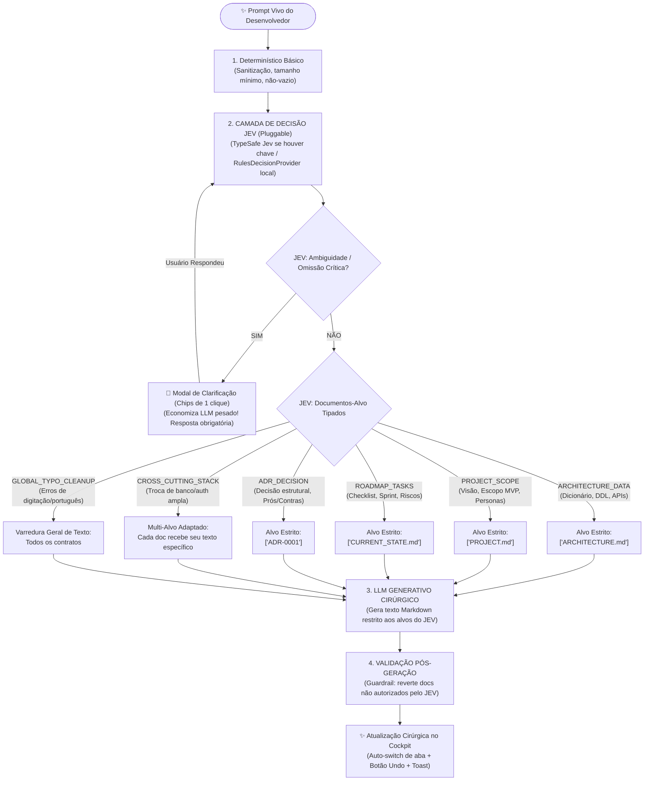

# Plano de Trabalho: Prompt Vivo Cirúrgico com Governança JEV First & Modal de Clarificação (Versão Definitiva)

> **Objetivo**: Implementar o padrão **Nível 4 (Composto: JEV para Decisão/Classificação → LLM para Geração → Validação Programática)** no mecanismo de **Prompt Vivo**, acompanhado de **4 melhorias críticas de usabilidade e ergonomia**, garantindo que o JEV classifique os documentos-alvo antes de qualquer geração textual, evite duplicação indevida entre contratos e acione um modal de clarificação quando houver ambiguidade.

---

## 1. O que é o JEV neste Projeto: Custos & Como Funciona

### 1.1. O JEV é pago ou gratuito?
- **O JEV Real (`typesafe.ai` / `aijev.org`)**:
  - É um modelo de decisão *"System One"* desenvolvido pela **TypeSafe AI**.
  - Diferente de LLMs que cobram caro para gerar tokens de texto, o Jev é extremamente barato: custa **~$0.042 por 1 milhão de tokens de entrada** e **$0 (GRATUITO) de saída**, pois ele retorna decisões tipadas e probabilidades numéricas sem gerar prosa.
  - Para o uso individual de um desenvolvedor, 1 milhão de tokens dura meses (centavos de real).
- **Como utilizar o JEV da TypeSafe AI**:
  - **Opção A (Direta)**: Criar conta em `typesafe.ai`, gerar uma chave e colocar no seu `.env` como `TYPESAFE_API_KEY=...`. O endpoint oficial é `POST https://api.typesafe.ai/v1/systemone`.
  - **Opção B (Via OpenRouter)**: Como o seu AI Second Brain já possui integração nativa com o **OpenRouter** no `scripts/ai-gateway.js`, o Jev pode ser consumido via OpenRouter com sua chave existente.
  - **Opção C (Nativa Local / Custo Zero / 0ms)**: O **`RulesDecisionProvider`** implementado dentro do próprio Second Brain. Ele executa a mesma interface do JEV (`IDecisionProvider`), avalia o estado tipado e classifica sem custo nenhum de token e sem depender de conexão com a internet.

### 1.2. Arquitetura Pluggable (JEV Híbrido)
O nosso motor de decisão funcionará de forma pluggable:
```
Se TYPESAFE_API_KEY estiver configurada no .env → Consulta TypeSafe Jev / OpenRouter
Senão → Executa o RulesDecisionProvider nativo local (0ms, 100% offline, custo zero)
```

---

## 2. As 4 Novas Melhorias Incorporadas ao Plano

### 🌟 Melhoria 1: Auto-Switch de Aba para o Documento Alterado
- **Problema**: Se você estiver vendo a aba `PROJECT.md` e pedir *"incluir dicionário de dados da tabela cliente"*, o JEV alterará com sucesso apenas o `ARCHITECTURE.md`. Se a interface mantiver a aba `PROJECT.md`, você terá a impressão de que nada mudou.
- **Solução**: Assim que a resposta cirúrgica chegar, a UI **comuta automaticamente para a aba do documento que foi alterado** (ex: `ARCHITECTURE.md`) e pisca um highlight suave + toast:  
  `"🎯 Ajuste cirúrgico aplicado com sucesso em ARCHITECTURE.md!"`.

### 🌟 Melhoria 2: Motor JEV Híbrido (Heurística Determinística + Micro-Decisão)
- Avalia termos técnicos explícitos (*tabela, dicionário, schema, endpoint, checklist, ortografia, trocar banco*).
- Se a frase for coloquial ou ambígua para a regra direta, aciona uma **micro-chamada de decisão** (apenas ~40 tokens de classificação, sem carregar os 4 contratos pesados) para retornar a classe tipada antes de disparar o LLM generativo.

### 🌟 Melhoria 3: Botão "Desfazer Último Ajuste" (Undo Snapshot)
- Mantém `previousGrillDraft` em memória.
- Após qualquer alteração do Prompt Vivo, exibe ao lado do input o botão `↺ Desfazer ajuste`, permitindo reverter para o estado anterior com 1 clique caso você não goste da sugestão da IA.

### 🌟 Melhoria 4: Chips Inteligentes de 1 Clique no Modal de Clarificação
- O modal de clarificação renderiza as alternativas prováveis da dúvida em formato de botões (*chips*, ex: `[ Stripe (Cartão + Pix) ]`, `[ Mercado Pago ]`, `[ Asaas ]`).
- Clicar no chip preenche instantaneamente o campo de resposta obrigatório e habilita o botão `⚡ Responder e Continuar` sem exigir digitação manual.

---

## 3. O Fluxo Completo de 4 Camadas (Nível 4 Composto)



---

## 4. Atualização de Avisos na Interface

- [x] `docs/brain-ui/index.html`:
  - Atualizado para: `💡 A IA aplicará cirurgicamente sem recarregar a tela.`
- [x] `docs/brain-ui/index.html` (Editor Expandido):
  - Atualizado para: `💡 A IA aplicará cirurgicamente sem recarregar a tela.`
- [x] Paridade estrita em `docs/brain-ui/demo/index.html`.
- [x] Título padronizado: `✨ Prompt Vivo: O que você gostaria de melhorar ou ajustar?`

---

## 5. Roteiro de Implementação dos Arquivos

1. [x] **`scripts/quickstart-grill.js`**:
   - Adicionado motor JEV local (`classifyWithJev`: com suporte a `RulesDecisionProvider` local, Opção C, custo zero, 0ms e detecção de ambiguidade).
   - Adicionado pipeline de Nível 4 Composto no `refineDraft`: JEV decide → LLM gera restrito → Validador pós-geração assegura isolamento dos contratos não autorizados.
2. [x] **`server.js`**:
   - Atualizado endpoint `/api/projects/quickstart/refine` para repassar `clarification`.
3. [x] **`docs/brain-ui/index.html` & `docs/brain-ui/demo/index.html`**:
   - Inserido `#qsClarificationModal` com chips interativos e preenchimento mandatório.
   - Atualizados avisos de ajuda do Prompt Vivo.
   - Adicionado botão `↺ Desfazer` (inicialmente oculto).
4. [x] **`docs/brain-ui/style.css` & `docs/brain-ui/demo/style.css`**:
   - Adicionadas classes do modal de clarificação (`.qs-clarify-card`, `.qs-clarify-badge`, chips, erro e animação `.tab-flash-active`).
5. [x] **`docs/brain-ui/app.js` & `docs/brain-ui/demo/app.js`**:
   - Gerenciamento de abertura/fechamento do modal de clarificação.
   - Implementado `selectClarifyOption(text)` para preenchimento de 1 clique com chips.
   - Implementado Auto-Switch da aba para o documento modificado com animação flash.
   - Implementado `undoGrillRefine()` com persistência em `previousGrillDraft`.
6. [x] **Validação**:
   - `node --check` validado em todos os scripts e frontends.
   - `npm run doctor` executado com 100% de integridade e saúde excelente.
