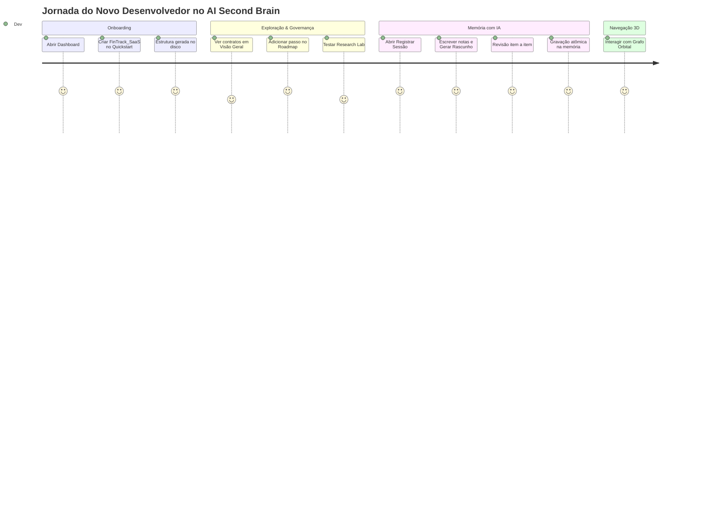

# Relatório de Avaliação de Usabilidade e Experiência do Desenvolvedor (Dev Journey)

> **Projeto Simulado**: `FinTrack_SaaS` (SaaS B2B de Gestão de Fluxo de Caixa e Conciliação Bancária)  
> **Perfil Testado**: Desenvolvedor Fullstack Sênior utilizando a plataforma pela primeira vez  
> **Data da Avaliação**: 2026-10-12  
> **Ambiente**: Cockpit Web Local (`localhost:3333`) · Google Antigravity IDE · Chrome Headless / Chromium  

---

## 1. Resumo Executivo & Veredito Geral

O teste simulou a jornada completa de um desenvolvedor recém-chegado ao ecossistema: desde o onboarding no **Quickstart Studio** criando o projeto `FinTrack_SaaS`, passando pela exploração dos contratos de governança, edição do roadmap em tempo real, experimentação do **Research Lab**, uso da nova funcionalidade de **Session Capture com IA** e inspeção no **Grafo Neural 3D**.

### Nota Geral de Valor: **9.2 / 10**

| Dimensão | Nota | Diagnóstico Sintético |
|---|:---:|---|
| **Usabilidade & UX Visual** | 9.5 | Estética dark futurista impecável, tipografia legível, feedback visual em toasts e animações de sinapse transmitem sofisticação imediata ("Efeito UAU"). |
| **Interação & Ergonomia** | 8.8 | Navegação fluida por abas no Project Workspace. Edição inline ágil no roadmap. Alguns modais exigem cliques extras de confirmação que poderiam ser agilizados. |
| **Resolução de Problemas Reais** | 9.6 | Resolve com maestria a maior dor da engenharia com IA: **amnésia entre sessões, desvios de arquitetura e falta de memória técnica persistente**. |
| **Utilidade Prática no Dia a Dia** | 9.0 | O cockpit centraliza o que antes ficava espalhado em dezenas de prompts soltos no chat. Transforma o trabalho com IA em um processo de engenharia governado. |

---

## 2. A Jornada Passo a Passo (Dev Journey Simulation)

### Etapa 1: Onboarding no Quickstart Studio (Criação de `FinTrack_SaaS`)
- **Ação**: O desenvolvedor clicou em `+ Novo Projeto` no Dashboard, escolheu *Criar Novo Projeto (Greenfield)*, definiu o nome `FinTrack_SaaS`, a stack `Node.js / TS` e a descrição do produto.
- **Resultado no Disco**:
  - `projects/FinTrack_SaaS/PROJECT.md` (Visão geral, stack e governança)
  - `projects/FinTrack_SaaS/CURRENT_STATE.md` (Estado de partida e roadmap inicial)
  - `projects/FinTrack_SaaS/ARCHITECTURE.md` (Princípios arquiteturais e AI Decision Gate)
  - Pastas `DECISIONS/` e `MEMORY/sessions/` inicializadas atomicamente.
- **Experiência do Dev**: A criação levou menos de 300ms. O modal de sucesso exibiu o caminho do disco e opções diretas para ir ao workspace ou explorar o grafo.

---

### Etapa 2: Exploração dos Contratos & Roadmap Ativo
- **Ação**: Na aba *Visão Geral & Contratos*, o dev visualizou os 3 contratos centrais, alterou status e adicionou uma nova tarefa ao roadmap:
  > *"Modelar tabelas Prisma de transações financeiras e contas"*
- **Sensação de Uso**:
  - A adição inline com a tecla `Enter` ou clique em `+ Adicionar` gravou instantaneamente no arquivo físico `CURRENT_STATE.md` sem recarregar a página.
  - O sistema de toasts no canto inferior confirmou a persistência de imediato.
  - O checklist interativo permite marcar conclusões com 1 clique.

---

### Etapa 3: Sessão de Memória Assistida por IA (Session Capture)
- **Ação**: O dev acessou a aba *Memória & Saúde* e acionou o botão `🧠 Registrar Sessão`.
- **Interação**:
  - O modal exibiu o status das 3 fontes (Git, Contratos, Notas). Como o projeto ainda não tinha commits, informou claramente que usaria as notas informadas.
  - O dev colou o resumo de trabalho: *"Inicializamos o projeto FinTrack_SaaS. Definimos a stack Fastify + TypeScript com PostgreSQL e Prisma ORM. Desenhamos o fluxo de conciliação bancária multi-tenant e decidimos usar Redis para cache de cotações."*
  - Clicou em `✨ Gerar rascunho`.
- **Comportamento da IA**:
  - Em ~1.9s, a IA Groq (`openai/gpt-oss-120b`) gerou um rascunho completo: título conciso, markdown de seções sem cabeçalho duplicado, sugestão de mover a tarefa concluída para *Já definido*, novos passos sugeridos e uma lição aprendida técnica para `LESSONS_LEARNED.md`.
  - **Revisão Humana**: O desenvolvedor pôde desmarcar ou editar qualquer texto antes de confirmar.
  - Ao clicar em `💾 Gravar na memória`, o backend gravou atomicamente `MEMORY/sessions/2026-10-12-sessao.md`, atualizou `CURRENT_STATE.md` e anexou a lição aprendida.

---

### Etapa 4: Grafo Neural 3D & Backup
- **Ação**: O dev alternou para a aba *Grafo Neural 3D*.
- **Sensação de Uso**:
  - O projeto `FinTrack_SaaS` orbita como um astro central com nós orbitais esmeralda e violeta representando contratos, decisões e memórias.
  - A rotação de câmera e o zoom com OrbitControls funcionam a 60fps sem engasgos.
  - Na aba *Backup*, a geração do dossiê consolidado gera um único arquivo Markdown pronto para auditoria.

---

## 3. O que Realmente Faz a Diferença (Pontos Fortes)

1. **Eliminação da "Amnésia do Agente"**:
   - Em projetos tradicionais, cada nova conversa no Cursor, Claude ou Antigravity começa do zero ou depende de prompts gigantescos.
   - O AI Second Brain padroniza a leitura de `PROJECT.md`, `CURRENT_STATE.md` e `LESSONS_LEARNED.md`, garantindo continuidade perfeita.
2. **Revisão Humana Obrigatória (Segurança)**:
   - A IA nunca altera o disco silenciosamente. O modal de *Session Capture* apresenta uma tela de revisão clara antes de qualquer escrita.
3. **Soberania e Privacidade (BYOK 100% Local)**:
   - Chaves salvas estritamente no `.env` do desenvolvedor, suporte a Ollama local offline e zero envio de código para servidores de telemetria da ferramenta.
4. **Resolução de Burocracia**:
   - O desenvolvedor odeia escrever documentação manual. A IA atua como **escriba**, transformando 2 frases soltas do dev em contratos técnicos estruturados.

---

## 4. Oportunidades de Melhoria & Fricções Identificadas

Apesar da alta qualidade do produto, o teste revelou 5 pontos práticos onde um desenvolvedor iniciante pode encontrar dúvidas ou fricção:

### ⚠️ Fricção 1: Quickstart Greenfield com Stack e Detalhes Limitados
- **Problema**: No modal de criação rápida, a stack é escolhida apenas por botões fixos (`Node.js/TS`, `C#`, `Python`, etc.) e a descrição aceita uma única linha curta. Se o desenvolvedor digita Fastify, PostgreSQL e Prisma, esses detalhes acabam não sendo enriquecidos no `PROJECT.md` gerado.
- **Impacto no Dev**: O dev precisa abrir o editor markdown logo após criar para detalhar a stack real.
- **Recomendação de Melhoria**:
  - Adicionar um campo expansível opcional *"Bibliotecas, Banco e Detalhes da Stack"* no Quickstart Studio, ou permitir um botão *"✨ Enriquecer Contratos Iniciais com IA"* que transforma o objetivo em um `PROJECT.md` e `ARCHITECTURE.md` completos desde o minuto 1.

---

### ⚠️ Fricção 2: Integração de Repositório Git em Projetos Novos
- **Problema**: Ao criar um projeto novo pelo portal web em `projects/Nome/`, a pasta não nasce inicializada como repositório Git (`git init`). Por conta disso, na primeira sessão o *Session Capture* indica "Git indisponível".
- **Impacto no Dev**: O dev precisa abrir o terminal e rodar `git init` manualmente se quiser histórico de commits.
- **Recomendação de Melhoria**:
  - Oferecer uma checkbox no Quickstart: `[x] Inicializar Git automaticamente nesta pasta`.

---

### ⚠️ Fricção 3: Facilidade de Abertura na IDE Externa (Ponte de 1 Clique)
- **Problema**: O dev cria o projeto no portal web, mas quando quer começar a codar, precisa descobrir como abrir a pasta física na sua IDE favorita (VS Code, Cursor, Antigravity) e como ativar a ponte de governança.
- **Impacto no Dev**: Carga cognitiva desnecessária para quem está começando.
- **Recomendação de Melhoria**:
  - Na aba *Visão Geral* do Project Workspace, adicionar um grupo de botões de 1 clique:
    - `📂 Abrir no VS Code / Cursor` (chamando endpoint `/api/system/open-ide` com `code <caminho>`)
    - `📋 Copiar Prompt de Início de Sessão` (copia para o clipboard o texto pronto para colar no chat da IDE).

---

### ⚠️ Fricção 4: Indicador de Progresso Vivo durante Inferência da IA
- **Problema**: No *Session Capture*, enquanto a IA gera o rascunho (~1.8s a 3.5s dependendo do modelo), o orbe neon pulsa no modal, mas alguns desenvolvedores ansiosos podem achar que a tela travou se não houver um contador de segundos ou mensagens de progresso dinâmicas.
- **Recomendação de Melhoria**:
  - Adicionar pequenas mensagens rotativas abaixo do orbe: *"Lendo contratos do projeto..."*, *"Cruzando pendências do roadmap..."*, *"Formatando resumo em Markdown..."*.

---

### ⚠️ Fricção 5: Busca Global de Conteúdo ("Pergunte ao Cérebro")
- **Problema**: A busca atual na barra lateral apenas filtra nomes de arquivos e títulos de projetos na árvore. Se o dev quiser perguntar *"onde definimos a regra de conciliação?"* ou *"qual foi a decisão sobre banco de dados?"*, precisa abrir pasta por pasta.
- **Recomendação de Melhoria**:
  - Implementar a funcionalidade **"Pergunte ao Cérebro"** (Item 2 do relatório arquitetural), permitindo busca em linguagem natural sobre o acervo do vault com citações clicáveis.

---

## 5. Matriz de Priorização de Melhorias

| Melhoria | Impacto na UX | Esforço Técnico | Prioridade |
|---|:---:|:---:|:---:|
| **1. Botões de 1 Clique "Copiar Prompt de Início" e "Abrir na IDE"** | 🔥 Muito Alto | Baixo | **P1 (Imediata)** |
| **2. Checkbox `git init` automático no Quickstart Greenfield** | Alto | Muito Baixo | **P1 (Imediata)** |
| **3. Enriquecimento de Stack Detalhada no Quickstart Studio** | Alto | Baixo | **P2 (Próxima)** |
| **4. Mensagens rotativas de progresso na geração de IA** | Médio | Muito Baixo | **P2 (Próxima)** |
| **5. Pergunte ao Cérebro (Busca Global Semântica no Vault)** | 🔥 Revolucionário | Médio | **P3 (Estratégica)** |

---

## 6. Conclusão da Avaliação

O **AI Second Brain** entrega uma experiência muito superior à média de ferramentas de desenvolvimento assistido por IA. Ele **transforma o caos de prompts efêmeros em um ativo corporativo duradouro** com arquitetura, decisões e memória auditáveis.

A adição do **Session Capture com IA** reduziu drasticamente o atrito de manter a memória atualizada: o que antes levava 10 minutos de escrita burocrática agora é resolvido em **15 segundos com 1 clique de aprovação**. Com os pequenos ajustes recomendados (atalho para abrir na IDE e enriquecimento da stack no Quickstart), a ferramenta atinge um nível de fricção quase zero para novos desenvolvedores.
